# Excel 6주차 정규 과제 

📌Excel 정규과제는 매주 정해진 분량의 『*진짜 쓰는 실무 엑셀*』 을 읽고 학습하는 것입니다. 이번주는 아래의 **EXCEL_6th_TIL**에 나열된 분량을 읽고 공부하시면 됩니다.

아래의 문제를 풀어보며 학습 내용을 점검하세요. 문제를 해결하는 과정에서 개념을 스스로 정리하고, 필요한 경우 제시된 강의를 참고하여 보완하는 것이 좋습니다.

**교재 실습 예제 파일은 1주차 과제 설명 노션에 있습니다. 해당 파일을 다운 후 실습 진행해주시면 됩니다.**

**👀(수행 인증샷은 필수입니다.)** 

## EXCEL_6th_TIL

### 7장 엑셀 활용의 10%를 채워 줄 기본 & 필수 함수 익히기
#### 01. 엑셀 기초 계산 함수와 통계 함수 사용하기
#### 02. 논리 함수, 참조 함수, 집계 함수
#### 03. 엑셀의 활용도를 올려 줄 실무 보조 함수
#### 04. 더 강력해진 기능의 엑셀 2021 이후 버전, M365 신규 함수
#### 05. 실무에서 발생하는 어려움을 해결하는 필수 함수 공식

## Study Schedule

| 주차  | 공부 범위     | 완료 여부 |
| ----- | ------------- | --------- |
| 1주차 | p.22~111    | ✅         |
| 2주차 | p.112~157   | ✅         |
| 3주차 | p.158~213  | ✅         |
| 4주차 | p.214~273 | ✅         |
| 5주차 | p.274~339 | ✅         |
| 6주차 | p.340~425 | ✅         |
| 7주차 | p.426~472 | 🍽️         |

 

<!-- 여기까진 그대로 둬 주세요-->

---

# 1️⃣ 학습 내용 정리

## 07-1. 엑셀 기초 계산 함수와 통계 함수 사용하기
> **SUM, AVERAGE, COUNTA 함수로 재고 현황 파악하기(342 ~ 344p)를 진행 후 인증사진을 첨부해주세요.**
- SUM 함수: 범위의 합계를 계산 
    - SUM (범위1, [범위2], …)
- AVERAGE 함수: 범위의 평균을 계산합니다
    - AVERAGE(범위1, [범위2], …)
- COUNTA 함수: 범위 내 비어 있지 않은 셀의 개수를 셉니다   
    - COUNTA(범위1, [범위2], …)  
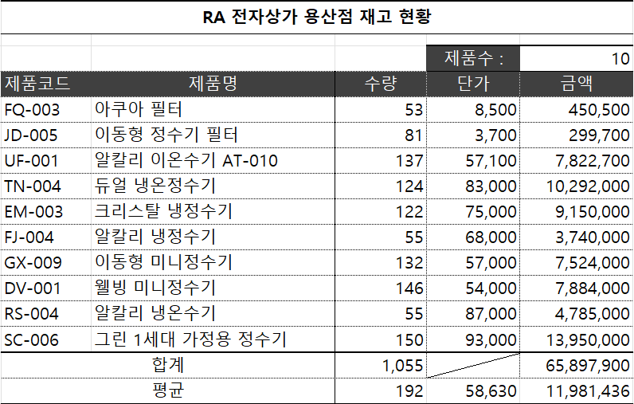

> **MAX, MIN, LARGE, SMALL 함수로 만족도 통계 구하기(345 ~ 347p)를 진행 후 인증사진을 첨부해주세요.**
- MAX 함수: 범위 내 최댓값을 계산합니다   
    - MAX(범위1, [범위2], …)  
- MIN 함수: 범위 내 최솟값을 계산합니다   
    - MIN(범위1, [범위2], …)   
- LARGE 함수: 범위 내 n번째로 큰 값을 계산합니다   
    - LARGE(범위, 순번)   
- SMALL 함수: 범위 내 n번째로 작은 값을 계산합니다   
    - SMALL(범위, 순번)
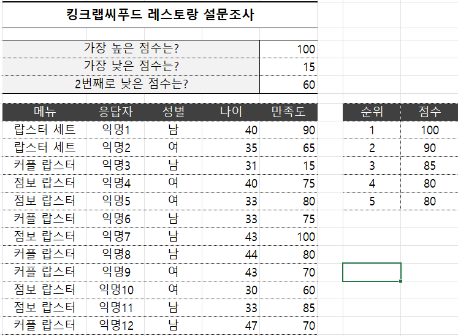

## 07-2. 논리 함수, 참조 함수, 집계 함수
> **IF 함수로 성적 관리하기(348 ~ 350p)를 진행 후 인증사진을 첨부해주세요.**
- IF 함수: 조건에 딸 참일 때와 거짓일 때 지정한 결과를 출력합니다
    - IF(조건, 결과(참),결과(거짓))
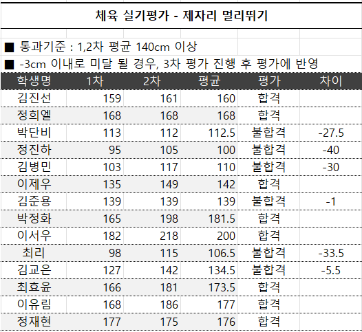

> **VLOOKUP, IFERROR 함수로 재고 현황 관리하기(351 ~ 355p)를 진행 후 인증사진을 첨부해주세요.**
- VLOOKUP 함수: 세로로 입력된 넓은 범위에서 '찾을 값'을 찾은 후 범위에서 지정한 '열 번호'의 값을 출력
    - VLOOKUP(찾을 값, 범위, 열 번호, [일치 옵션])
- HLOOKUP 함수: 가로로 입력된 넓은 범위에서 '찾을 값'을 찾은 후 범위에서 지정한 '행 번호'의 값을 출력
    - HLOOKUP(찾을 값, 범위, 행 번호, [일치 옵션])
- IFERROR 함수: 입력한 수식이 오류를 반환할 때, 오류 대신 지정한 결과를 출력합니다.
    - IFERROR(수식, 오류일 때 표시 값)
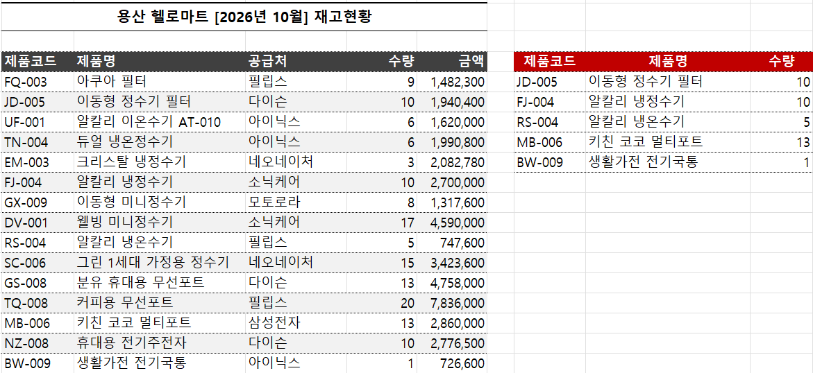

> **SUMIF, COUNTIF, AVERAGEIF 함수로 매출, 배송 현황 관리(355 ~ 365p)를 진행 후 인증사진을 첨부해주세요.**
- SUMIF 함수: 조건을 만족하는 셀의 합계를 계산합니다.
    - SUMIF(조건 범위, 조건, [합계 범위])
- SUMIFS 함수: 여러 조건을 만족하는 값의 합계를 계산합니다.
    - SUMIFS(합계 범위, 조건 범위1, 조건1, [조건 범위2], [조건2], …)
- AVERAGEIF 함수: 조건을 만족하는 셀의 평균을 계산합니다.
    - AVERAGEIF(조건 범위, 조건, [평균 범위])
- AVERAGEIFS 함수: 여러 조건을 만족하는 값의 평균을 계산합니다.
    - AVERAGEIFS(평균 범위, 조건 범위1, 조건1, [조건 범위2], [조건2], …)
- COUNTIF 함수: 조건을 만족하는 셀의 개수를 구합니다.
    - COUNTIF(조건 범위, 조건)
- COUNTIFS: 여러 조건을 만족하는 셀의 개수를 구합니다.
    - COUNTIFS(조건 범위1, 조건1, [조건 범위2], [조건2])
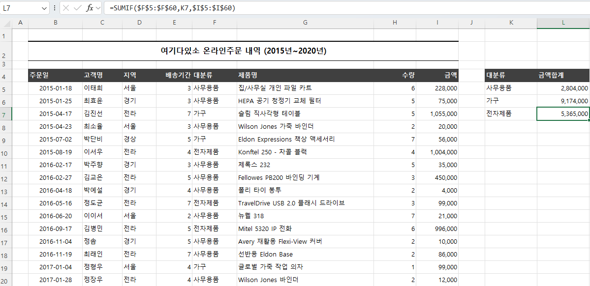
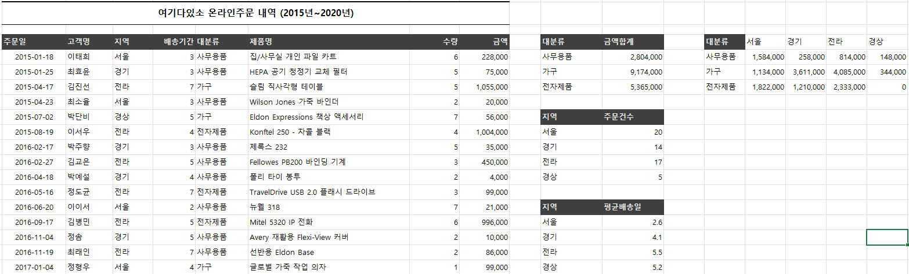

## 07-3. 엑셀의 활용도를 올려 줄 실무 보조 함수
> **LEFT, RIGHT, MID 함수로 텍스트 가공하기(366 ~ 370p)를 진행 후 인증사진을 첨부해주세요.**
- LEFT: 문자열의 왼쪽부터 원하는 개수만큼 문자를 추출합니다
    - LEFT(셀, [문자 개수])
- RIGHT: 문자열의 오른쪽부터 원하는 개수만큼 문자를 추출합니다
    - RIGHT(셀, [문자 개수])
- MID: 문자열의 중간부터 원하는 개수만큼 문자를 추출합니다
    - MID(셀, 시작 위치, 문자 개수)

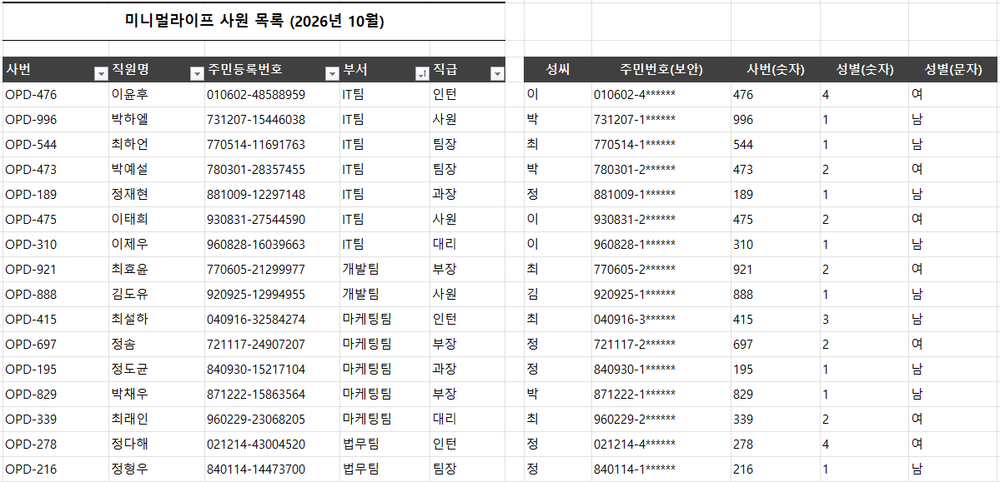

> **TRIM 함수 사용으로 보이지 않는 문자로 인한 오류 방지하기(370 ~ 373p)를 진행 후 인증사진을 첨부해주세요.**
- TRIM: 문자열의 앞/뒤에 입력된 공백을 제거합니다.
    - TRIM(문자열)
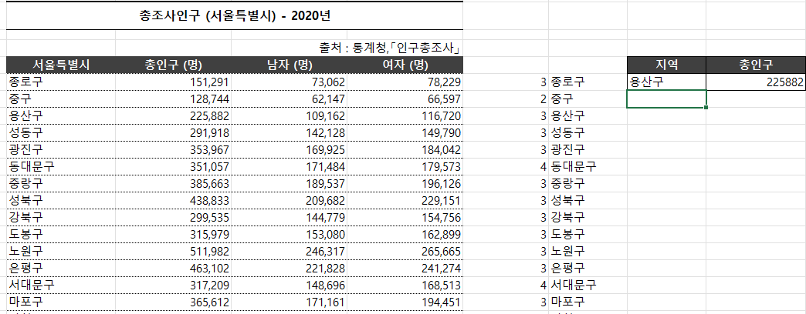

> **TODAY, DATE, YEAR/MONTH/DATE 함수로 날짜 구하기(381 ~ 383p)를 진행 후 인증사진을 첨부해주세요.**
- TODAY 함수: 오늘 날짜를 출력합니다.
    - =TODAY()
- YEAR/MONTH/DAY 함수: 지정한 날짜 값 인수에서 연도/월/일을 분리합니다.
    - =YEAR(날짜), =MONTH(날짜), =DAY(날짜)
- DATE 함수: 연도, 월, 일을 지정해서 날짜를 입력합니다.
    - =DATE(연도, 월, 일)
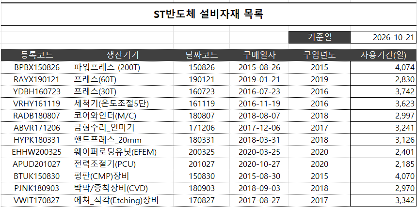
> **INDIRECT 함수로 여러 시트 실시간 참조하기(385 ~ 388p)를 진행 후 인증사진을 첨부해주세요.**
- INDIRECT 함수: 셀 주소를 문자열로 입력해서 참조할 수 있습니다.[cite: 5]
    - =INDIRECT(셀 주소, [A1 방식]）

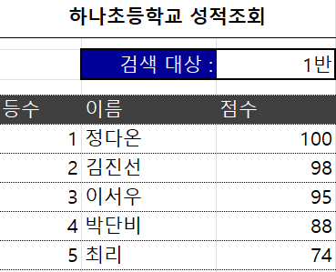
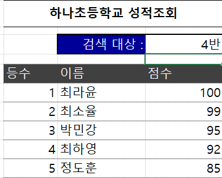

## 07-4. 더 강력해진 기능의 엑셀 2021 이후 버전, M365 신규 함수
> **최신 버전 엑셀에서 배열 사용하기(391 ~ 392p)를 진행 후 인증사진을 첨부해주세요.**
<!-- 이 부분을 지우고 인증사진을 제출해주세요.-->

> **VLOOKUP보다 중요한 필수 신규 함수, FILTER(393 ~ 396p)를 진행 후 인증사진을 첨부해주세요.**
<!-- 이 부분을 지우고 인증사진을 제출해주세요.-->

> **이름만으로도 강력해 보이는 M365 신규 함수, XLOOKUP(396 ~ 398p)를 진행 후 인증사진을 첨부해주세요.**
<!-- 이 부분을 지우고 인증사진을 제출해주세요.-->

> **다른 기능과 만나면 활용도가 배가 되는 UNIQUE, SORT 함수(399 ~ 402p)를 진행 후 인증사진을 첨부해주세요.**
<!-- 이 부분을 지우고 인증사진을 제출해주세요.-->

## 07-5. 실무에서 발생하는 어려움을 해결하는 필수 함수 공식
> **여러 조건을 비교해서 결과 출력하기, 다중 조건 IF 함수(403 ~ 407p)를 진행 후 인증사진을 첨부해주세요.**
<!-- 이 부분을 지우고 인증사진을 제출해주세요.-->

> **단어의 포함 여부를 검색하는 ISNUMBER, SEARCH 함수 공식(407 ~ 411p)를 진행 후 인증사진을 첨부해주세요.**
<!-- 이 부분을 지우고 인증사진을 제출해주세요.-->

> **VLOOKUP 함수의 단점을 해결해 주는 INDEX/MATCH 함수 공식(412 ~ 415p)를 진행 후 인증사진을 첨부해주세요.**
<!-- 이 부분을 지우고 인증사진을 제출해주세요.-->

> **여러 조건을 만족하는 결과 겁색하기, VLOOKUP 다중 조건 공식(415 ~ 417p)를 진행 후 인증사진을 첨부해주세요.**
<!-- 이 부분을 지우고 인증사진을 제출해주세요.-->

---

### 🎉 수고하셨습니다.

