# SQL_MASTER 4주차 정규과제

📌SQL MASTER 정규과제는 매주 정해진 분량의 『*데이터 분석을 위한 SQL 레시피*』 를 읽고 학습하는 것입니다. 이번 주는 아래의 **SQL_MASTER_4th_TIL**에 나열된 분량을 읽고 공부하시면 됩니다.

아래 실습을 수행하며 학습 내용을 직접 적용해보세요. 단순히 결과를 재현하는 것이 아니라, SQL을 직접 작성하는 과정에서 개념을 스스로 정리하는 것이 중요합니다.

필요한 경우 교재와 추가 자료를 참고하여 이해를 보완하시기 바랍니다.

## SQL_MASTER_4th_TIL

### 5장 사용자를 파악하기 위한 데이터 추출
#### 2. 시계열에 따른 사용자 전체의 상태 변화 찾기
#### 3. 시계열에 따른 사용자의 개별적인 행동 분석하기 


## Study Schedule

| 주차  | 공부 범위     | 완료 여부 |
| ----- | ------------- | --------- |
| 1주차 | p.52~136   | ✅         |
| 2주차 | p.138~184  | ✅         |
| 3주차 | p.186~232 | ✅         |
| 4주차 | p.233~321 | ✅         |
| 5주차 | p.324~406 | 🍽️         |
| 6주차 | p.408~464 | 🍽️         |
| 7주차 | p.466~566 | 🍽️         |

<br>

<!-- 여기까진 그대로 둬 주세요-->


# 실습 

## 0. 실습 규칙

1. 샘플 데이터 생성 코드는 **08_SQL_MASTER_Template/src** 경로에 장별로 정리되어 있습니다.
2. 아래 목차에 맞춰 해당 코드를 실행하여 샘플 데이터를 생성한 후, 각 장에서 요구하는 쿼리를 직접 작성해보시기 바랍니다.
3. 작성한 쿼리의 **실행 결과 화면도 함께 제출**해 주세요.
4. 단순히 교재의 예시 코드를 그대로 작성하는 것이 아니라, **제시된 로직을 충분히 이해한 뒤 교재를 보지 않고 스스로 쿼리를 구성**해보는 것을 권장합니다.
5. 교재 예시는 PostgreSQL, Hive, BigQuery 등 다양한 DBMS 기준으로 제시되어 있기 때문에, **MySQL이 아닌 다른 SQL 환경을 사용하여 실습을 진행해도 무방합니다.**
6. 다만, 사용 중인 DBMS에 맞는 문법으로 적절히 변환하여 작성하시기 바랍니다.


## 2. 시계열에 따른 사용자 전체의 상태 변화 찾기

### 2-1 등록 수의 추이와 경향 보기

**핵심 개념**
- 서비스의 등록 수는 사용자 유입이 증가하는지 감소하는지 확인하는 가장 기본적인 지표이다.
- 사용자 수는 중복을 제거하기 위해 `COUNT(DISTINCT user_id)`로 집계한다.
- 월별 추이를 볼 때는 `LAG()`를 이용하면 전월 등록 수와 전월비를 한 번에 비교할 수 있다.
- 등록 디바이스처럼 가입 시점에 저장되는 속성을 `CASE WHEN`과 함께 집계하면 유입 사용자의 구성 변화도 확인할 수 있다.

👉 **한 줄 정리:** 단순히 현재 등록자 수만 보는 것이 아니라 **시간에 따른 추이와 구성 변화**를 함께 봐야 한다.

```sql
-- 날짜별 등록 수의 추이를 집계하는 쿼리
SELECT
    register_date,
    COUNT(DISTINCT user_id) AS register_count
FROM `4th_week.mst_users`
GROUP BY register_date
ORDER BY register_date;
```
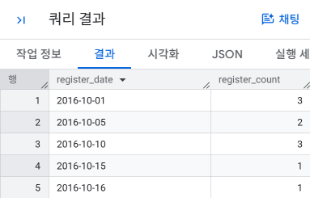
```sql
-- 2) 매달 등록 수와 전월비를 계산하는 쿼리
WITH mst_users_with_year_month AS (
    SELECT
        *,
        substr(register_date, 1, 7) AS year_month
    FROM `4th_week.mst_users`
)
SELECT
    year_month,
    COUNT(DISTINCT user_id) AS register_count,
    LAG(COUNT(DISTINCT user_id)) OVER(ORDER BY year_month) AS last_month_count,
    SAFE_DIVIDE(
        COUNT(DISTINCT user_id), 
        LAG(COUNT(DISTINCT user_id)) OVER(ORDER BY year_month)
    ) AS month_over_month_ratio
FROM mst_users_with_year_month
GROUP BY year_month
ORDER BY year_month;
```
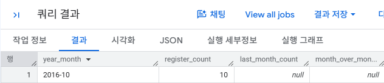
```sql

-- 3) 디바이스들의 등록 수를 집계하는 쿼리
SELECT
    SUBSTRING(register_date, 1, 7) AS year_month,
    COUNT(DISTINCT user_id) AS register_count,
    COUNT(DISTINCT CASE WHEN register_device = 'pc'  THEN user_id END) AS register_pc,
    COUNT(DISTINCT CASE WHEN register_device = 'sp'  THEN user_id END) AS register_sp,
    COUNT(DISTINCT CASE WHEN register_device = 'app' THEN user_id END) AS register_app
FROM `4th_week.mst_users`
GROUP BY SUBSTRING(register_date, 1, 7)
ORDER BY year_month;
```
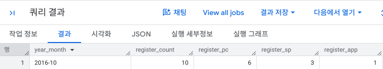

---

### 2-2 지속률과 정착률 산출하기

**핵심 개념**
- **지속률(Repeat Rate)**은 등록일로부터 정확히 n일 후에도 서비스를 사용했는지를 보는 지표이다.
- **정착률(Retention Rate)**은 등록 후 지정된 기간 안에 한 번이라도 서비스를 사용했는지를 보는 지표이다.
- 예를 들어 14일 정착률은 등록 후 **8~14일** 사이의 사용 여부를 판정한다.
- 아직 로그가 쌓이지 않은 미래 구간은 `0`이 아니라 `NULL`로 처리해야 실제 미사용자와 구분할 수 있다.

👉 **한 줄 정리:** 지속률은 **특정 날짜의 재방문**, 정착률은 **특정 기간 안의 재방문**을 본다.

```sql
-- '로그 최근 일자'와 '사용자별 등록일의 다음날'을 계산하는 쿼리
WITH action_log_with_mst_users AS (
    SELECT
        u.user_id,
        u.register_date,
        -- 한번 타임스탬프 자료형으로 변환하고 날짜 자료형으로 변환하기
        DATE(TIMESTAMP(a.stamp)) AS action_date,
        MAX(DATE(TIMESTAMP(a.stamp))) OVER() AS latest_date,
        --  등록일 다음날의 날짜 계산하기
        DATE_ADD(CAST(u.register_date AS DATE), INTERVAL 1 DAY) AS next_day_1
    FROM
        `4th_week.mst_users` AS u
    LEFT OUTER JOIN
        `4th_week.action_log` AS a
    ON
        u.user_id = a.user_id
)
SELECT *
FROM
    action_log_with_mst_users
ORDER BY
    register_date;
```
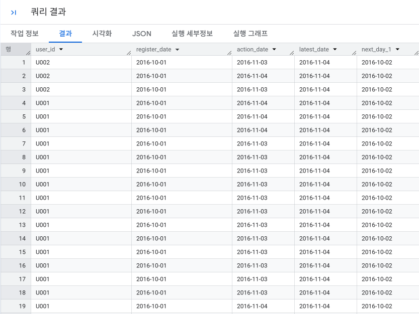
```sql
-- 사용자의 액션 플래그를 계산하는 쿼리
WITH action_log_with_mst_users AS (
    SELECT
        u.user_id,
        u.register_date,
        DATE(TIMESTAMP(a.stamp)) AS action_date,
        MAX(DATE(TIMESTAMP(a.stamp))) OVER() AS latest_date,
        DATE_ADD(CAST(u.register_date AS DATE), INTERVAL 1 DAY) AS next_day_1
    FROM
        `4th_week.mst_users` AS u
    LEFT OUTER JOIN
        `4th_week.action_log` AS a
    ON
        u.user_id = a.user_id
),
user_action_flag AS (
    SELECT
        user_id,
        register_date,
        -- 4. 등록일 다음날에 액션을 했는지 안 했는지를 플래그로 나타내기
        SIGN(
            -- 3. 사용자별로 등록일 다음날에 한 액션의 합계 구하기
            SUM(
                -- 1. 등록일 다음날이 로그의 최신 날짜 이전인지 확인하기
                CASE WHEN next_day_1 <= latest_date THEN
                    -- 2. 등록일 다음날의 날짜에 액션을 했다면 1, 안 했다면 0 지정하기
                    CASE WHEN next_day_1 = action_date THEN 1 ELSE 0 END
                END
            )
        ) AS next_1_day_action
    FROM
        action_log_with_mst_users
    GROUP BY
        user_id, register_date
)
SELECT *
FROM
    user_action_flag
ORDER BY
    register_date, user_id;
```
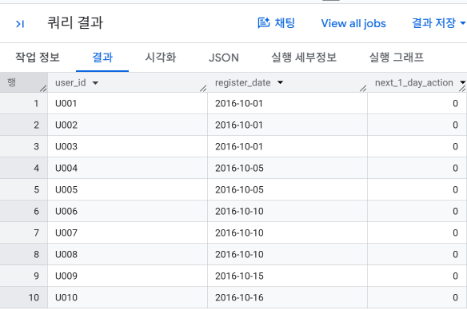

#### 지속률
```sql
-- 다음날 지속률을 계산하는 쿼리
WITH action_log_with_mst_users AS (
    SELECT
        u.user_id,
        u.register_date,
        DATE(TIMESTAMP(a.stamp)) AS action_date,
        MAX(DATE(TIMESTAMP(a.stamp))) OVER() AS latest_date,
        DATE_ADD(CAST(u.register_date AS DATE), INTERVAL 1 DAY) AS next_day_1
    FROM
        `4th_week.mst_users` AS u
    LEFT OUTER JOIN
        `4th_week.action_log` AS a
    ON
        u.user_id = a.user_id
),
user_action_flag AS (
    SELECT
        user_id,
        register_date,
        SIGN(
            SUM(
                CASE WHEN next_day_1 <= latest_date THEN
                    CASE WHEN next_day_1 = action_date THEN 1 ELSE 0 END
                END
            )
        ) AS next_1_day_action
    FROM
        action_log_with_mst_users
    GROUP BY
        user_id, register_date
)
SELECT
    register_date,
    AVG(100.0 * next_1_day_action) AS repeat_rate_1_day
FROM
    user_action_flag
GROUP BY
    register_date
ORDER BY
    register_date;
```
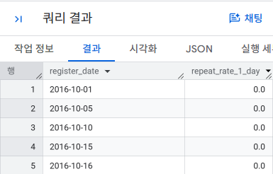
---
```sql
--지속률 지표를 관리하는 마스터 테이블을 작성하는 쿼리
WITH repeat_interval AS (
    SELECT '01 day repeat' AS index_name, 1 AS interval_date UNION ALL
    SELECT '02 day repeat', 2 UNION ALL
    SELECT '03 day repeat', 3 UNION ALL
    SELECT '04 day repeat', 4 UNION ALL
    SELECT '05 day repeat', 5 UNION ALL
    SELECT '06 day repeat', 6 UNION ALL
    SELECT '07 day repeat', 7
)
SELECT *
FROM repeat_interval
ORDER BY index_name;
```
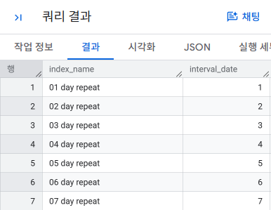
```sql
-- 지속률을 세로 기반으로 집계하는 쿼리
WITH repeat_interval AS (
    SELECT '01 day repeat' AS index_name, 1 AS interval_date UNION ALL
    SELECT '02 day repeat', 2 UNION ALL
    SELECT '03 day repeat', 3 UNION ALL
    SELECT '04 day repeat', 4 UNION ALL
    SELECT '05 day repeat', 5 UNION ALL
    SELECT '06 day repeat', 6 UNION ALL
    SELECT '07 day repeat', 7
),
action_log_with_index_date AS (
    SELECT
        u.user_id,
        u.register_date,
        -- 타임스탬프 자료형으로 변환 후 날짜 자료형으로 변환
        DATE(TIMESTAMP(a.stamp)) AS action_date,
        MAX(DATE(TIMESTAMP(a.stamp))) OVER() AS latest_date,
        r.index_name,
        -- 등록일로부터 n일 후의 날짜 계산하기
        DATE_ADD(CAST(u.register_date AS DATE), INTERVAL r.interval_date DAY) AS index_date
    FROM
        `4th_week.mst_users` AS u
    LEFT OUTER JOIN
        `4th_week.action_log` AS a
    ON
        u.user_id = a.user_id
    CROSS JOIN
        repeat_interval AS r
),
user_action_flag AS (
    SELECT
        user_id,
        register_date,
        index_name,
        -- 등록일로부터 n일 후에 액션을 했는지 플래그로 나타내기
        SIGN(
            -- 사용자별로 등록일로부터 n일 후에 한 액션의 합계 구하기
            SUM(
                -- 등록일로부터 n일 후가 로그의 최신 날짜 이전인지 확인하기
                CASE WHEN index_date <= latest_date THEN
                    -- 등록일로부터 n일 후의 날짜에 액션을 했다면 1, 아니라면 0 지정하기
                    CASE WHEN index_date = action_date THEN 1 ELSE 0 END
                END
            )
        ) AS index_date_action
    FROM
        action_log_with_index_date
    GROUP BY
        user_id, register_date, index_name, index_date
)
SELECT
    register_date,
    index_name,
    AVG(100.0 * index_date_action) AS repeat_rate
FROM
    user_action_flag
GROUP BY
    register_date, index_name
ORDER BY
    register_date, index_name;
```
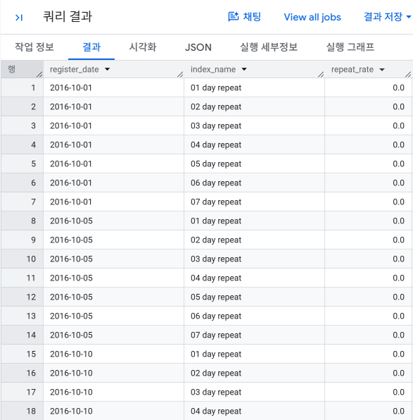

#### 정착률
```sql
-- 정착률 지표를 관리하는 마스터 테이블을 작성하는 쿼리
WITH repeat_interval AS (
    SELECT '07 day retention' AS index_name, 1 AS interval_begin_date, 7 AS interval_end_date UNION ALL
    SELECT '14 day retention', 8, 14 UNION ALL
    SELECT '21 day retention', 15, 21 UNION ALL
    SELECT '28 day retention', 22, 28
)
SELECT *
FROM repeat_interval
ORDER BY index_name;
```
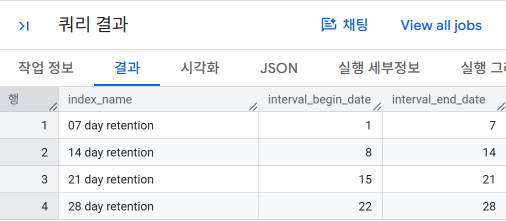
```sql
-- 정착률을 계산하는 쿼리
WITH repeat_interval AS (
    -- [코드 12-9] 참고: BigQuery는 UNION ALL 활용
    SELECT '07 day retention' AS index_name, 1 AS interval_begin_date, 7 AS interval_end_date UNION ALL
    SELECT '14 day retention', 8, 14 UNION ALL
    SELECT '21 day retention', 15, 21 UNION ALL
    SELECT '28 day retention', 22, 28
),
action_log_with_index_date AS (
    SELECT
        u.user_id,
        u.register_date,
        -- BigQuery: 타임스탬프 자료형으로 변환 후 날짜 자료형으로 변환
        DATE(TIMESTAMP(a.stamp)) AS action_date,
        MAX(DATE(TIMESTAMP(a.stamp))) OVER() AS latest_date,
        r.index_name,
        -- BigQuery: 지표의 대상 기간 시작일과 종료일 계산하기
        DATE_ADD(CAST(u.register_date AS DATE), INTERVAL r.interval_begin_date DAY) AS index_begin_date,
        DATE_ADD(CAST(u.register_date AS DATE), INTERVAL r.interval_end_date DAY) AS index_end_date
    FROM
        `4th_week.mst_users` AS u
    LEFT OUTER JOIN
        `4th_week.action_log` AS a
    ON
        u.user_id = a.user_id
    CROSS JOIN
        repeat_interval AS r
),
user_action_flag AS (
    SELECT
        user_id,
        register_date,
        index_name,
        -- 4. 지표의 대상 기간에 액션을 했는지 플래그로 나타내기
        SIGN(
            -- 3. 사용자별로 대상 기간에 한 액션의 합계 구하기
            SUM(
                -- 1. 대상 기간의 종료일이 로그의 최신 날짜 이전인지 확인하기
                CASE WHEN index_end_date <= latest_date THEN
                    -- 2. 지표의 대상 기간에 액션을 했다면 1, 안 했다면 0 지정하기
                    CASE WHEN action_date BETWEEN index_begin_date AND index_end_date THEN 1 ELSE 0 END
                END
            )
        ) AS index_date_action
    FROM
        action_log_with_index_date
    GROUP BY
        user_id, register_date, index_name, index_begin_date, index_end_date
)
SELECT
    register_date,
    index_name,
    AVG(100.0 * index_date_action) AS index_rate
FROM
    user_action_flag
GROUP BY
    register_date, index_name
ORDER BY
    register_date, index_name;
```
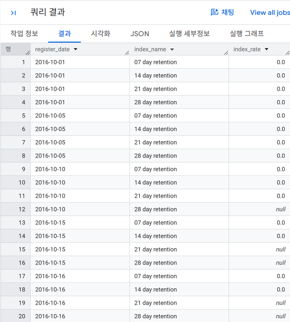
```sql
-- 지속률 지표를 관리하는 마스터 테이블을 정착률 형식으로 수정한 쿼리
WITH repeat_interval AS (
    SELECT '01 day repeat' AS index_name, 1 AS interval_begin_date, 1 AS interval_end_date UNION ALL
    SELECT '02 day repeat', 2, 2 UNION ALL
    SELECT '03 day repeat', 3, 3 UNION ALL
    SELECT '04 day repeat', 4, 4 UNION ALL
    SELECT '05 day repeat', 5, 5 UNION ALL
    SELECT '06 day repeat', 6, 6 UNION ALL
    SELECT '07 day repeat', 7, 7 UNION ALL
    SELECT '07 day retention', 1, 7 UNION ALL
    SELECT '14 day retention', 8, 14 UNION ALL
    SELECT '21 day retention', 15, 21 UNION ALL
    SELECT '28 day retention', 22, 28
)
SELECT *
FROM repeat_interval
ORDER BY index_name;
```
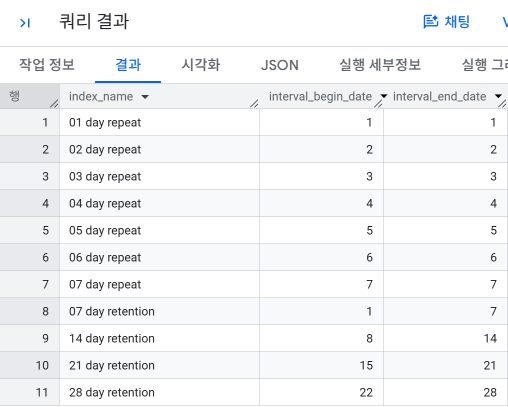
```sql
-- n일 지속률들을 집계하는 쿼리
WITH repeat_interval AS (
    -- [코드 12-11] 참고하기
    SELECT '01 day repeat' AS index_name, 1 AS interval_begin_date, 1 AS interval_end_date UNION ALL
    SELECT '02 day repeat', 2, 2 UNION ALL
    SELECT '03 day repeat', 3, 3 UNION ALL
    SELECT '04 day repeat', 4, 4 UNION ALL
    SELECT '05 day repeat', 5, 5 UNION ALL
    SELECT '06 day repeat', 6, 6 UNION ALL
    SELECT '07 day repeat', 7, 7 UNION ALL
    SELECT '07 day retention', 1, 7 UNION ALL
    SELECT '14 day retention', 8, 14 UNION ALL
    SELECT '21 day retention', 15, 21 UNION ALL
    SELECT '28 day retention', 22, 28
),
action_log_with_index_date AS (
    SELECT
        u.user_id,
        u.register_date,
        DATE(TIMESTAMP(a.stamp)) AS action_date,
        MAX(DATE(TIMESTAMP(a.stamp))) OVER() AS latest_date,
        r.index_name,
        DATE_ADD(CAST(u.register_date AS DATE), INTERVAL r.interval_begin_date DAY) AS index_begin_date,
        DATE_ADD(CAST(u.register_date AS DATE), INTERVAL r.interval_end_date DAY) AS index_end_date
    FROM
        `4th_week.mst_users` AS u
    LEFT OUTER JOIN
        `4th_week.action_log` AS a
    ON
        u.user_id = a.user_id
    CROSS JOIN
        repeat_interval AS r
),
user_action_flag AS (
    SELECT
        user_id,
        register_date,
        index_name,
        SIGN(
            SUM(
                CASE WHEN index_end_date <= latest_date THEN
                    CASE WHEN action_date BETWEEN index_begin_date AND index_end_date THEN 1 ELSE 0 END
                END
            )
        ) AS index_date_action
    FROM
        action_log_with_index_date
    GROUP BY
        user_id, register_date, index_name, index_begin_date, index_end_date
)
SELECT
    index_name,
    AVG(100.0 * index_date_action) AS repeat_rate
FROM
    user_action_flag
GROUP BY
    index_name
ORDER BY
    index_name;
```
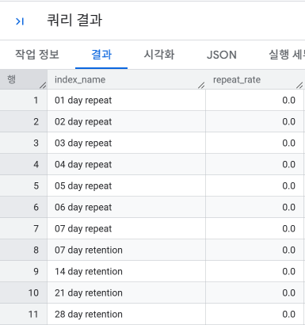
### 2-3 지속과 정착에 영향을 주는 액션 집계하기 

**핵심 개념**
- 지속률이나 정착률 자체를 확인한 뒤에는 **어떤 행동을 한 사용자가 더 오래 남는지** 분석해야 한다.
- 사용자 × 액션의 모든 조합을 만든 뒤, 해당 액션을 했으면 `1`, 하지 않았으면 `0`으로 플래그를 만든다.
- 이후 액션 실행 여부에 따라 다음날 지속률이나 14일 정착률을 비교하면 어떤 행동이 서비스 정착과 관계가 있는지 파악할 수 있다.
- `AVG(0/1 플래그)`를 이용하면 비율을 간단하게 계산할 수 있다.

👉 **한 줄 정리:** **성과가 좋은 사용자가 공통적으로 했던 액션**을 찾는 것이 핵심이다.

```sql
-- 모든 사용자와 액션의 조합을 도출하는 쿼리
WITH repeat_interval AS (
    SELECT '01 day repeat' AS index_name, 1 AS interval_begin_date, 1 AS interval_end_date
),
action_log_with_index_date AS (
    SELECT
        u.user_id,
        u.register_date,
        DATE(TIMESTAMP(a.stamp)) AS action_date,
        MAX(DATE(TIMESTAMP(a.stamp))) OVER() AS latest_date,
        r.index_name,
        DATE_ADD(CAST(u.register_date AS DATE), INTERVAL r.interval_begin_date DAY) AS index_begin_date,
        DATE_ADD(CAST(u.register_date AS DATE), INTERVAL r.interval_end_date DAY) AS index_end_date
    FROM
        `4th_week.mst_users` AS u
    LEFT OUTER JOIN
        `4th_week.action_log` AS a
    ON
        u.user_id = a.user_id
    CROSS JOIN
        repeat_interval AS r
),
user_action_flag AS (
    SELECT
        user_id,
        register_date,
        index_name,
        SIGN(
            SUM(
                CASE WHEN index_end_date <= latest_date THEN
                    CASE WHEN action_date BETWEEN index_begin_date AND index_end_date THEN 1 ELSE 0 END
                END
            )
        ) AS index_date_action
    FROM
        action_log_with_index_date
    GROUP BY
        user_id, register_date, index_name, index_begin_date, index_end_date
),
mst_actions AS (
    SELECT 'view' AS action
    UNION ALL SELECT 'comment' AS action
    UNION ALL SELECT 'follow' AS action
),
mst_user_actions AS (
    SELECT
        u.user_id,
        u.register_date,
        a.action
    FROM
        `4th_week.mst_users` AS u
    CROSS JOIN
        mst_actions AS a
)
SELECT *
FROM mst_user_actions
ORDER BY user_id, action;
```
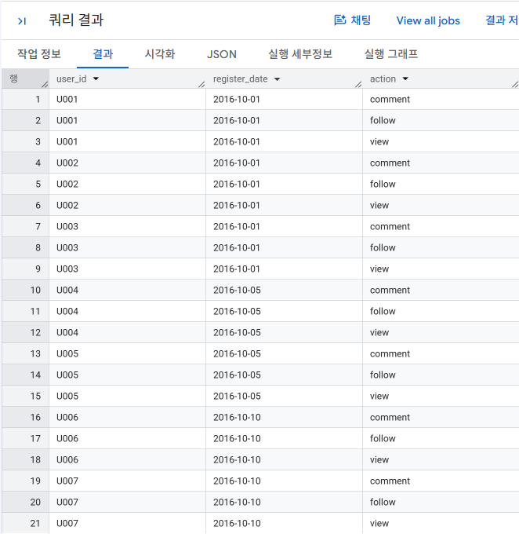
```sql
-- 사용자의 액션 로그를 0,1의 플래그로 표현하는 쿼리
WITH repeat_interval AS (
    SELECT '01 day repeat' AS index_name, 1 AS interval_begin_date, 1 AS interval_end_date
),
action_log_with_index_date AS (
    SELECT
        u.user_id,
        u.register_date,
        DATE(TIMESTAMP(a.stamp)) AS action_date,
        MAX(DATE(TIMESTAMP(a.stamp))) OVER() AS latest_date,
        r.index_name,
        DATE_ADD(CAST(u.register_date AS DATE), INTERVAL r.interval_begin_date DAY) AS index_begin_date,
        DATE_ADD(CAST(u.register_date AS DATE), INTERVAL r.interval_end_date DAY) AS index_end_date
    FROM
        `4th_week.mst_users` AS u
    LEFT OUTER JOIN
        `4th_week.action_log` AS a
    ON
        u.user_id = a.user_id
    CROSS JOIN
        repeat_interval AS r
),
user_action_flag AS (
    SELECT
        user_id,
        register_date,
        index_name,
        SIGN(
            SUM(
                CASE WHEN index_end_date <= latest_date THEN
                    CASE WHEN action_date BETWEEN index_begin_date AND index_end_date THEN 1 ELSE 0 END
                END
            )
        ) AS index_date_action
    FROM
        action_log_with_index_date
    GROUP BY
        user_id, register_date, index_name, index_begin_date, index_end_date
),
mst_actions AS (
    SELECT 'view' AS action
    UNION ALL SELECT 'comment' AS action
    UNION ALL SELECT 'follow' AS action
),
mst_user_actions AS (
    SELECT
        u.user_id,
        u.register_date,
        a.action
    FROM
        `4th_week.mst_users` AS u
    CROSS JOIN
        mst_actions AS a
),
register_action_flag AS (
    SELECT DISTINCT
        m.user_id,
        m.register_date,
        m.action,
        CASE
            WHEN a.action IS NOT NULL THEN 1
            ELSE 0
        END AS do_action,
        f.index_name,
        f.index_date_action
    FROM
        mst_user_actions AS m
    LEFT JOIN
        `4th_week.action_log` AS a
    ON
        m.user_id = a.user_id
        -- BigQuery의 경우 한 번 타임스탬프 자료형으로 변환한 뒤 날짜 자료형으로 변환하기
        AND CAST(m.register_date AS DATE) = DATE(TIMESTAMP(a.stamp))
        AND m.action = a.action
    LEFT JOIN
        user_action_flag AS f
    ON
        m.user_id = f.user_id
    WHERE
        f.index_date_action IS NOT NULL
)
SELECT *
FROM
    register_action_flag
ORDER BY
    user_id, index_name, action;
```
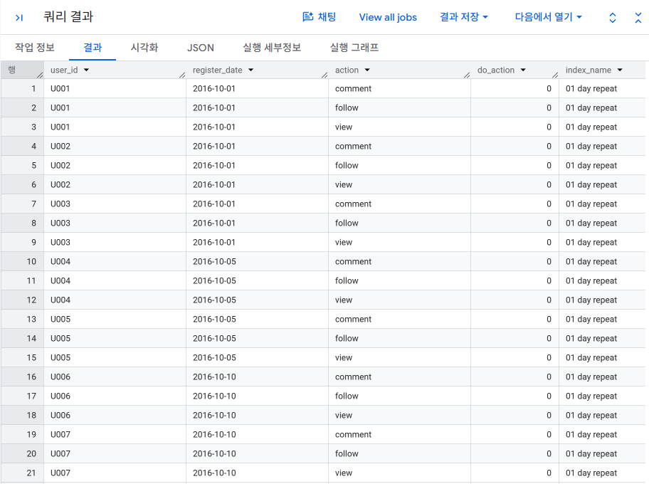

```sql
-- 액션에 따른 지속률과 정착률을 집계하는 쿼리
WITH repeat_interval AS (
    SELECT '01 day repeat' AS index_name, 1 AS interval_begin_date, 1 AS interval_end_date UNION ALL
    SELECT '02 day repeat', 2, 2 UNION ALL
    SELECT '03 day repeat', 3, 3 UNION ALL
    SELECT '04 day repeat', 4, 4 UNION ALL
    SELECT '05 day repeat', 5, 5 UNION ALL
    SELECT '06 day repeat', 6, 6 UNION ALL
    SELECT '07 day repeat', 7, 7 UNION ALL
    SELECT '07 day retention', 1, 7 UNION ALL
    SELECT '14 day retention', 8, 14 UNION ALL
    SELECT '21 day retention', 15, 21 UNION ALL
    SELECT '28 day retention', 22, 28
),
action_log_with_index_date AS (
    SELECT
        u.user_id,
        u.register_date,
        DATE(TIMESTAMP(a.stamp)) AS action_date,
        MAX(DATE(TIMESTAMP(a.stamp))) OVER() AS latest_date,
        r.index_name,
        DATE_ADD(CAST(u.register_date AS DATE), INTERVAL r.interval_begin_date DAY) AS index_begin_date,
        DATE_ADD(CAST(u.register_date AS DATE), INTERVAL r.interval_end_date DAY) AS index_end_date
    FROM
        `4th_week.mst_users` AS u
    LEFT OUTER JOIN
        `4th_week.action_log` AS a
    ON
        u.user_id = a.user_id
    CROSS JOIN
        repeat_interval AS r
),
user_action_flag AS (
    SELECT
        user_id,
        register_date,
        index_name,
        SIGN(
            SUM(
                CASE WHEN index_end_date <= latest_date THEN
                    CASE WHEN action_date BETWEEN index_begin_date AND index_end_date THEN 1 ELSE 0 END
                END
            )
        ) AS index_date_action
    FROM
        action_log_with_index_date
    GROUP BY
        user_id, register_date, index_name, index_begin_date, index_end_date
),
mst_actions AS (
    SELECT 'view' AS action
    UNION ALL SELECT 'comment'
    UNION ALL SELECT 'follow'
),
mst_user_actions AS (
    SELECT
        u.user_id,
        u.register_date,
        a.action
    FROM
        `4th_week.mst_users` AS u
    CROSS JOIN
        mst_actions AS a
),
register_action_flag AS (
    SELECT DISTINCT
        m.user_id,
        m.register_date,
        m.action,
        CASE
            WHEN a.action IS NOT NULL THEN 1
            ELSE 0
        END AS do_action,
        f.index_name,
        f.index_date_action
    FROM
        mst_user_actions AS m
    LEFT JOIN
        `4th_week.action_log` AS a
    ON
        m.user_id = a.user_id
        AND CAST(m.register_date AS DATE) = DATE(TIMESTAMP(a.stamp))
        AND m.action = a.action
    LEFT JOIN
        user_action_flag AS f
    ON
        m.user_id = f.user_id
    WHERE
        f.index_date_action IS NOT NULL
)
SELECT
    action,
    COUNT(1) AS users,
    AVG(100.0 * do_action) AS usage_rate,
    index_name,
    AVG(CASE do_action WHEN 1 THEN 100.0 * index_date_action END) AS idx_rate,
    AVG(CASE do_action WHEN 0 THEN 100.0 * index_date_action END) AS no_action_idx_rate
FROM
    register_action_flag
GROUP BY
    index_name, action
ORDER BY
    index_name, action;
```
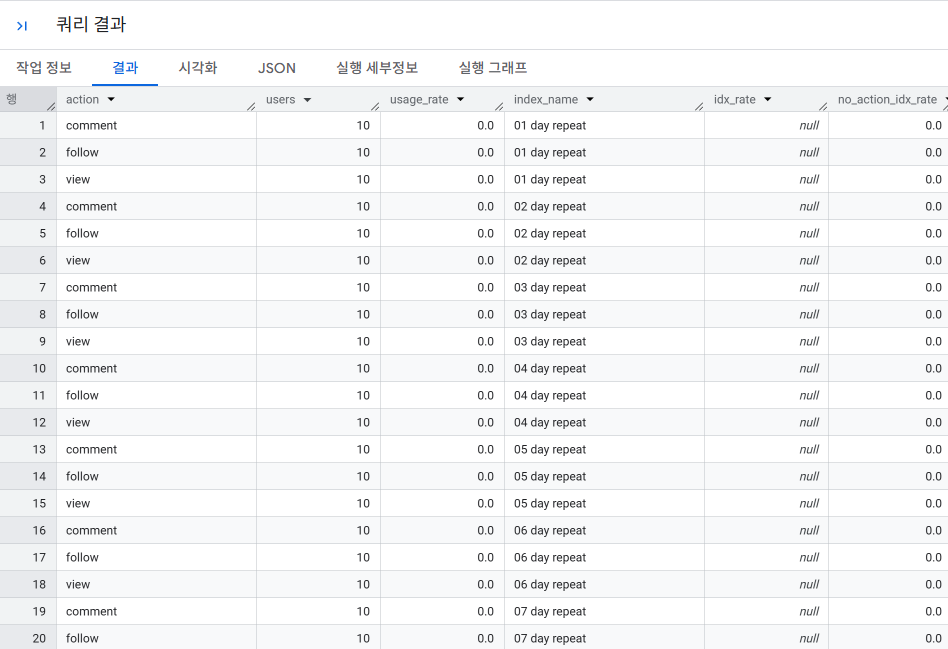
---
 
### 2-4 액션 수에 따른 정착률 집계하기 

**핵심 개념**
- 액션을 단순히 **했는가/안 했는가**만 보는 것에서 더 나아가, **몇 번 했는지**와 정착률의 관계를 확인할 수 있다.
- 액션 횟수는 그대로 사용하기보다 `0회`, `1~5회`, `6~10회`, `11회 이상`처럼 구간화하면 해석이 쉬워진다.
- 특정 액션이 많을수록 정착률이 계속 높아지는지, 어느 구간부터 차이가 없어지는지 확인할 수 있다.

👉 **한 줄 정리:** 액션의 **유무뿐 아니라 빈도**도 정착에 영향을 줄 수 있다.

```sql
-- 액션의 계급 마스터와 사용자 액션 플래그의 조합을 산출하는 쿼리
WITH repeat_interval AS (
    SELECT '14 day retention' AS index_name, 8 AS interval_begin_date, 14 AS interval_end_date
),
action_log_with_index_date AS (
    SELECT
        u.user_id,
        u.register_date,
        DATE(TIMESTAMP(a.stamp)) AS action_date,
        MAX(DATE(TIMESTAMP(a.stamp))) OVER() AS latest_date,
        r.index_name,
        DATE_ADD(CAST(u.register_date AS DATE), INTERVAL r.interval_begin_date DAY) AS index_begin_date,
        DATE_ADD(CAST(u.register_date AS DATE), INTERVAL r.interval_end_date DAY) AS index_end_date
    FROM
        `4th_week.mst_users` AS u
    LEFT OUTER JOIN
        `4th_week.action_log` AS a
    ON
        u.user_id = a.user_id
    CROSS JOIN
        repeat_interval AS r
),
user_action_flag AS (
    SELECT
        user_id,
        register_date,
        index_name,
        SIGN(
            SUM(
                CASE WHEN index_end_date <= latest_date THEN
                    CASE WHEN action_date BETWEEN index_begin_date AND index_end_date THEN 1 ELSE 0 END
                END
            )
        ) AS index_date_action
    FROM
        action_log_with_index_date
    GROUP BY
        user_id, register_date, index_name, index_begin_date, index_end_date
),
mst_action_bucket AS (
    -- 액션 단계 마스터 (BigQuery의 경우 SELECT 구문과 UNION ALL로 대체)
    SELECT 'comment' AS action, 0 AS min_count, 0 AS max_count UNION ALL
    SELECT 'comment', 1, 5 UNION ALL
    SELECT 'comment', 6, 10 UNION ALL
    SELECT 'comment', 11, 9999 UNION ALL
    SELECT 'follow', 0, 0 UNION ALL
    SELECT 'follow', 1, 5 UNION ALL
    SELECT 'follow', 6, 10 UNION ALL
    SELECT 'follow', 11, 9999
),
mst_user_action_bucket AS (
    -- 사용자 마스터와 액션 단계 마스터 조합하기
    SELECT
        u.user_id,
        u.register_date,
        a.action,
        a.min_count,
        a.max_count
    FROM
        `4th_week.mst_users` AS u
    CROSS JOIN
        mst_action_bucket AS a
)
SELECT *
FROM
    mst_user_action_bucket
ORDER BY
    user_id, action, min_count;
```
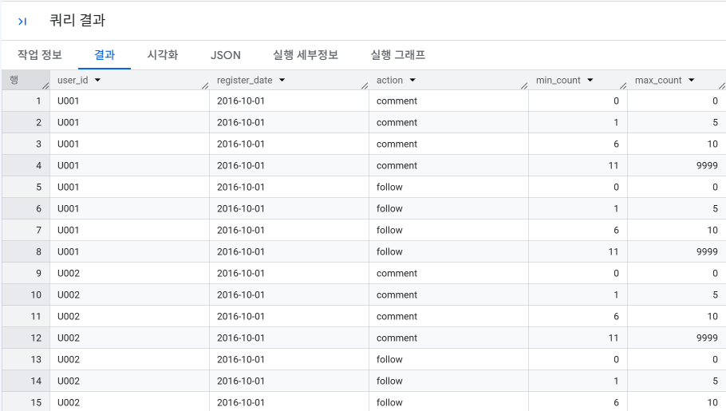

```sql
-- 등록 후 7일 동안의 액션 수를 집계하는 쿼리
WITH repeat_interval AS (
    SELECT '14 day retention' AS index_name, 8 AS interval_begin_date, 14 AS interval_end_date
),
action_log_with_index_date AS (
    SELECT
        u.user_id,
        u.register_date,
        DATE(TIMESTAMP(a.stamp)) AS action_date,
        MAX(DATE(TIMESTAMP(a.stamp))) OVER() AS latest_date,
        r.index_name,
        DATE_ADD(CAST(u.register_date AS DATE), INTERVAL r.interval_begin_date DAY) AS index_begin_date,
        DATE_ADD(CAST(u.register_date AS DATE), INTERVAL r.interval_end_date DAY) AS index_end_date
    FROM
        `4th_week.mst_users` AS u
    LEFT OUTER JOIN
        `4th_week.action_log` AS a
    ON
        u.user_id = a.user_id
    CROSS JOIN
        repeat_interval AS r
),
user_action_flag AS (
    SELECT
        user_id,
        register_date,
        index_name,
        SIGN(
            SUM(
                CASE WHEN index_end_date <= latest_date THEN
                    CASE WHEN action_date BETWEEN index_begin_date AND index_end_date THEN 1 ELSE 0 END
                END
            )
        ) AS index_date_action
    FROM
        action_log_with_index_date
    GROUP BY
        user_id, register_date, index_name, index_begin_date, index_end_date
),
mst_action_bucket AS (
    SELECT 'comment' AS action, 0 AS min_count, 0 AS max_count UNION ALL
    SELECT 'comment', 1, 5 UNION ALL
    SELECT 'comment', 6, 10 UNION ALL
    SELECT 'comment', 11, 9999 UNION ALL
    SELECT 'follow', 0, 0 UNION ALL
    SELECT 'follow', 1, 5 UNION ALL
    SELECT 'follow', 6, 10 UNION ALL
    SELECT 'follow', 11, 9999
),
mst_user_action_bucket AS (
    SELECT
        u.user_id,
        u.register_date,
        a.action,
        a.min_count,
        a.max_count
    FROM
        `4th_week.mst_users` AS u
    CROSS JOIN
        mst_action_bucket AS a
),
register_action_flag AS (
    -- 등록일에서 7일 후까지의 액션 수를 세고,
    -- 액션 단계와 14일 정착 달성 플래그 계산하기
    SELECT
        m.user_id,
        m.action,
        m.min_count,
        m.max_count,
        COUNT(a.action) AS action_count,
        CASE
            WHEN COUNT(a.action) BETWEEN m.min_count AND m.max_count THEN 1
            ELSE 0
        END AS achieve,
        f.index_name,
        f.index_date_action
    FROM
        mst_user_action_bucket AS m
    LEFT JOIN
        `4th_week.action_log` AS a
    ON
        m.user_id = a.user_id
        -- BigQuery의 경우
        AND DATE(TIMESTAMP(a.stamp)) BETWEEN CAST(m.register_date AS DATE) AND DATE_ADD(CAST(m.register_date AS DATE), INTERVAL 7 DAY)
        AND m.action = a.action
    LEFT JOIN
        user_action_flag AS f
    ON
        m.user_id = f.user_id
    WHERE
        f.index_date_action IS NOT NULL
    GROUP BY
        m.user_id,
        m.action,
        m.min_count,
        m.max_count,
        f.index_name,
        f.index_date_action
)
SELECT *
FROM
    register_action_flag
ORDER BY
    user_id, action, min_count;
```
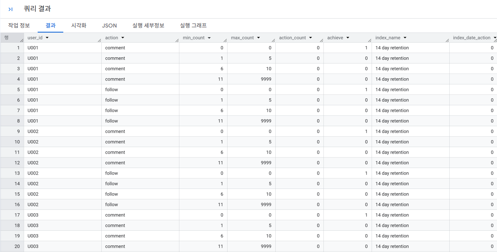

```sql
--등록 후 7일 동안의 액션 횟수별로 14일 정착률을 집계하는 쿼리
WITH repeat_interval AS (
    SELECT '14 day retention' AS index_name, 8 AS interval_begin_date, 14 AS interval_end_date
),
action_log_with_index_date AS (
    SELECT
        u.user_id,
        u.register_date,
        DATE(TIMESTAMP(a.stamp)) AS action_date,
        MAX(DATE(TIMESTAMP(a.stamp))) OVER() AS latest_date,
        r.index_name,
        DATE_ADD(CAST(u.register_date AS DATE), INTERVAL r.interval_begin_date DAY) AS index_begin_date,
        DATE_ADD(CAST(u.register_date AS DATE), INTERVAL r.interval_end_date DAY) AS index_end_date
    FROM
        `4th_week.mst_users` AS u
    LEFT OUTER JOIN
        `4th_week.action_log` AS a
    ON
        u.user_id = a.user_id
    CROSS JOIN
        repeat_interval AS r
),
user_action_flag AS (
    SELECT
        user_id,
        register_date,
        index_name,
        SIGN(
            SUM(
                CASE WHEN index_end_date <= latest_date THEN
                    CASE WHEN action_date BETWEEN index_begin_date AND index_end_date THEN 1 ELSE 0 END
                END
            )
        ) AS index_date_action
    FROM
        action_log_with_index_date
    GROUP BY
        user_id, register_date, index_name, index_begin_date, index_end_date
),
mst_action_bucket AS (
    SELECT 'comment' AS action, 0 AS min_count, 0 AS max_count UNION ALL
    SELECT 'comment', 1, 5 UNION ALL
    SELECT 'comment', 6, 10 UNION ALL
    SELECT 'comment', 11, 9999 UNION ALL
    SELECT 'follow', 0, 0 UNION ALL
    SELECT 'follow', 1, 5 UNION ALL
    SELECT 'follow', 6, 10 UNION ALL
    SELECT 'follow', 11, 9999
),
mst_user_action_bucket AS (
    SELECT
        u.user_id,
        u.register_date,
        a.action,
        a.min_count,
        a.max_count
    FROM
        `4th_week.mst_users` AS u
    CROSS JOIN
        mst_action_bucket AS a
),
register_action_flag AS (
    SELECT
        m.user_id,
        m.action,
        m.min_count,
        m.max_count,
        COUNT(a.action) AS action_count,
        CASE
            WHEN COUNT(a.action) BETWEEN m.min_count AND m.max_count THEN 1
            ELSE 0
        END AS achieve,
        f.index_name,
        f.index_date_action
    FROM
        mst_user_action_bucket AS m
    LEFT JOIN
        `4th_week.action_log` AS a
    ON
        m.user_id = a.user_id
        AND DATE(TIMESTAMP(a.stamp)) BETWEEN CAST(m.register_date AS DATE) AND DATE_ADD(CAST(m.register_date AS DATE), INTERVAL 7 DAY)
        AND m.action = a.action
    LEFT JOIN
        user_action_flag AS f
    ON
        m.user_id = f.user_id
    WHERE
        f.index_date_action IS NOT NULL
    GROUP BY
        m.user_id,
        m.action,
        m.min_count,
        m.max_count,
        f.index_name,
        f.index_date_action
)
SELECT
    action,
    -- BigQuery의 경우 다음과 같이 문자열 연결하기
    CONCAT(CAST(min_count AS string), ' ~ ', CAST(max_count AS string)) AS count_range,
    SUM(CASE achieve WHEN 1 THEN 1 ELSE 0 END) AS achieve,
    index_name,
    AVG(CASE achieve WHEN 1 THEN 100.0 * index_date_action END) AS achieve_index_rate
FROM
    register_action_flag
GROUP BY
    index_name, action, min_count, max_count
ORDER BY
    index_name, action, min_count;
```
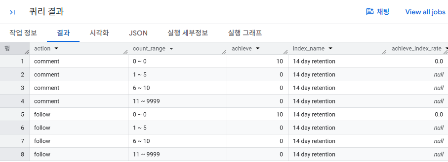

---

### 2-5 사용 일수에 따른 정착률 집계하기 

**핵심 개념**
- 등록 직후 며칠 동안 서비스를 사용했는지가 이후 장기 정착에 영향을 주는지 확인한다.
- 교재에서는 **등록 다음날부터 7일 동안의 사용 일수**와 **28일 정착률(등록 후 22~28일)**의 관계를 본다.
- `COUNT(DISTINCT action_date)`를 이용하면 액션 횟수가 아니라 실제 사용한 **날짜 수**를 셀 수 있다.
- 사용 일수별 사용자 비율과 누적 구성비까지 계산하면 핵심 사용자 구간을 쉽게 파악할 수 있다.

👉 **한 줄 정리:** 가입 직후 **며칠이나 반복해서 사용했는지**가 장기 정착의 중요한 힌트가 된다.

```sql
-- 등록일 다음날부터 7일 동안의 사용 일수와 28일 정착 플래그를 생성하는 쿼리
WITH repeat_interval AS (
    SELECT '28 day retention' AS index_name, 22 AS interval_begin_date, 28 AS interval_end_date
),
action_log_with_index_date AS (
    SELECT
        u.user_id,
        u.register_date,
        DATE(TIMESTAMP(a.stamp)) AS action_date,
        MAX(DATE(TIMESTAMP(a.stamp))) OVER() AS latest_date,
        r.index_name,
        DATE_ADD(CAST(u.register_date AS DATE), INTERVAL r.interval_begin_date DAY) AS index_begin_date,
        DATE_ADD(CAST(u.register_date AS DATE), INTERVAL r.interval_end_date DAY) AS index_end_date
    FROM
        `4th_week.mst_users` AS u
    LEFT OUTER JOIN
        `4th_week.action_log` AS a
    ON
        u.user_id = a.user_id
    CROSS JOIN
        repeat_interval AS r
),
user_action_flag AS (
    SELECT
        user_id,
        register_date,
        index_name,
        SIGN(
            SUM(
                CASE WHEN index_end_date <= latest_date THEN
                    CASE WHEN action_date BETWEEN index_begin_date AND index_end_date THEN 1 ELSE 0 END
                END
            )
        ) AS index_date_action
    FROM
        action_log_with_index_date
    GROUP BY
        user_id, register_date, index_name, index_begin_date, index_end_date
),
register_action_flag AS (
    -- 등록일 다음날부터 7일 동안의 사용 일수와 28일 정착 플래그를 생성
    SELECT
        m.user_id,
        -- BigQuery의 경우 다음과 같이 사용하기
        COUNT(DISTINCT DATE(TIMESTAMP(a.stamp))) AS dt_count,
        f.index_name,
        f.index_date_action
    FROM
        `4th_week.mst_users` AS m
    LEFT JOIN
        `4th_week.action_log` AS a
    ON
        m.user_id = a.user_id
        -- 등록 다음날부터 7일 이내의 액션 로그 결합하기
        -- BigQuery의 경우 다음과 같이 사용하기
        AND DATE(TIMESTAMP(a.stamp)) BETWEEN DATE_ADD(CAST(m.register_date AS DATE), INTERVAL 1 DAY) 
                                     AND DATE_ADD(CAST(m.register_date AS DATE), INTERVAL 8 DAY)
    LEFT JOIN
        user_action_flag AS f
    ON
        m.user_id = f.user_id
    WHERE
        f.index_date_action IS NOT NULL
    GROUP BY
        m.user_id,
        f.index_name,
        f.index_date_action
)
SELECT *
FROM
    register_action_flag;
```
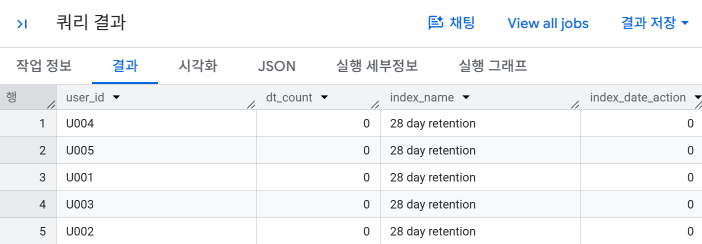

```sql
-- 사용 일수에 따른 정착률을 집계하는 쿼리
WITH repeat_interval AS (
    SELECT '28 day retention' AS index_name, 22 AS interval_begin_date, 28 AS interval_end_date
),
action_log_with_index_date AS (
    SELECT
        u.user_id,
        u.register_date,
        DATE(TIMESTAMP(a.stamp)) AS action_date,
        MAX(DATE(TIMESTAMP(a.stamp))) OVER() AS latest_date,
        r.index_name,
        DATE_ADD(CAST(u.register_date AS DATE), INTERVAL r.interval_begin_date DAY) AS index_begin_date,
        DATE_ADD(CAST(u.register_date AS DATE), INTERVAL r.interval_end_date DAY) AS index_end_date
    FROM
        `4th_week.mst_users` AS u
    LEFT OUTER JOIN
        `4th_week.action_log` AS a
    ON
        u.user_id = a.user_id
    CROSS JOIN
        repeat_interval AS r
),
user_action_flag AS (
    SELECT
        user_id,
        register_date,
        index_name,
        SIGN(
            SUM(
                CASE WHEN index_end_date <= latest_date THEN
                    CASE WHEN action_date BETWEEN index_begin_date AND index_end_date THEN 1 ELSE 0 END
                END
            )
        ) AS index_date_action
    FROM
        action_log_with_index_date
    GROUP BY
        user_id, register_date, index_name, index_begin_date, index_end_date
),
register_action_flag AS (
    SELECT
        m.user_id,
        COUNT(DISTINCT DATE(TIMESTAMP(a.stamp))) AS dt_count,
        f.index_name,
        f.index_date_action
    FROM
        `4th_week.mst_users` AS m
    LEFT JOIN
        `4th_week.action_log` AS a
    ON
        m.user_id = a.user_id
        AND DATE(TIMESTAMP(a.stamp)) BETWEEN DATE_ADD(CAST(m.register_date AS DATE), INTERVAL 1 DAY) 
                                     AND DATE_ADD(CAST(m.register_date AS DATE), INTERVAL 8 DAY)
    LEFT JOIN
        user_action_flag AS f
    ON
        m.user_id = f.user_id
    WHERE
        f.index_date_action IS NOT NULL
    GROUP BY
        m.user_id,
        f.index_name,
        f.index_date_action
)
SELECT
    dt_count AS dates,
    COUNT(user_id) AS users,
    100.0 * COUNT(user_id) / SUM(COUNT(user_id)) OVER() AS user_ratio,
    100.0 
      * SUM(COUNT(user_id)) 
        OVER(ORDER BY index_name, dt_count 
             ROWS BETWEEN UNBOUNDED PRECEDING AND CURRENT ROW) 
      / SUM(COUNT(user_id)) OVER() AS cum_ratio,
    SUM(index_date_action) AS achieve_users,
    AVG(100.0 * index_date_action) AS achieve_ratio
FROM
    register_action_flag
GROUP BY
    index_name, dt_count
ORDER BY
    index_name, dt_count;
```

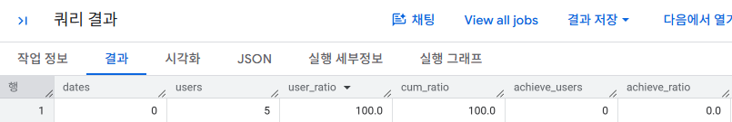

---

### 2-6 사용자의 잔존율 집계하기 

**핵심 개념**
- 잔존율은 특정 시기에 등록한 사용자 집단(cohort)이 이후 몇 개월 동안 계속 서비스를 사용하는지 보는 지표이다.
- 등록 월을 기준으로 사용 월별 활성 사용자 수를 집계하면 코호트별 장기 유지 패턴을 비교할 수 있다.
- 단기 지속률/정착률보다 더 긴 관점에서 서비스의 사용자 유지력을 확인할 수 있다.
- 수치가 변한 시점에 캠페인이나 서비스 개편 같은 이벤트를 같이 기록하면 원인 분석에 도움이 된다.

👉 **한 줄 정리:** 잔존율은 **같은 시기에 들어온 사용자가 시간이 지나도 얼마나 남아 있는가**를 본다.

```sql
-- 12개월 후까지의 월을 도출하기 위한 보조 테이블을 만드는 쿼리
WITH mst_intervals AS (
    -- Hive, Redshift, BigQuery, SparkSQL의 경우 SELECT 구문과 UNION ALL로 대체 가능
    SELECT 1 AS interval_month UNION ALL
    SELECT 2 UNION ALL
    SELECT 3 UNION ALL
    SELECT 4 UNION ALL
    SELECT 5 UNION ALL
    SELECT 6 UNION ALL
    SELECT 7 UNION ALL
    SELECT 8 UNION ALL
    SELECT 9 UNION ALL
    SELECT 10 UNION ALL
    SELECT 11 UNION ALL
    SELECT 12
)
SELECT *
FROM mst_intervals;
```
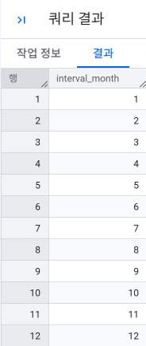

```sql
-- 등록 월에서 12개월 후까지의 잔존율을 집계하는 쿼리
WITH mst_intervals AS (
    SELECT 1 AS interval_month UNION ALL
    SELECT 2 UNION ALL
    SELECT 3 UNION ALL
    SELECT 4 UNION ALL
    SELECT 5 UNION ALL
    SELECT 6 UNION ALL
    SELECT 7 UNION ALL
    SELECT 8 UNION ALL
    SELECT 9 UNION ALL
    SELECT 10 UNION ALL
    SELECT 11 UNION ALL
    SELECT 12
),
mst_users_with_index_month AS (
    -- 사용자 마스터에 등록 월부터 12개월 후까지의 월을 추가하기
    SELECT
        u.user_id,
        u.register_date,
        -- BigQuery의 경우 다음과 같이 사용하기
        DATE_ADD(DATE(TIMESTAMP(u.register_date)), INTERVAL i.interval_month MONTH) AS index_date,
        SUBSTR(u.register_date, 1, 7) AS register_month,
        SUBSTR(CAST(
            DATE_ADD(DATE(TIMESTAMP(u.register_date)), INTERVAL i.interval_month MONTH)
        AS STRING), 1, 7) AS index_month
    FROM
        `4th_week.mst_users` AS u
    CROSS JOIN
        mst_intervals AS i
),
action_log_in_month AS (
    -- 액션 로그의 날짜에서 월 부분만 추출하기
    SELECT DISTINCT
        user_id,
        -- BigQuery의 경우는 substr 사용하기
        SUBSTR(stamp, 1, 7) AS action_month
    FROM
        `4th_week.action_log`
)
-- 사용자 마스터와 액션 로그를 결합한 뒤, 월별로 잔존율 집계하기
SELECT
    u.register_month,
    u.index_month,
    -- action_month이 NULL이 아니라면(액션을 했다면) 사용자 수 집계
    SUM(CASE WHEN a.action_month IS NOT NULL THEN 1 ELSE 0 END) AS users,
    AVG(CASE WHEN a.action_month IS NOT NULL THEN 100.0 ELSE 0.0 END) AS retension_rate
FROM
    mst_users_with_index_month AS u
LEFT JOIN
    action_log_in_month AS a
ON
    u.user_id = a.user_id
    AND u.index_month = a.action_month
GROUP BY
    u.register_month, u.index_month
ORDER BY
    u.register_month, u.index_month;
```
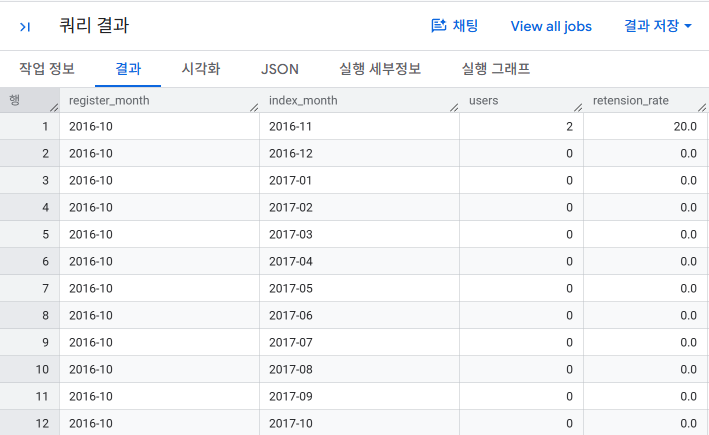

---

### 2-7 방문 빈도를 기반으로 사용자 속성을 정의하고 집계하기

**핵심 개념**
- 한 달 동안 서비스를 사용한 사용자 수를 **MAU(Monthly Active Users)**라고 한다.
- MAU 총합만으로는 서비스 상태를 정확히 알기 어려우므로 사용자를 세 가지로 나눈다.
  - **신규 사용자(New)**: 이번 달에 등록한 사용자
  - **리피트 사용자(Repeat)**: 지난달에도 사용했고 이번 달에도 사용한 사용자
  - **컴백 사용자(Comeback)**: 이번 달 신규가 아니며 지난달에는 사용하지 않았지만 다시 돌아온 사용자
- 같은 MAU라도 신규/리피트/컴백 구성에 따라 서비스의 건강 상태와 필요한 대책이 달라진다.

👉 **한 줄 정리:** MAU는 숫자 하나보다 **누가 들어오고, 남고, 돌아왔는지**로 나눠 봐야 의미가 있다.

```sql
-- 신규 사용자 수, 리피트 사용자 수, 컴백 사용자 수를 집계하는 쿼리
WITH monthly_user_action AS (
    -- 월별 사용자 액션 집약하기
    SELECT DISTINCT
        u.user_id,
        SUBSTR(u.register_date, 1, 7) AS register_month,
        SUBSTR(l.stamp, 1, 7) AS action_month,
        SUBSTR(CAST(
            DATE_SUB(DATE(TIMESTAMP(l.stamp)), INTERVAL 1 MONTH)
        AS STRING), 1, 7) AS action_month_priv
    FROM
        `4th_week.mst_users` AS u
    JOIN
        `4th_week.action_log` AS l
    ON
        u.user_id = l.user_id
),
monthly_user_with_type AS (
    -- 월별 사용자 분류 테이블
    SELECT
        action_month,
        user_id,
        CASE
            -- 등록 월과 액션월이 일치하면 신규 사용자
            WHEN register_month = action_month THEN 'new_user'
            -- 이전 월에 액션이 있다면 리피트 사용자
            WHEN action_month_priv = LAG(action_month) OVER(PARTITION BY user_id ORDER BY action_month) THEN 'repeat_user'
            -- 이외의 경우는 컴백 사용자
            ELSE 'come_back_user'
        END AS c,
        action_month_priv
    FROM
        monthly_user_action
)
SELECT
    action_month,
    -- 특정 달의 MAU
    COUNT(user_id) AS mau,
    -- ===============================================
    -- new_users: 특정 달의 신규 사용자 수
    -- repeat_users: 특정 달의 리피트 사용자 수
    -- come_back_users: 특정 달의 컴백 사용자 수
    -- ===============================================
    COUNT(CASE WHEN c = 'new_user' THEN 1 END) AS new_users,
    COUNT(CASE WHEN c = 'repeat_user' THEN 1 END) AS repeat_users,
    COUNT(CASE WHEN c = 'come_back_user' THEN 1 END) AS come_back_users
FROM
    monthly_user_with_type
GROUP BY
    action_month
ORDER BY
    action_month;
```
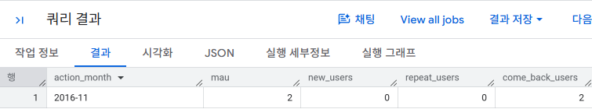

```sql
-- 리피트 사용자를 세분화해서 집계하는 쿼리
WITH monthly_user_action AS (
    SELECT DISTINCT
        u.user_id,
        SUBSTR(u.register_date, 1, 7) AS register_month,
        SUBSTR(l.stamp, 1, 7) AS action_month,
        SUBSTR(CAST(DATE_SUB(DATE(TIMESTAMP(l.stamp)), INTERVAL 1 MONTH) AS STRING), 1, 7) AS action_month_priv
    FROM
        `4th_week.mst_users` AS u
    JOIN
        `4th_week.action_log` AS l
    ON
        u.user_id = l.user_id
),
monthly_user_with_type AS (
    SELECT
        action_month,
        user_id,
        CASE
            WHEN register_month = action_month THEN 'new_user'
            WHEN action_month_priv = LAG(action_month) OVER(PARTITION BY user_id ORDER BY action_month) THEN 'repeat_user'
            ELSE 'come_back_user'
        END AS c,
        action_month_priv
    FROM
        monthly_user_action
),
monthly_users AS (
    SELECT
        m1.action_month,
        COUNT(m1.user_id) AS mau,
        COUNT(CASE WHEN m1.c = 'new_user'       THEN 1 END) AS new_users,
        COUNT(CASE WHEN m1.c = 'repeat_user'    THEN 1 END) AS repeat_users,
        COUNT(CASE WHEN m1.c = 'come_back_user' THEN 1 END) AS come_back_users,
        
        -- 해당 월에 리피트 사용자이면서, 이전 달에 신규 사용자였던 사용자 수
        COUNT(CASE WHEN m1.c = 'repeat_user' AND m0.c = 'new_user' THEN 1 END) AS new_repeat_users,
        
        -- 해당 월에 리피트 사용자이면서, 이전 달에 리피트 사용자였던 사용자 수
        COUNT(CASE WHEN m1.c = 'repeat_user' AND m0.c = 'repeat_user' THEN 1 END) AS continuous_repeat_users,
        
        -- 해당 월에 리피트 사용자이면서, 이전 달이 컴백 사용자였던 사용자 수
        COUNT(CASE WHEN m1.c = 'repeat_user' AND m0.c = 'come_back_user' THEN 1 END) AS come_back_repeat_users

    FROM
        -- m1: 해당 월의 사용자 분류 테이블
        monthly_user_with_type AS m1
    LEFT OUTER JOIN
        -- m0: 이전 달의 사용자 분류 테이블
        monthly_user_with_type AS m0
    ON
        m1.user_id = m0.user_id
        AND m1.action_month_priv = m0.action_month
    GROUP BY
        m1.action_month
)
SELECT *
FROM
    monthly_users
ORDER BY
    action_month;
```
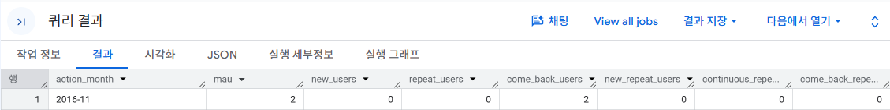

```sql
-- MAU 내역과 MAU 속성들의 반복률을 계산하는 쿼리
WITH monthly_user_action AS (
    SELECT DISTINCT
        u.user_id,
        SUBSTR(u.register_date, 1, 7) AS register_month,
        SUBSTR(l.stamp, 1, 7) AS action_month,
        SUBSTR(CAST(DATE_SUB(DATE(TIMESTAMP(l.stamp)), INTERVAL 1 MONTH) AS STRING), 1, 7) AS action_month_priv
    FROM
        `4th_week.mst_users` AS u
    JOIN
        `4th_week.action_log` AS l
    ON
        u.user_id = l.user_id
),
monthly_user_with_type AS (
    SELECT
        action_month,
        user_id,
        CASE
            WHEN register_month = action_month THEN 'new_user'
            WHEN action_month_priv = LAG(action_month) OVER(PARTITION BY user_id ORDER BY action_month) THEN 'repeat_user'
            ELSE 'come_back_user'
        END AS c,
        action_month_priv
    FROM
        monthly_user_action
),
monthly_users AS (
    SELECT
        m1.action_month,
        COUNT(m1.user_id) AS mau,
        COUNT(CASE WHEN m1.c = 'new_user'       THEN 1 END) AS new_users,
        COUNT(CASE WHEN m1.c = 'repeat_user'    THEN 1 END) AS repeat_users,
        COUNT(CASE WHEN m1.c = 'come_back_user' THEN 1 END) AS come_back_users,
        COUNT(CASE WHEN m1.c = 'repeat_user' AND m0.c = 'new_user'       THEN 1 END) AS new_repeat_users,
        COUNT(CASE WHEN m1.c = 'repeat_user' AND m0.c = 'repeat_user'    THEN 1 END) AS continuous_repeat_users,
        COUNT(CASE WHEN m1.c = 'repeat_user' AND m0.c = 'come_back_user' THEN 1 END) AS come_back_repeat_users
    FROM
        monthly_user_with_type AS m1
    LEFT OUTER JOIN
        monthly_user_with_type AS m0
    ON
        m1.user_id = m0.user_id
        AND m1.action_month_priv = m0.action_month
    GROUP BY
        m1.action_month
)
SELECT
    action_month,
    mau,
    new_users,
    repeat_users,
    come_back_users,
    new_repeat_users,
    continuous_repeat_users,
    come_back_repeat_users,
    
    -- 이전 달에 신규 사용자이면서 해당 월에 신규 리피트 사용자인 사용자의 비율
    100.0 * new_repeat_users 
        / NULLIF(LAG(new_users) OVER(ORDER BY action_month), 0) 
        AS priv_new_repeat_ratio,
        
    -- 이전 달에 리피트 사용자이면서 해당 월에 기존 리피트 사용자인 사용자의 비율
    100.0 * continuous_repeat_users 
        / NULLIF(LAG(repeat_users) OVER(ORDER BY action_month), 0) 
        AS priv_continuous_repeat_ratio,
        
    -- 이전 달에 컴백 사용자이면서 해당 월에 컴백 리피트 사용자인 사용자의 비율
    100.0 * come_back_repeat_users 
        / NULLIF(LAG(come_back_users) OVER(ORDER BY action_month), 0) 
        AS priv_come_back_repeat_ratio

FROM
    monthly_users
ORDER BY
    action_month;
```
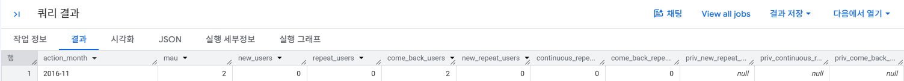
---


### 2-8 방문 종류를 기반으로 성장지수 집계하기 

**핵심 개념**
- 성장지수는 사용자의 상태 변화를 수치화하여 서비스가 성장하고 있는지를 확인하는 지표이다.
- 사용자 상태를 다음 네 가지로 구분한다.
  - `Signup`: 신규 등록 후 사용 시작 → **+1**
  - `Reactivation`: 비활성 사용자가 다시 활성화 → **+1**
  - `Deactivation`: 활성 사용자가 비활성 상태로 전환 → **-1**
  - `Exit`: 서비스 탈퇴 → **-1**
- 계속 사용하는 사용자와 계속 사용하지 않는 사용자는 상태 변화가 없으므로 성장지수에 직접 영향을 주지 않는다.

👉 **한 줄 정리:** **새로 들어오거나 돌아오는 사용자 - 떠나거나 비활성화되는 사용자**를 계산한 값이 성장지수이다.

```sql
-- 성장지수 산출을 위해 사용자 상태를 집계하는 쿼리 
WITH unique_action_log AS (
    -- 같은 날짜 로그를 중복해 세지 않도록 중복 배제하기
    SELECT DISTINCT
        user_id,
        -- BigQuery의 경우 다음과 같이 사용하기
        SUBSTR(stamp, 1, 10) AS action_date
    FROM
        `4th_week.action_log`
),
mst_calendar AS (
    -- 집계하고 싶은 기간을 캘린더 테이블로 만들어두기
    -- generate_series 등으로 동적 생성도 가능 (BigQuery: UNNEST(GENERATE_DATE_ARRAY(...)) 활용 가능)
    SELECT '2016-10-01' AS dt UNION ALL
    SELECT '2016-10-02' UNION ALL
    SELECT '2016-10-03' UNION ALL
    -- ... (필요한 날짜만큼 추가) ...
    SELECT '2016-11-04'
),
target_date_with_user AS (
    -- 사용자 마스터에 캘린더 테이블의 날짜를 target_date로 추가하기
    SELECT
        c.dt AS target_date,
        u.user_id,
        u.register_date,
        u.withdraw_date
    FROM
        `4th_week.mst_users` AS u
    CROSS JOIN
        mst_calendar AS c
),
user_status_log AS (
    SELECT
        u.target_date,
        u.user_id,
        u.register_date,
        u.withdraw_date,
        a.action_date,
        CASE WHEN u.register_date = a.action_date THEN 1 ELSE 0 END AS is_new,
        CASE WHEN u.withdraw_date = a.action_date THEN 1 ELSE 0 END AS is_exit,
        CASE WHEN u.target_date   = a.action_date THEN 1 ELSE 0 END AS is_access,
        LAG(CASE WHEN u.target_date = a.action_date THEN 1 ELSE 0 END)
            OVER(PARTITION BY u.user_id ORDER BY u.target_date) AS was_access
    FROM
        target_date_with_user AS u
    LEFT JOIN
        unique_action_log AS a
    ON
        u.user_id = a.user_id
        AND u.target_date = a.action_date
    WHERE
        -- 집계 기간을 등록일 이후로만 필터링하기
        u.register_date <= u.target_date
        -- 탈퇴 날짜가 포함되어 있으면, 집계 기간을 탈퇴 날짜 이전만으로 필터링하기
        AND (
            u.withdraw_date IS NULL
            OR u.target_date <= u.withdraw_date
        )
)
SELECT
    target_date,
    user_id,
    is_new,
    is_exit,
    is_access,
    was_access
FROM
    user_status_log;
```
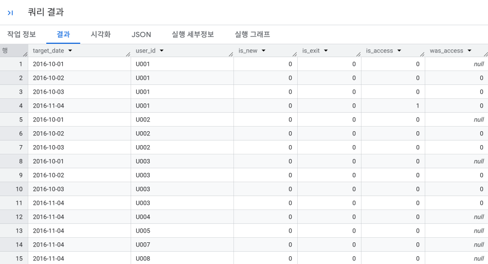

```sql
-- 매일의 성장지수를 계산하는 쿼리
WITH unique_action_log AS (
    SELECT DISTINCT
        user_id,
        SUBSTR(stamp, 1, 10) AS action_date
    FROM
        `4th_week.action_log`
),
mst_calendar AS (
    SELECT '2016-10-01' AS dt UNION ALL
    SELECT '2016-10-02' UNION ALL
    SELECT '2016-10-03' UNION ALL
    SELECT '2016-11-04'
),
target_date_with_user AS (
    SELECT
        c.dt AS target_date,
        u.user_id,
        u.register_date,
        u.withdraw_date
    FROM
        `4th_week.mst_users` AS u
    CROSS JOIN
        mst_calendar AS c
),
user_status_log AS (
    SELECT
        u.target_date,
        u.user_id,
        u.register_date,
        u.withdraw_date,
        a.action_date,
        CASE WHEN u.register_date = a.action_date THEN 1 ELSE 0 END AS is_new,
        CASE WHEN u.withdraw_date = a.action_date THEN 1 ELSE 0 END AS is_exit,
        CASE WHEN u.target_date   = a.action_date THEN 1 ELSE 0 END AS is_access,
        LAG(CASE WHEN u.target_date = a.action_date THEN 1 ELSE 0 END)
            OVER(PARTITION BY u.user_id ORDER BY u.target_date) AS was_access
    FROM
        target_date_with_user AS u
    LEFT JOIN
        unique_action_log AS a
    ON
        u.user_id = a.user_id
        AND u.target_date = a.action_date
    WHERE
        u.register_date <= u.target_date
        AND (
            u.withdraw_date IS NULL
            OR u.target_date <= u.withdraw_date
        )
),
user_growth_index AS (
    SELECT
        *,
        CASE
            -- 어떤 날짜에 신규 등록 또는 탈퇴한 경우 signup 또는 exit으로 판정하기
            WHEN is_new + is_exit = 1 THEN
                CASE
                    WHEN is_new = 1 THEN 'signup'
                    WHEN is_exit = 1 THEN 'exit'
                END
            -- 신규 등록과 탈퇴가 아닌 경우 reactivation 또는 deactivation으로 판정하기
            -- 이때 reactivation, deactivation의 정의에 맞지 않는 경우는 NULL로 지정
            WHEN is_new + is_exit = 0 THEN
                CASE
                    WHEN was_access = 0 AND is_access = 1 THEN 'reactivation'
                    WHEN was_access = 1 AND is_access = 0 THEN 'deactivation'
                END
            -- 어떤 날짜에 신규 등록과 탈퇴를 함께 했다면(is_new + is_exit = 2) NULL로 지정
        END AS growth_index
    FROM
        user_status_log
)
SELECT
    target_date,
    SUM(CASE growth_index WHEN 'signup' THEN 1 ELSE 0 END) AS signup,
    SUM(CASE growth_index WHEN 'reactivation' THEN 1 ELSE 0 END) AS reactivation,
    SUM(CASE growth_index WHEN 'deactivation' THEN -1 ELSE 0 END) AS deactivation,
    SUM(CASE growth_index WHEN 'exit' THEN -1 ELSE 0 END) AS exit,
    -- 성장지수 정의에 맞게 계산하기
    SUM(
        CASE growth_index
            WHEN 'signup'       THEN 1
            WHEN 'reactivation' THEN 1
            WHEN 'deactivation' THEN -1
            WHEN 'exit'         THEN -1
            ELSE 0
        END
    ) AS growth_index
FROM
    user_growth_index
GROUP BY
    target_date
ORDER BY
    target_date;
```
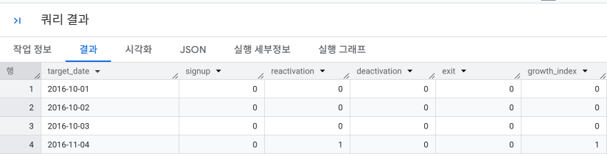
---

### 2-9 지표 개선 방법 익히기 

**핵심 개념**
- 사용자를 분석하는 것 자체가 목적이 아니라, **서비스 지표를 실제로 개선하는 것**이 목적이다.
- 교재에서는 다음 순서로 분석하는 방법을 제안한다.
  1. 개선하고 싶은 지표를 정한다.
  2. 지표에 영향을 줄 것으로 예상되는 사용자 행동을 가설로 세운다.
  3. 행동 여부/횟수에 따라 사용자를 나누고 목표 지표의 차이를 비교한다.
- 성별·연령 같은 고정 속성보다 실제로 바꿀 수 있는 **행동(Action)**을 찾는 것이 개선 관점에서 더 중요하다.

👉 **한 줄 정리:** `목표 지표 설정 → 행동 가설 설정 → SQL로 검증 → 개선 액션 결정`의 흐름으로 분석한다.

---

## 3. 시계열에 따른 사용자의 개별적인 행동 분석하기 

### 3-1 사용자의 액션 간격 집계하기

**핵심 개념**
- 사용자 행동을 분석할 때는 **무엇을 했는가**뿐 아니라 **다음 행동까지 얼마나 걸렸는가**도 중요하다.
- 이러한 시간 차이를 **리드 타임(Lead Time)**이라고 한다.
- 날짜가 저장된 위치에 따라 계산 방법이 달라진다.
  1. 같은 레코드의 두 날짜 → 날짜끼리 차이 계산
  2. 서로 다른 테이블의 날짜 → `JOIN` 후 차이 계산
  3. 같은 테이블의 이전/다음 기록 → `LAG()` 또는 `LEAD()` 사용

👉 **한 줄 정리:** 액션 사이의 **시간 간격을 수치화**하면 사용자가 어디에서 오래 머무는지 알 수 있다.

```sql
-- 신청일과 숙박일의 리드 타임을 계산하는 쿼리
WITH reservations AS (
    -- BigQuery의 경우 VALUES 구문 대신 UNION ALL을 사용하여 일시 테이블 생성
    SELECT 1 AS reservation_id, DATE '2016-09-01' AS register_date, DATE '2016-10-01' AS visit_date, 3 AS days UNION ALL
    SELECT 2, DATE '2016-09-20', DATE '2016-10-01', 2 UNION ALL
    SELECT 3, DATE '2016-09-30', DATE '2016-11-20', 2 UNION ALL
    SELECT 4, DATE '2016-10-01', DATE '2017-01-03', 2 UNION ALL
    SELECT 5, DATE '2016-11-01', DATE '2016-12-28', 3
)
SELECT
    reservation_id,
    register_date,
    visit_date,
    -- BigQuery의 경우 DATE_DIFF 함수 사용하기
    DATE_DIFF(DATE(TIMESTAMP(visit_date)), DATE(TIMESTAMP(register_date)), DAY) AS lead_time
FROM
    reservations;
```
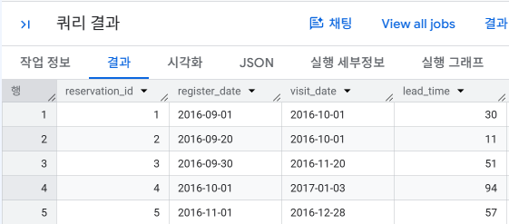

```sql
-- 각 단계에서의 리드 타임과 토탈 리드 타임을 계산하는 쿼리
WITH requests AS (
    -- BigQuery의 경우 UNION ALL 등으로 대체 가능
    SELECT 'U001' AS user_id, '1' AS product_id, DATE '2016-09-01' AS request_date UNION ALL
    SELECT 'U001', '2', DATE '2016-09-20' UNION ALL
    SELECT 'U002', '3', DATE '2016-09-30' UNION ALL
    SELECT 'U003', '4', DATE '2016-10-01' UNION ALL
    SELECT 'U004', '5', DATE '2016-11-01'
),
estimates AS (
    SELECT 'U001' AS user_id, '2' AS product_id, DATE '2016-09-21' AS estimate_date UNION ALL
    SELECT 'U002', '3', DATE '2016-10-15' UNION ALL
    SELECT 'U003', '4', DATE '2016-10-15' UNION ALL
    SELECT 'U004', '5', DATE '2016-12-01'
),
orders AS (
    SELECT 'U001' AS user_id, '2' AS product_id, DATE '2016-10-01' AS order_date UNION ALL
    SELECT 'U004', '5', DATE '2016-12-05'
)
SELECT
    r.user_id,
    r.product_id,
    -- BigQuery의 경우 date_diff 함수 사용하기
    DATE_DIFF(DATE(TIMESTAMP(e.estimate_date)), DATE(TIMESTAMP(r.request_date)), DAY) AS estimate_lead_time,
    DATE_DIFF(DATE(TIMESTAMP(o.order_date)), DATE(TIMESTAMP(e.estimate_date)), DAY) AS order_lead_time,
    DATE_DIFF(DATE(TIMESTAMP(o.order_date)), DATE(TIMESTAMP(r.request_date)), DAY) AS total_lead_time
FROM
    requests AS r
LEFT OUTER JOIN
    estimates AS e
ON
    r.user_id = e.user_id
    AND r.product_id = e.product_id
LEFT OUTER JOIN
    orders AS o
ON
    r.user_id = o.user_id
    AND r.product_id = o.product_id;
```
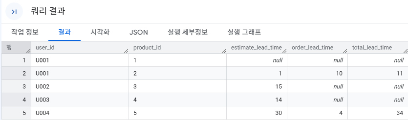

```sql
-- 이전 구매일로부터의 일수를 계산하는 쿼리
WITH purchase_log AS (
    -- BigQuery의 경우 UNION ALL 등으로 대체 가능
    SELECT 'U001' AS user_id, '1' AS product_id, '2016-09-01' AS purchase_date UNION ALL
    SELECT 'U001', '2', '2016-09-20' UNION ALL
    SELECT 'U002', '3', '2016-09-30' UNION ALL
    SELECT 'U001', '4', '2016-10-01' UNION ALL
    SELECT 'U002', '5', '2016-11-01'
)
SELECT
    user_id,
    purchase_date,
    -- BigQuery의 경우 date_diff 함수 사용하기
    DATE_DIFF(
        DATE(TIMESTAMP(purchase_date)),
        LAG(DATE(TIMESTAMP(purchase_date))) OVER(PARTITION BY user_id ORDER BY purchase_date),
        DAY
    ) AS lead_time
FROM
    purchase_log;
```
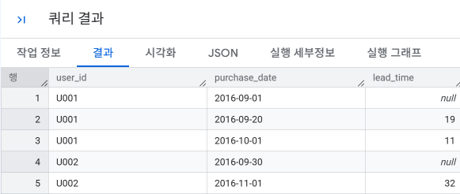

---

### 3-2 카트 추가 후에 구매했는지 파악하기 

**핵심 개념**
- 카트에 상품을 넣고 구매하지 않고 떠나는 것을 **카트 탈락(Cart Abandonment)**이라고 한다.
- 먼저 쉼표로 저장된 여러 상품 ID를 한 상품당 한 행으로 펼친다.
- 사용자와 상품별로 `add_cart` 시각과 `purchase` 시각을 구한 뒤 둘의 차이(lead time)를 계산한다.
- 교재에서는 **1시간 / 6시간 / 24시간 / 48시간 이내 구매율**과 **48시간 이후 미구매율**을 비교한다.

👉 **한 줄 정리:** 카트에 담은 뒤 **얼마나 빨리 구매로 전환되는지**를 시간대별로 측정한다.

```sql
-- 상품들이 카트에 추가된 시각과 구매된 시각을 산출
WITH row_action_log AS (
    SELECT
        dt,
        user_id,
        action,
        product_id,
        stamp
    FROM
        `4th_week.action_log`
    -- 쉼표로 구분된 product_id 리스트 전개하기 (BigQuery의 경우 CROSS JOIN unnest 사용)
    CROSS JOIN UNNEST(SPLIT(products, ',')) AS product_id
),
action_time_stats AS (
    -- 사용자와 상품 조합의 카드 추가 시간과 구매 시간 추출하기
    SELECT
        user_id,
        product_id,
        MIN(CASE action WHEN 'add_cart' THEN dt END) AS dt,
        MIN(CASE action WHEN 'add_cart' THEN stamp END) AS add_cart_time,
        MIN(CASE action WHEN 'purchase' THEN stamp END) AS purchase_time,
        -- BigQuery의 경우 unix_seconds 함수로 초 단위 UNIX 시간 추출 후 차이 구하기
        MIN(CASE action WHEN 'purchase' THEN UNIX_SECONDS(TIMESTAMP(stamp)) END) 
        - MIN(CASE action WHEN 'add_cart' THEN UNIX_SECONDS(TIMESTAMP(stamp)) END) AS lead_time
    FROM
        row_action_log
    GROUP BY
        user_id, product_id
)
SELECT
    user_id,
    product_id,
    add_cart_time,
    purchase_time,
    lead_time
FROM
    action_time_stats
ORDER BY
    user_id, product_id;
```
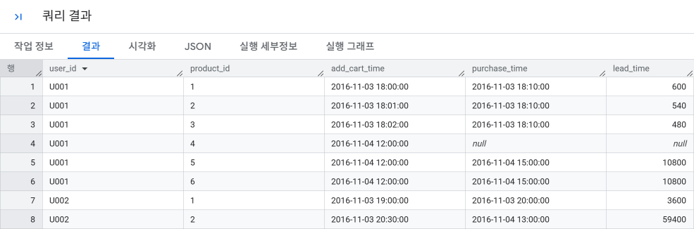

```sql
-- 카트 추가 후 n시간 이내에 구매된 상품 수와 구매율을 집계하는 쿼리
WITH row_action_log AS (
    SELECT
        dt,
        user_id,
        action,
        product_id,
        stamp
    FROM
        `4th_week.action_log`
    CROSS JOIN UNNEST(SPLIT(products, ',')) AS product_id
),
action_time_stats AS (
    SELECT
        user_id,
        product_id,
        MIN(CASE action WHEN 'add_cart' THEN dt END) AS dt,
        MIN(CASE action WHEN 'add_cart' THEN stamp END) AS add_cart_time,
        MIN(CASE action WHEN 'purchase' THEN stamp END) AS purchase_time,
        MIN(CASE action WHEN 'purchase' THEN UNIX_SECONDS(TIMESTAMP(stamp)) END) 
        - MIN(CASE action WHEN 'add_cart' THEN UNIX_SECONDS(TIMESTAMP(stamp)) END) AS lead_time
    FROM
        row_action_log
    GROUP BY
        user_id, product_id
),
purchase_lead_time_flag AS (
    SELECT
        user_id,
        product_id,
        dt,
        CASE WHEN lead_time <= 1 * 60 * 60 THEN 1 ELSE 0 END AS purchase_1_hour,
        CASE WHEN lead_time <= 6 * 60 * 60 THEN 1 ELSE 0 END AS purchase_6_hours,
        CASE WHEN lead_time <= 24 * 60 * 60 THEN 1 ELSE 0 END AS purchase_24_hours,
        CASE WHEN lead_time <= 48 * 60 * 60 THEN 1 ELSE 0 END AS purchase_48_hours,
        CASE 
            WHEN lead_time IS NULL OR NOT (lead_time <= 48 * 60 * 60) THEN 1 
            ELSE 0 
        END AS not_purchase
    FROM
        action_time_stats
)
SELECT
    dt,
    COUNT(*) AS add_cart,
    SUM(purchase_1_hour) AS purchase_1_hour,
    AVG(purchase_1_hour) AS purchase_1_hour_rate,
    SUM(purchase_6_hours) AS purchase_6_hours,
    AVG(purchase_6_hours) AS purchase_6_hours_rate,
    SUM(purchase_24_hours) AS purchase_24_hours,
    AVG(purchase_24_hours) AS purchase_24_hours_rate,
    SUM(purchase_48_hours) AS purchase_48_hours,
    AVG(purchase_48_hours) AS purchase_48_hours_rate,
    SUM(not_purchase) AS not_purchase,
    AVG(not_purchase) AS not_purchase_rate
FROM
    purchase_lead_time_flag
GROUP BY
    dt
ORDER BY
    dt;
```
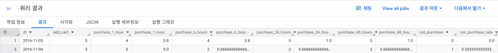

---

### 3-3 등록으로부터의 매출을 날짜별로 집계하기 

**핵심 개념**
- 사용자를 획득하기 위해 사용한 광고비가 적절한지 판단하려면 등록 이후 **시간 경과에 따른 매출**을 볼 필요가 있다.
- 교재에서는 등록일을 기준으로 **30일 / 45일 / 60일 누적 매출**을 계산한다.
- 전체 사용자 수를 분모로 하면 **ARPU(Average Revenue Per User)**, 실제 과금 사용자 수를 분모로 하면 **ARPPU(Average Revenue Per Paid User)**가 된다.
- 더 장기적으로 고객이 만들어내는 가치를 평가하는 지표가 **LTV(Life Time Value)**이다.

👉 **한 줄 정리:** 사용자 획득 비용과 비교하려면 **가입 후 시간이 지날수록 1명이 얼마나 매출을 만드는지**를 추적해야 한다.

```sql
-- 사용자들의 등록일로부터 경과한 일수별 매출을 계산하는 쿼리
WITH index_intervals AS (
    -- Hive, Redshift, BigQuery, SparkSQL의 경우 UNION ALL 등으로 대체 가능
    SELECT '30 day sales amount' AS index_name, 0 AS interval_begin_date, 30 AS interval_end_date UNION ALL
    SELECT '45 day sales amount', 0, 45 UNION ALL
    SELECT '60 day sales amount', 0, 60
),
mst_users_with_base_date AS (
    SELECT
        user_id,
        -- 기준일로 등록일 사용하기
        register_date AS base_date
    FROM
        `4th_week.mst_users`
),
purchase_log_with_index_date AS (
    SELECT
        u.user_id,
        u.base_date,
        -- BigQuery의 경우 한 번 타임스탬프 자료형으로 변환하고 날짜 자료형으로 변환하기
        DATE(TIMESTAMP(p.stamp)) AS action_date,
        MAX(DATE(TIMESTAMP(p.stamp))) OVER() AS latest_date,
        SUBSTR(CAST(u.base_date AS STRING), 1, 7) AS month,
        i.index_name,
        
        -- BigQuery의 경우 다음과 같이 사용하기
        -- 지표 대상 기간의 시작일과 종료일 계산하기
        DATE_ADD(CAST(u.base_date AS DATE), INTERVAL i.interval_begin_date DAY) AS index_begin_date,
        DATE_ADD(CAST(u.base_date AS DATE), INTERVAL i.interval_end_date DAY) AS index_end_date,
        
        p.amount
    FROM
        mst_users_with_base_date AS u
    LEFT OUTER JOIN
        `4th_week.action_log` AS p
    ON
        u.user_id = p.user_id
        AND p.action = 'purchase'
    CROSS JOIN
        index_intervals AS i
)
SELECT *
FROM
    purchase_log_with_index_date;
```
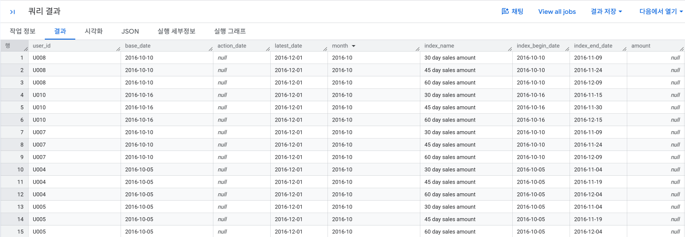

```sql
-- 월별 등록자수와 경과일수별 매출을 집계하는 쿼리
WITH index_intervals AS (
    SELECT '30 day sales amount' AS index_name, 0 AS interval_begin_date, 30 AS interval_end_date UNION ALL
    SELECT '45 day sales amount', 0, 45 UNION ALL
    SELECT '60 day sales amount', 0, 60
),
mst_users_with_base_date AS (
    SELECT
        user_id,
        register_date AS base_date
    FROM
        `4th_week.mst_users`
),
purchase_log_with_index_date AS (
    SELECT
        u.user_id,
        u.base_date,
        DATE(TIMESTAMP(p.stamp)) AS action_date,
        MAX(DATE(TIMESTAMP(p.stamp))) OVER() AS latest_date,
        SUBSTR(CAST(u.base_date AS STRING), 1, 7) AS month,
        i.index_name,
        DATE_ADD(CAST(u.base_date AS DATE), INTERVAL i.interval_begin_date DAY) AS index_begin_date,
        DATE_ADD(CAST(u.base_date AS DATE), INTERVAL i.interval_end_date DAY) AS index_end_date,
        p.amount
    FROM
        mst_users_with_base_date AS u
    LEFT OUTER JOIN
        `4th_week.action_log` AS p
    ON
        u.user_id = p.user_id
        AND p.action = 'purchase'
    CROSS JOIN
        index_intervals AS i
),
user_purchase_amount AS (
    -- 사용자별로 지표 대상 기간 내 구매 금액 합계 구하기
    SELECT
        user_id,
        month,
        index_name,
        SUM(
            -- 1. 지표의 대상 기간 종료일이 로그의 최신 날짜 이전인지 확인
            CASE WHEN index_end_date <= latest_date THEN
                -- 2. 대상 기간 내에 구매한 경우 금액(amount), 아니면 0 지정
                CASE 
                    WHEN action_date BETWEEN index_begin_date AND index_end_date THEN amount 
                    ELSE 0 
                END
            END
        ) AS index_date_amount
    FROM
        purchase_log_with_index_date
    GROUP BY
        user_id, month, index_name, index_begin_date, index_end_date
)
SELECT
    month,
    -- 등록자수 세기 (대상 기간 종료일이 최신 로그 날짜 이전인 경우만)
    COUNT(index_date_amount) AS users,
    index_name,
    -- 지표의 대상 기간 동안 구매한 사용자 수
    COUNT(CASE WHEN index_date_amount > 0 THEN user_id END) AS purchase_uu,
    -- 지표의 대상 기간 동안의 합계 매출
    SUM(index_date_amount) AS total_amount,
    -- 등록자별 평균 매출
    AVG(index_date_amount) AS avg_amount
FROM
    user_purchase_amount
GROUP BY
    month, index_name
ORDER BY
    month, index_name;
```
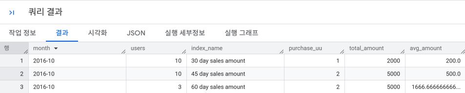

---

### 🎉 수고하셨습니다.
