# SQL_MASTER 5주차 정규과제

📌SQL MASTER 정규과제는 매주 정해진 분량의 『*데이터 분석을 위한 SQL 레시피*』 를 읽고 학습하는 것입니다. 이번 주는 아래의 **SQL_MASTER_5th_TIL**에 나열된 분량을 읽고 공부하시면 됩니다.

아래 실습을 수행하며 학습 내용을 직접 적용해보세요. 단순히 결과를 재현하는 것이 아니라, SQL을 직접 작성하는 과정에서 개념을 스스로 정리하는 것이 중요합니다.

필요한 경우 교재와 추가 자료를 참고하여 이해를 보완하시기 바랍니다.

## SQL_MASTER_5th_TIL

### 6장 웹사이트에서의 행동을 파악하는 데이터 추출하기
#### 1. 사이트 전체의 특징/경향 찾기
#### 2. 사이트 내의 사용자 행동 파악하기
#### 3. 입력 양식 최적화하기 


## Study Schedule

| 주차  | 공부 범위     | 완료 여부 |
| ----- | ------------- | --------- |
| 1주차 | p.52~136   | ✅         |
| 2주차 | p.138~184  | ✅         |
| 3주차 | p.186~232 | ✅         |
| 4주차 | p.233~321 | ✅         |
| 5주차 | p.324~406 | ✅         |
| 6주차 | p.408~464 | 🍽️         |
| 7주차 | p.466~566 | 🍽️         |

<br>

<!-- 여기까진 그대로 둬 주세요-->


# 실습

## 0. 실습 규칙

1. 샘플 데이터 생성 코드는 **08_SQL_MASTER_Template/src** 경로에 장별로 정리되어 있습니다.
2. 아래 목차에 맞춰 해당 코드를 실행하여 샘플 데이터를 생성한 후, 각 장에서 요구하는 쿼리를 직접 작성해보시기 바랍니다.
3. 작성한 쿼리의 **실행 결과 화면도 함께 제출**해 주세요.
4. 단순히 교재의 예시 코드를 그대로 작성하는 것이 아니라, **제시된 로직을 충분히 이해한 뒤 교재를 보지 않고 스스로 쿼리를 구성**해보는 것을 권장합니다.
5. 교재 예시는 PostgreSQL, Hive, BigQuery 등 다양한 DBMS 기준으로 제시되어 있기 때문에, **MySQL이 아닌 다른 SQL 환경을 사용하여 실습을 진행해도 무방합니다.**
6. 다만, 사용 중인 DBMS에 맞는 문법으로 적절히 변환하여 작성하시기 바랍니다.

## 1. 사이트 전체의 특징/경향 찾기

### 1-1 날짜별 방문자 수 / 방문 횟수 / 페이지 뷰 집계하기

- 웹사이트에서는 방문자 수, 방문 횟수, 페이지 뷰 집계가 기본.

| 지표 | 집계할 내용 |
| :--- | :--- |
| **방문자 수** | 브라우저를 꺼도 사라지지 않는 쿠키의 유니크 수<br>※한 명의 사용자가 1일에 3회 사이트를 방문해도 1회로 집계 |
| **방문 횟수** | 브라우저를 껐을 때 사라지는 쿠키의 유니크 수<br>※한 명의 사용자가 1일에 3회 사이트를 방문하면 3회로 집계 |
| **페이지 뷰** | 페이지를 출력한 로그의 줄 수|
```sql
-- 날짜별 접근 데이터를 집계하는 쿼리
SELECT
  SUBSTR(stamp, 1, 10) AS dt,
  COUNT(DISTINCT long_session) AS access_users,     -- 브라우저를 꺼도 사라지지 않는 쿠키의 유니크 수
  COUNT(DISTINCT short_session) AS access_count,    -- 브라우저를 껐을 때 사라지는 쿠키의 유니크 수
  COUNT(*) AS page_view,                            -- 모든 접근 경로들의 수
  1.0 * COUNT(*) / NULLIF(COUNT(DISTINCT long_session), 0) AS pv_per_user
FROM
  `5th_week.access_log`
GROUP BY dt
ORDER BY dt;
```
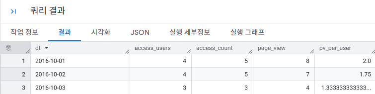

### 1-2 페이지별 쿠키 / 방문 횟수 / 페이지 뷰 집계하기

- 우리는 URL을 집계하여 각 페이지의 방문 횟수나 페이지 뷰 등을 집계함
- 그러나 한 페이지를 가리키는 여러 URL이 (매개변수 등으로 인해) 존재하므로, 단순한 방법으로는 페이지 뷰를 제대로 구할 수 없음 → URL에서 정보 추출 필요

#### 1-2-1 URL 별로 집계하기
```sql
-- URL 별로 집계하는 쿼리
SELECT
  url,                      
  COUNT(DISTINCT short_session) AS access_count,
  COUNT(DISTINCT long_session) AS access_users, 
  COUNT(*) AS page_view                         
FROM
  `5th_week.access_log`                         
GROUP BY url
ORDER BY url;
```
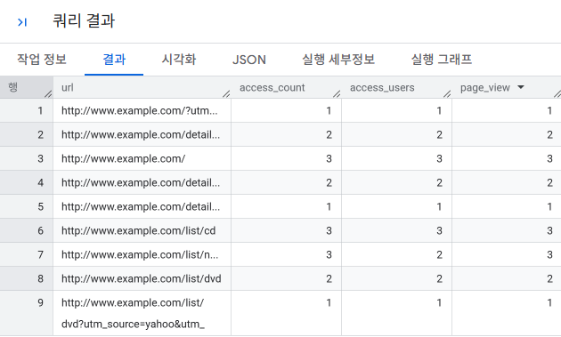

#### 1-2-2 경로별로 집계하기
- URL을 하나하나 집계하기에는, 각각은 너무 세분화되어 있음.
- 요청 매개변수를 제거해 집계의 밀도를 높이기

```sql
-- 경로별로 집계하는 쿼리
WITH
access_log_with_path AS (
  SELECT
    *,
    -- 정규표현식 대신 NET.HOST와 SPLIT 조합으로 경로만 직관적으로 잘라내기
    SPLIT(SPLIT(url, NET.HOST(url))[SAFE_ORDINAL(2)], '?')[SAFE_ORDINAL(1)] AS url_path
    -- NET.HOST(url): URL에서 도메인([www.example.com](https://www.example.com))만 분리
    -- SPLIT(url, 도메인)[SAFE_ORDINAL(2)]: 원본 URL을 도메인을 기준으로 쪼갠 뒤, 2번째 조각인 도메인 뒤쪽 텍스트(/list/dvd?utm=...)만 추출
    -- SPLIT(..., '?')[SAFE_ORDINAL(1)]: 가져온 텍스트를 다시 물음표(?) 기준으로 쪼개어, 파라미터가 시작되기 전인 순수 경로(/list/dvd)만 1번째 조각으로 추출
  FROM
    `5th_week.access_log`
)
SELECT
  url_path,
  COUNT(DISTINCT short_session) AS access_count,
  COUNT(DISTINCT long_session) AS access_users,
  COUNT(*) AS page_view
FROM
  access_log_with_path
GROUP BY
  url_path
ORDER BY
  url_path
;
```
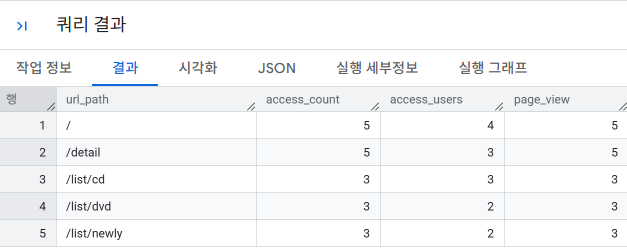

#### 1-2-3 URL에 의미를 부여해서 집계하기
- 각 URL마다 의미가 있기에, 공통으로 처리할 수 있거나 특별하게 처리해야 하는 경우가 존재한다.

```sql
-- URL에 의미를 부여해서 집계하는 쿼리
WITH access_log_with_path AS (
  SELECT
    *,
    SPLIT(SPLIT(url, NET.HOST(url))[SAFE_ORDINAL(2)], '?')[SAFE_ORDINAL(1)] AS url_path
  FROM
    `5th_week.access_log`
)
, access_log_with_split_path AS (
  SELECT
    *,
    SPLIT(url_path, '/')[SAFE_ORDINAL(2)] AS path1,
    SPLIT(url_path, '/')[SAFE_ORDINAL(3)] AS path2
  FROM
    access_log_with_path
)
, access_log_with_page_name AS (
  SELECT
    *,
    CASE                                    -- 조건에 맞게 페이지 이름 붙이기
      WHEN path1 = 'list' THEN
        CASE
          WHEN path2 = 'newly' THEN 'newly_list'
          ELSE 'category_list'
        END
      ELSE url_path
    END AS page_name
  FROM
    access_log_with_split_path
)
SELECT
  page_name,
  COUNT(DISTINCT short_session) AS access_count,
  COUNT(DISTINCT long_session) AS access_users,
  COUNT(*) AS page_view
FROM
  access_log_with_page_name
GROUP BY
  page_name
ORDER BY
  page_name;
```
### 1-3 유입원별로 방문 횟수 또는 CVR 집계하기
- 웹사이트에 접근하는 방법에는 다양한 방법 존재
- 어떤 수단이 웹사이트로의 유입을 늘리는지 시각적으로 표현하는 목적으로도 사용 가능

#### 1-3-1 유입원 판정
- 직전 페이지의 URL을 레퍼러(referer)이라고 하며, 이러한 레퍼러 등을 활용하면 다음과 같은 판정을 할 수 있다.
    - URL 매개변수 기반 판정
    - 레퍼러 도메인과 랜딩 페이지를 이용한 판정<br>

`URL 매개변수 기반 판정`
- URL에 광고 계측 전용 매개변수를 설정(utm 파라미터 등)
- URL 매개변수를 사용하면 다양한 유입 계측이 가능

| URL 생성 도구 항목 | URL 매개변수 | 용도 |
| :--- | :--- | :--- |
| Campaign Source(필수) | `utm_source` | The referrer<br>사이트 이름 또는 매체의 명칭 |
| Campaign Medium | `utm_medium` | Marketing medium<br>유입 분류 |
| Campaign Name | `utm_campaign` | Product, promo code, or slogan<br>캠페인 페이지의 이름 |
| Campaign Term | `utm_term` | Identify the paid keywords<br>유입 키워드 |
| Campaign Content | `utm_content` | Use to differentiate ads<br>광고를 분류하는 식별자 |

---
<br>

`Referer 도메인과 랜딩 페이지를 사용한 판정`
- 검색 엔진, 개인 블로그와 같이 광고 담당자가 조작할 수 없는 영역은 레퍼러를 사용해야만 유입 경로 파악 가능

#### 1-3-2 유입원별 방문 횟수 집계하기

| 유입 경로 | 판정 방법 | 집계 방법 |
| :--- | :--- | :--- |
| **검색 연동 광고**, **제휴 마케팅 사이트**, **AD 네트워크**  | URL 생성 도구로 만들어진 매개변수 | URL에 `utm_source`, `utm_medium`이 있을 경우. 이러한 두 개의 문자열을 결합해서 집계 |
| **검색 엔진** | 도메인 | 레퍼러의 도메인이 다음과 같은 검색 엔진일 때<br>• `search.naver.com`<br>• `www.google.co.kr` |
| **소셜 미디어** | 도메인 | 레퍼러의 도메인이 다음과 같은 소셜 미디어일 때<br>• `twitter.com`<br>• `www.facebook.com` |
| **기타 사이트** | 도메인 | 위에 언급한 도메인이 아닐 경우 `other`라는 이름으로 집계 |
```sql
-- 유입원별로 방문 횟수를 집계하는 쿼리
WITH access_log_with_parse_info AS (
  SELECT
    *,
    SPLIT(SPLIT(url, '://')[SAFE_ORDINAL(2)], '/')[SAFE_ORDINAL(1)] AS url_domain,
    SPLIT(SPLIT(url, 'utm_source=')[SAFE_ORDINAL(2)], '&')[SAFE_ORDINAL(1)] AS url_utm_source,
    SPLIT(SPLIT(url, 'utm_medium=')[SAFE_ORDINAL(2)], '&')[SAFE_ORDINAL(1)] AS url_utm_medium,
    SPLIT(SPLIT(referrer, '://')[SAFE_ORDINAL(2)], '/')[SAFE_ORDINAL(1)] AS referrer_domain
  FROM
    `5th_week.access_log`
)
, access_log_with_via_info AS (
  SELECT
    *,
    ROW_NUMBER() OVER(ORDER BY stamp) AS log_id,
    CASE
      WHEN IFNULL(url_utm_source, '') <> '' AND IFNULL(url_utm_medium, '') <> ''
        THEN CONCAT(url_utm_source, '-', url_utm_medium)
      WHEN referrer_domain IN ('search.yahoo.co.jp', 'www.google.co.jp') THEN 'search'
      WHEN referrer_domain IN ('twitter.com', 'www.facebook.com') THEN 'social'
      ELSE 'other'
    END AS via
  FROM
    access_log_with_parse_info
  WHERE
    COALESCE(referrer_domain, '') NOT IN ('', url_domain)
)
SELECT
  via,
  COUNT(1) AS access_count
FROM
  access_log_with_via_info
GROUP BY
  via
ORDER BY
  access_count DESC;
```

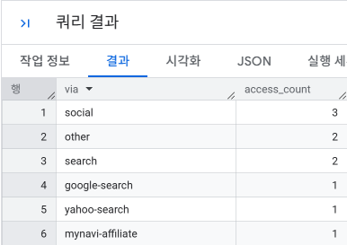

#### 1-3-2 유입원별 방문 횟수 집계하기
 - CVR: 각 방문에서 구매한 비율
 - 어떠한 유입 경로가 가장 효율적인지 파악할 수 있다.

 ```sql
 WITH access_log_with_parse_info AS (
  SELECT
    *,
    SPLIT(SPLIT(url, '://')[SAFE_ORDINAL(2)], '/')[SAFE_ORDINAL(1)] AS url_domain,
    SPLIT(SPLIT(url, 'utm_source=')[SAFE_ORDINAL(2)], '&')[SAFE_ORDINAL(1)] AS url_utm_source,
    SPLIT(SPLIT(url, 'utm_medium=')[SAFE_ORDINAL(2)], '&')[SAFE_ORDINAL(1)] AS url_utm_medium,
    SPLIT(SPLIT(referrer, '://')[SAFE_ORDINAL(2)], '/')[SAFE_ORDINAL(1)] AS referrer_domain
  FROM
    `5th_week.access_log`
)
, access_log_with_via_info AS (
  SELECT
    *,
    ROW_NUMBER() OVER(ORDER BY stamp) AS log_id,
    CASE
      WHEN IFNULL(url_utm_source, '') <> '' AND IFNULL(url_utm_medium, '') <> ''
        THEN CONCAT(url_utm_source, '-', url_utm_medium)
      WHEN referrer_domain IN ('search.yahoo.co.jp', 'www.google.co.jp') THEN 'search'
      WHEN referrer_domain IN ('twitter.com', 'www.facebook.com') THEN 'social'
      ELSE 'other'
    END AS via
  FROM
    access_log_with_parse_info
  WHERE
    COALESCE(referrer_domain, '') NOT IN ('', url_domain)
)
, access_log_with_purchase_amount AS (
  SELECT
    a.log_id,
    a.via,
    SUM(
      CASE
        WHEN DATE(TIMESTAMP(p.stamp)) 
             BETWEEN DATE(TIMESTAMP(a.stamp)) 
                 AND DATE_ADD(DATE(TIMESTAMP(a.stamp)), INTERVAL 1 DAY)
        THEN amount
      END
    ) AS amount
  FROM
    access_log_with_via_info AS a
  LEFT OUTER JOIN
    `5th_week.purchase_log` AS p
    ON a.long_session = p.long_session
  GROUP BY
    a.log_id, a.via
)
SELECT
  via,
  COUNT(1) AS via_count,
  COUNT(amount) AS conversions,
  100.0 * COUNT(amount) / COUNT(1) AS cvr,
  IFNULL(SUM(amount), 0) AS amount,
  IFNULL(SUM(amount), 0) / COUNT(1) AS avg_amount
FROM
  access_log_with_purchase_amount
GROUP BY
  via
ORDER BY
  cvr DESC;
 ```
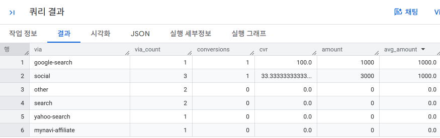

### 1-4 접근 요일,시간대 파악하기
- 사용자가 많이 접근하는 요일과 시간대는 서비스에 따라 특징이 있기 때문에, 외부 노출이 더 효과적인 시기가 존재한다.
- 이러한 리포트를 만드는 과정
    1. 24시간에서 추출하고자 하는 단위를 결정
    2. 접근한 시간을 해당 단위로 집계하고, 요일과 함께 방문자 수를 집계
- Bigquery의 경우 `EXTRACT(dayofweek from timestamp)`로 요일 번호 추출

```sql
-- 요일/시간대별 방문자 수를 집계하는 쿼리
WITH parsed_data AS (
  SELECT
    SUBSTR(stamp, 12, 8) AS index_time,
    EXTRACT(DAYOFWEEK FROM TIMESTAMP(stamp)) AS day_of_week
  FROM
    `5th_week.purchase_log`
)
SELECT
  index_time,
  COUNT(CASE WHEN day_of_week = 1 THEN 1 END) AS sun,
  COUNT(CASE WHEN day_of_week = 2 THEN 1 END) AS mon,
  COUNT(CASE WHEN day_of_week = 3 THEN 1 END) AS tue,
  COUNT(CASE WHEN day_of_week = 4 THEN 1 END) AS wed,
  COUNT(CASE WHEN day_of_week = 5 THEN 1 END) AS thu,
  COUNT(CASE WHEN day_of_week = 6 THEN 1 END) AS fri,
  COUNT(CASE WHEN day_of_week = 7 THEN 1 END) AS sat
FROM
  parsed_data
GROUP BY
  index_time
ORDER BY
  index_time;
  ```

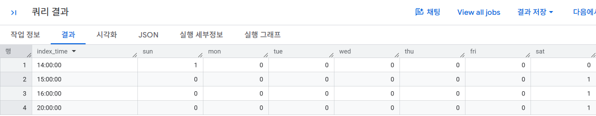

**디바이스에 따라서 하용자의 행동이 다를 수 있다**

## 2. 사이트 내의 사용자 행동 파악하기 

### 2-1 입구 페이지와 출구 페이지 파악하기

- 웹사이트에서의 특징적인 지표: 방문자 수, 방문 횟수, 직귀율, 이탈률 등 <br>
- 웹사이트에서의 리포트: 폴아웃 리포트, 사용자 흐름 등
- 입구 페이지: 사이트에 방문했을 떄 처음 접근한 페이지: 랜딩 페이지
- 출구 페이지: 마지막으로 접근한 페이지/이탈한 페이지: 이탈 페이지

#### 2-1-1 입구 페이지와 출구 페이지 집계하기
```sql
-- 각 세션의 입구 페이지와 출구 페이지 경로를 추출하는 쿼리
SELECT
    session,
    path,
    stamp,
    FIRST_VALUE(path)
        over(
            PARTITION BY session
            ORDER BY stamp ASC
            ROWS BETWEEN UNBOUNDED PRECEDING
                     AND UNBOUNDED FOLLOWING
        ) AS landing,
    LAST_VALUE(path)
        over(
            PARTITION BY session
            ORDER BY stamp ASC
            ROWS BETWEEN UNBOUNDED PRECEDING
                     AND UNBOUNDED FOLLOWING
        ) AS exit
FROM `5th_week.activity_log`
```
`윈도 프레임 지정 (Window Frame Specification)`

`ROWS BETWEEN UNBOUNDED PRECEDING AND UNBOUNDED FOLLOWING` 구문은 윈도우 함수에서 연산 대상을 **현재 파티션의 첫 번째 행부터 마지막 행까지 전체로 지정**하는 옵션입니다. `LAST_VALUE` 등 파티션 전체를 탐색해야 하는 함수를 사용할 때, 이 구문을 생략하면 기본값(첫 번째 행부터 현재 행까지만 탐색)이 적용되어 논리 오류가 발생하므로 반드시 명시해야 합니다.

---

**1. 핵심 키워드 요약**

| 키워드 | 의미 | 설명 |
| :--- | :--- | :--- |
| **`CURRENT ROW`** | 현재 행 | 연산의 기준이 되는 현재 레코드 |
| **`n PRECEDING`** | n행 앞 | 현재 행을 기준으로 이전(위쪽) n번째 행[cite: 8] |
| **`n FOLLOWING`** | n행 뒤 | 현재 행을 기준으로 다음(아래쪽) n번째 행[cite: 8] |
| **`UNBOUNDED PRECEDING`** | 이전 행 전부 | 현재 파티션의 첫 번째 행부터 시작[cite: 8] |
| **`UNBOUNDED FOLLOWING`** | 이후 행 전부 | 현재 파티션의 마지막 행까지 포함[cite: 8] |

---

**2. 대표적인 활용 패턴**

* **파티션 전체 범위에서 최상위/최하위 값 추출 (`FIRST_VALUE`, `LAST_VALUE` 사용 시 필수):**
  ```sql
  ROWS BETWEEN UNBOUNDED PRECEDING AND UNBOUNDED FOLLOWING
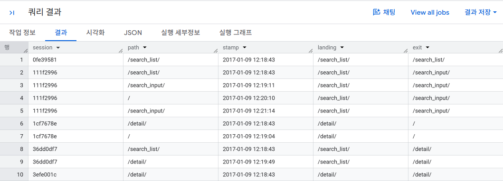

```sql
WITH landing_exit AS(
    SELECT
        session,
        path,
        stamp,
        FIRST_VALUE(path)
            over(
                PARTITION BY session
                ORDER BY stamp ASC
                ROWS BETWEEN UNBOUNDED PRECEDING
                         AND UNBOUNDED FOLLOWING
            ) AS landing,
        LAST_VALUE(path)
            over(
                PARTITION BY session
                ORDER BY stamp ASC
                ROWS BETWEEN UNBOUNDED PRECEDING
                         AND UNBOUNDED FOLLOWING
            ) AS exit
    FROM `5th_week.activity_log`
)
, landing_count AS (
    SELECT
        landing AS path,
        COUNT(DISTINCT session) AS landing_count -- 각 페이지가 몇 번이나 입구 페이지였는가
    FROM landing_exit
    GROUP BY landing
)
, exit_count AS (
    SELECT
        exit AS path,
        COUNT(DISTINCT session) AS exit_count   -- 각 페이지가 몇 번이나 출구 페이지였는가
    FROM landing_exit
    GROUP BY exit
)
-- 입구 페이지와 출구 페이지 방문 횟수 결과를 한꺼번에 출력하기
SELECT 'landing' AS type, *
FROM landing_count
UNION ALL
SELECT 'exit' AS type, *
FROM exit_count
```
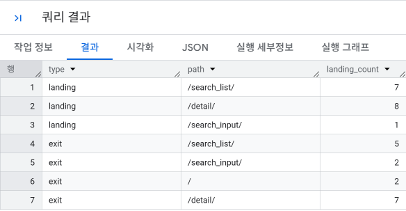

#### 2-1-2 어디에서 조회를 시작해서, 어디에서 이탈하는지 집계하기
```sql
WITH landing_exit AS(
    SELECT
        session,
        path,
        stamp,
        FIRST_VALUE(path)
            over(
                PARTITION BY session
                ORDER BY stamp ASC
                ROWS BETWEEN UNBOUNDED PRECEDING
                         AND UNBOUNDED FOLLOWING
            ) AS landing,
        LAST_VALUE(path)
            over(
                PARTITION BY session
                ORDER BY stamp ASC
                ROWS BETWEEN UNBOUNDED PRECEDING
                         AND UNBOUNDED FOLLOWING
            ) AS exit
    FROM `5th_week.activity_log`
)
SELECT
    landing,
    exit,
    COUNT(DISTINCT session) AS count
FROM landing_exit
GROUP BY
    landing, exit;
```
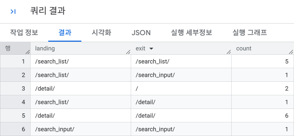

### 2-2 이탈률과 직귀율 계산하기

- `<이탈률>=<출구 수>/<페이지 뷰>`
    - 페이지를 떠나는 수, 이탈률과 그 페이지의 특성을 함께 봐야 한다.
- `<직귀율>=<직귀 수>/<입구 수 or 방문 횟수>`
    - 특정 페이지만 조회하고 곧바로 이탈한 비율, 직귀율이 높은 페이지는 성과로 이어지지 않을 가능성이 높으르모 확인 필요

```sql
-- 경로별 이탈률을 집계하는 쿼리
WITH exit_flag AS (
    SELECT
        *,
        CASE
            WHEN ROW_NUMBER() OVER(PARTITION BY session ORDER BY stamp DESC)=1
            THEN 1
            ELSE 0
        END AS is_exit
    FROM `5th_week.activity_log`
)
SELECT
    path,
    SUM(is_exit) AS exit_count,
    COUNT(1) AS page_view,
    AVG(100.0*is_exit) AS exit_radio
FROM exit_flag
GROUP BY path;
```
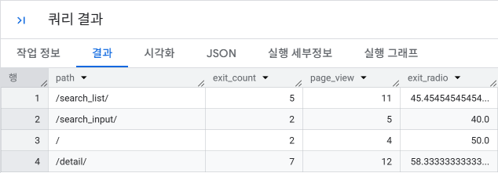
```sql
-- 경로들의 직귀율을 집계하는 쿼리
WITH landing_bounce_flag AS(
    SELECT
        *,
        -- 입구 페이지 판정
        CASE
            WHEN ROW_NUMBER() OVER(PARTITION BY session ORDER BY stamp ASC)=1
            THEN 1
            ELSE 0
        END AS is_landing,
        -- 직귀 판정
        CASE
            WHEN COUNT(1) OVER(PARTITION BY session) = 1 
            THEN 1
            ELSE 0
        END AS is_bounce
    FROM `5th_week.activity_log`
)
SELECT
    path,
    SUM(is_bounce) AS bounce_count,
    SUM(is_landing) AS landing_count,
    AVG(100.0*CASE WHEN is_landing =1 THEN is_bounce END) AS bounce_ratio
FROM landing_bounce_flag
GROUP BY path;
```
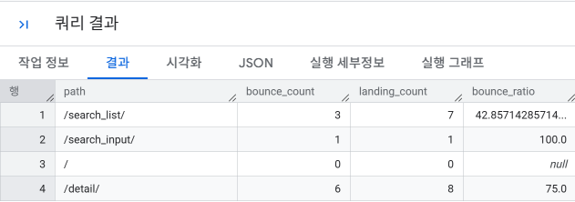


### 2-3 성과로 이어지는 페이지 파악하기 

- 성과(결제)로 이어진 페이지와 이어지지 않은 페이지 구분
- 성과와 직결되는 페이지로 유도해야 웹사이트 전체의 CVR 향상 가능<br>
⚠️ 조회 수는 높지 않지만 성과에 이르는 비율이 높다면, 해당 페이지의 중요도가 높다고 할 수 있음

```sql
WITH activity_log_with_conversion_flag AS (
    SELECT
        session,
        stamp,
        path,
        MAX(
            CASE                                    -- 컨버전 페이지보다 이전 접근에 플래그를 추가(구매 완료 전에 고객이 방문했던 페이지들에 1을 부여)
                WHEN path = '/complete' THEN 1
                ELSE 0
            END
        ) OVER (
            PARTITION BY session
            ORDER BY TIMESTAMP(stamp)
            ROWS BETWEEN CURRENT ROW AND UNBOUNDED FOLLOWING
        ) AS has_conversion -- 현재 행부터 세션 끝까지 봤을 때 /complete가 하나라도 있는가?

    FROM `5th_week.activity_log`
)

SELECT
    path,
    COUNT(*) AS visits,
    SUM(has_conversion) AS conversions,            -- 해당 path 방문 중 나중에 complete까지 간 횟수
    ROUND(
        100.0 * SUM(has_conversion) / COUNT(*),
        2
    ) AS cvr

FROM activity_log_with_conversion_flag
WHERE path != '/complete'

GROUP BY path
ORDER BY cvr DESC;
```

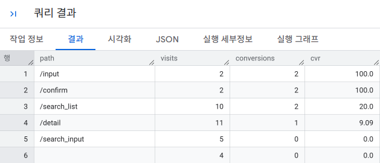

`MAX 함수 내부 구조`
```
/search_list   MAX(0,0,0,0,1) = 1
/detail        MAX(0,0,0,1)   = 1
/input         MAX(0,0,1)     = 1
/confirm       MAX(0,1)       = 1
/complete      MAX(1)         = 1
```
### 2-4 페이지 가치 산출하기 
금액이라는 개념을 사용해 성과를 고려하는 `페이지 가치`라는 치표 사용

#### 2-4-1 페이지 가치 집계 준비하기
`성과를 수치화하기`
- 구매 금액을 기반으로 성과 수치화 가능
- 페에지의 목적을 달성했을 때마다 점수룰 부여하는 경우도 가능

`페이지 가치를 할당하는 방법`
- **마지막 페이지에 할당하기**  
  직접적인 효과가 있다고 판단할 수 있는 페이지에 성과를 모두 할당합니다. 이를 활용하면 매출에 직접적으로 기여하는 페이지를 판단할 수 있습니다.

- **첫 페이지에 할당하기**  
  성과로 이어지는 계기가 되었던 첫 번째 페이지에 성과를 모두 할당합니다. 이를 활용하면 매출에 간접적으로 기여하는 페이지를 판단할 수 있습니다. 예를 들어 광고 또는 검색 엔진 등의 외부 유입에서 어떤 페이지가 가치가 높은지 찾아낼 수 있습니다.

- **균등하게 분산하기**  
  성과에 이르기까지 거쳤던 모든 페이지에 성과를 균등하게 할당합니다. 어떤 페이지를 경유했을 때 사용자가 성과에 이르는지를 판단할 수 있습니다. 적은 페이지를 거쳐 성과로 연결된 경우와 반복적으로 방문하는 페이지의 경우에 해당 페이지의 가치가 높게 측정됩니다.

- **성과 지점에서 가까운 페이지에 더 높게 할당하기**  
  마지막 페이지에 가까울수록 높은 가치를 할당합니다.

- **성과 지점에서 먼 페이지에 더 높게 할당하기**  
  첫 페이지에 가까울수록 높은 가치를 할당합니다.

#### 2-4-2 특정한 계급 수로 히스토그램만들기
- 페이지의 가치를 구하려면 '무엇을 성과 수치로 사용할 것인가'와 '무엇을 평가할 것인가'를 결정해야 한다.
```sql
WITH conversion_flag AS (
    -- 1. 각 접근 이후에 /complete가 존재하는지 확인
    SELECT
        session,
        stamp,
        path,

        MAX(
            CASE
                WHEN path = '/complete' THEN 1
                ELSE 0
            END
        ) OVER (
            PARTITION BY session
            ORDER BY TIMESTAMP(stamp)
            ROWS BETWEEN CURRENT ROW AND UNBOUNDED FOLLOWING
        ) AS has_conversion

    FROM `5th_week.activity_log`
),

conversion_path AS (
    -- 2. 전환으로 이어진 경로만 추출
    -- /input, /confirm, /complete는 가치 계산 대상에서 제외
    SELECT
        session,
        stamp,
        path,

        -- 첫 페이지부터의 순서
        ROW_NUMBER() OVER (
            PARTITION BY session
            ORDER BY TIMESTAMP(stamp)
        ) AS asc_order,

        -- 마지막 페이지부터의 순서
        ROW_NUMBER() OVER (
            PARTITION BY session
            ORDER BY TIMESTAMP(stamp) DESC
        ) AS desc_order,

        -- 해당 세션의 페이지 수
        COUNT(*) OVER (
            PARTITION BY session
        ) AS page_count

    FROM conversion_flag
    WHERE has_conversion = 1
      AND path NOT IN ('/input', '/confirm', '/complete')
),

page_value AS (
    -- 3. 한 컨버전에 1000이라는 가치 할당
    SELECT
        session,
        path,

        -- 균등 배분
        1000.0 / page_count AS fair_assign,

        -- 첫 페이지에 전부 배분
        CASE
            WHEN asc_order = 1 THEN 1000.0
            ELSE 0
        END AS first_assign,

        -- 마지막 페이지에 전부 배분
        CASE
            WHEN desc_order = 1 THEN 1000.0
            ELSE 0
        END AS last_assign,

        -- 전환에서 멀수록 높은 가치
        1000.0 * desc_order
        / (page_count * (page_count + 1) / 2.0)
        AS decrease_assign,

        -- 전환에 가까울수록 높은 가치
        1000.0 * asc_order
        / (page_count * (page_count + 1) / 2.0)
        AS increase_assign

    FROM conversion_path
),

page_total_value AS (
    -- 4. 같은 path의 가치 합계
    SELECT
        path,

        SUM(fair_assign)     AS sum_fair,
        SUM(first_assign)    AS sum_first,
        SUM(last_assign)     AS sum_last,
        SUM(decrease_assign) AS sum_dec,
        SUM(increase_assign) AS sum_inc

    FROM page_value
    GROUP BY path
),

page_access_count AS (
    -- 5. 원본 로그에서 각 페이지의 방문 횟수 계산
    SELECT
        path,
        COUNT(*) AS access_cnt

    FROM `5th_week.activity_log`

    -- 가치 평가 대상과 동일하게 제외
    WHERE path NOT IN ('/input', '/confirm', '/complete')
      AND path != ''

    GROUP BY path
)

-- 6. 페이지 가치 ÷ 방문 횟수
SELECT
    a.path,
    a.access_cnt,

    ROUND(v.sum_fair  / a.access_cnt, 2) AS avg_fair,
    ROUND(v.sum_first / a.access_cnt, 2) AS avg_first,
    ROUND(v.sum_last  / a.access_cnt, 2) AS avg_last,
    ROUND(v.sum_dec   / a.access_cnt, 2) AS avg_dec,
    ROUND(v.sum_inc   / a.access_cnt, 2) AS avg_inc

FROM page_access_count AS a
LEFT JOIN page_total_value AS v
    ON a.path = v.path

ORDER BY a.access_cnt DESC;
```
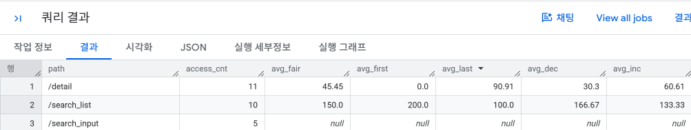


### 2-5 검색 조건들의 사용자 행동 가시화하기 
- 검색 조건별로 **상세 페이지 이동률(CTR)**과 **상세 페이지 이동 후 전환율(CVR)**을 비교한다.
- CTR과 CVR이 모두 높은 검색 조건은 사용자의 목적이 명확하고 성과로 이어질 가능성이 높은 조건이다.
- 핵심은 각 검색 로그에 `상세 페이지까지 갔는가`, `최종 전환까지 갔는가`를 0/1 플래그로 붙이는 것이다.

```sql
-- 검색 조건별 CTR / CVR 집계
WITH search_flag AS (
    SELECT
        session,
        stamp,
        path,
        search_type,

        -- 현재 검색 이후 상세 페이지에 도달했는가?
        MAX(CASE WHEN path = '/detail' THEN 1 ELSE 0 END) OVER (
            PARTITION BY session
            ORDER BY TIMESTAMP(stamp)
            ROWS BETWEEN CURRENT ROW AND UNBOUNDED FOLLOWING
        ) AS has_detail,

        -- 현재 검색 이후 최종 전환까지 도달했는가?
        MAX(CASE WHEN path = '/complete' THEN 1 ELSE 0 END) OVER (
            PARTITION BY session
            ORDER BY TIMESTAMP(stamp)
            ROWS BETWEEN CURRENT ROW AND UNBOUNDED FOLLOWING
        ) AS has_conversion

    FROM `5th_week.activity_log`
)

SELECT
    search_type,
    COUNT(*) AS search_count,
    SUM(has_detail) AS detail_count,
    ROUND(100.0 * AVG(has_detail), 2) AS ctr,
    SUM(CASE WHEN has_detail = 1 THEN has_conversion ELSE 0 END) AS conversion_count,
    ROUND(
        100.0 * AVG(CASE WHEN has_detail = 1 THEN has_conversion END),
        2
    ) AS cvr
FROM search_flag
WHERE path = '/search_list'
GROUP BY search_type
ORDER BY search_count DESC;
```

> 바로 다음 페이지가 `/detail`인 경우만 클릭으로 인정하고 싶다면 `LEAD()` 또는 `LAG()`를 사용해 직전/직후 이동만 판정하면 된다.

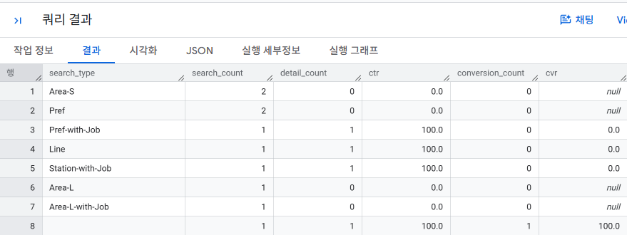

### 2-6 폴아웃 리포트를 사용해 사용자 회유를 가시화하기 

- **폴스루(Fall Through)**: 다음 단계까지 이동한 비율
- **폴아웃(Fall Out)**: 특정 단계에서 이탈한 비율
- `/ → /search_list → /detail → /input → /complete`처럼 주요 단계를 정하고 각 단계까지 몇 개의 세션이 도달했는지 계산한다.
- `first_trans_rate`: 첫 단계 대비 도달률, `step_trans_rate`: 바로 이전 단계 대비 도달률

```sql
-- 폴아웃 리포트: 주요 단계별 도달 수와 이동률
WITH session_step AS (
    SELECT
        session,
        MIN(CASE WHEN path IN ('', '/') THEN TIMESTAMP(stamp) END) AS step1_time,
        MIN(CASE WHEN path = '/search_list' THEN TIMESTAMP(stamp) END) AS step2_time,
        MIN(CASE WHEN path = '/detail' THEN TIMESTAMP(stamp) END) AS step3_time,
        MIN(CASE WHEN path = '/input' THEN TIMESTAMP(stamp) END) AS step4_time,
        MIN(CASE WHEN path = '/complete' THEN TIMESTAMP(stamp) END) AS step5_time
    FROM `5th_week.activity_log`
    GROUP BY session
),

funnel AS (
    SELECT 1 AS step, '/' AS path,
           COUNTIF(step1_time IS NOT NULL) AS access_count
    FROM session_step

    UNION ALL
    SELECT 2, '/search_list',
           COUNTIF(step1_time IS NOT NULL
                   AND step2_time IS NOT NULL
                   AND step1_time <= step2_time)
    FROM session_step

    UNION ALL
    SELECT 3, '/detail',
           COUNTIF(step1_time IS NOT NULL
                   AND step2_time IS NOT NULL
                   AND step3_time IS NOT NULL
                   AND step1_time <= step2_time
                   AND step2_time <= step3_time)
    FROM session_step

    UNION ALL
    SELECT 4, '/input',
           COUNTIF(step1_time IS NOT NULL
                   AND step2_time IS NOT NULL
                   AND step3_time IS NOT NULL
                   AND step4_time IS NOT NULL
                   AND step1_time <= step2_time
                   AND step2_time <= step3_time
                   AND step3_time <= step4_time)
    FROM session_step

    UNION ALL
    SELECT 5, '/complete',
           COUNTIF(step1_time IS NOT NULL
                   AND step2_time IS NOT NULL
                   AND step3_time IS NOT NULL
                   AND step4_time IS NOT NULL
                   AND step5_time IS NOT NULL
                   AND step1_time <= step2_time
                   AND step2_time <= step3_time
                   AND step3_time <= step4_time
                   AND step4_time <= step5_time)
    FROM session_step
)

SELECT
    step,
    path,
    access_count,
    ROUND(
        100.0 * SAFE_DIVIDE(
            access_count,
            FIRST_VALUE(access_count) OVER (ORDER BY step)
        ),
        2
    ) AS first_trans_rate,
    ROUND(
        100.0 * SAFE_DIVIDE(
            access_count,
            LAG(access_count) OVER (ORDER BY step)
        ),
        2
    ) AS step_trans_rate
FROM funnel
ORDER BY step;
```
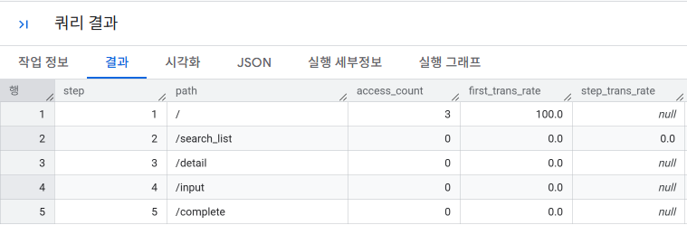

### 2-7 사이트 내부에서 사용자 흐름 파악하기 

- 특정 페이지를 기준으로 **어디에서 들어왔고 어디로 이동했는지** 확인한다.
- `LAG()`는 이전 페이지, `LEAD()`는 다음 페이지를 가져온다.
- 예를 들어 `/detail`을 기준으로 앞뒤 2단계의 사용자 흐름을 확인할 수 있다.

```sql
-- /detail 페이지 전후의 사용자 흐름 확인
WITH user_flow AS (
    SELECT
        session,
        TIMESTAMP(stamp) AS stamp,
        path AS current_path,

        COALESCE(
            LAG(path, 2) OVER (PARTITION BY session ORDER BY TIMESTAMP(stamp)),
            'NULL'
        ) AS prev_2,

        COALESCE(
            LAG(path, 1) OVER (PARTITION BY session ORDER BY TIMESTAMP(stamp)),
            'NULL'
        ) AS prev_1,

        COALESCE(
            LEAD(path, 1) OVER (PARTITION BY session ORDER BY TIMESTAMP(stamp)),
            'NULL'
        ) AS next_1,

        COALESCE(
            LEAD(path, 2) OVER (PARTITION BY session ORDER BY TIMESTAMP(stamp)),
            'NULL'
        ) AS next_2

    FROM `5th_week.activity_log`
)

SELECT
    prev_2,
    prev_1,
    current_path,
    next_1,
    next_2,
    COUNT(*) AS flow_count,
    ROUND(100.0 * COUNT(*) / SUM(COUNT(*)) OVER (), 2) AS flow_ratio
FROM user_flow
WHERE current_path = '/detail'
GROUP BY prev_2, prev_1, current_path, next_1, next_2
ORDER BY flow_count DESC;
```

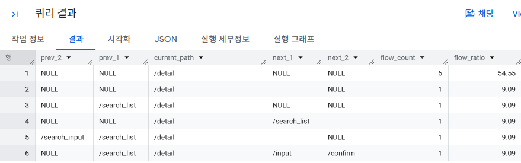


### 2-8 페이지 완독률 집계하기 

- 페이지 뷰만으로는 사용자가 콘텐츠를 끝까지 읽었는지 알 수 없다.
- `view`, `read-20%`, `read-40%`, `read-60%`, `read-80%`, `read-100%` 같은 로그를 남기면 콘텐츠별 완독률을 계산할 수 있다.
- 완독률이 낮으면 콘텐츠 품질뿐 아니라 가독성, 페이지 구성, 추천 모듈의 위치도 함께 점검할 수 있다.

```sql
-- URL별 페이지 완독률 집계
SELECT
    url,
    action,
    COUNT(1) AS count,
    100.0*COUNT(1)/SUM(CASE WHEN action = 'view' THEN COUNT(1) ELSE 0 END)
    OVER(PARTITION BY url)
    AS action_per_view
FROM `5th_week.read_log`
GROUP BY
    url, action
ORDER BY
    url, count DESC
```

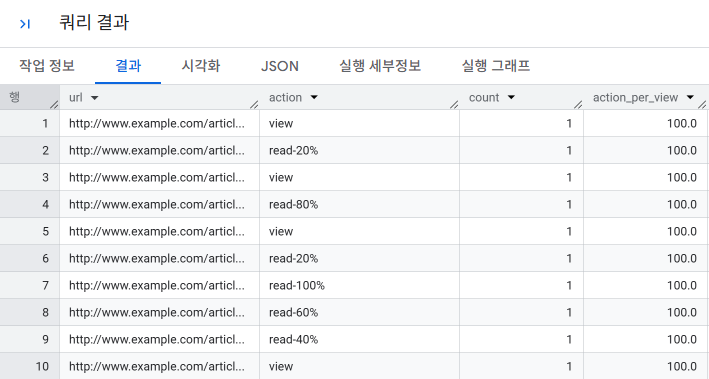

### 2-9 사용자 행동 전체를 시각화하기 

- 직귀율, 이탈률, 이동률, CVR처럼 각각의 지표만 보면 서비스의 일부만 볼 수 있다.
- 사이트 외부 유입 → 랜딩 페이지 → 검색 → 상세 페이지 → 입력 → 완료까지를 하나의 **조감도**로 연결해 전체 흐름을 본다.
- 분석의 목적은 **어디에서 사용자가 많이 들어오고 어디에서 막히는지**를 한눈에 파악해 개선 우선순위를 정하는 것이다.


## 3. 입력 양식 최적화하기 

- **엔트리 폼(Entry Form)**: 자료 청구 양식과 구매 양식 등
- 입력 양식 최적화(EFO, Entry Form Optimization)는 입력 과정에서의 오류와 이탈을 줄여 최종 전환율을 높이는 작업이다.
    - 필수 입력과 선택 입력을 명확하게 구분해서 입력 수를 줄인다
        - 필수 입력 항목을 위로 올려 배치한다.
    - 오류 발생 빈도를 줄인다
        - 입력 예를 보여준다
        - 입력에 실수가 있었음을 실시간으로 알려준다
    - 쉽게 입력할 수 있게 만든다
        - 입력 항목을 줄인다
        - 우편번호와 주소 등에는 자동 완성 기능을 사용한다
    - 이탈할 만한 요소를 제거한다.
        - 불필요한 링크를 제거한다(메뉴 단순화 등)
        - 실수로 이탈하지 않게 페이지를 벗어날 때 확인 대화 상자를 띄워 이탈할 것인지를 다시 한 번 묻는다.
- 문제를 명확하게 파악하고, 해결책이 어떤 효과를 가져올지 수치화 할 수 있어야 한다.
- 핵심 지표는 **오류율, 입력→확인 이동률, CVR, 이탈률, 입력 양식 직귀율**이다.

### 3-1 오류율 집계하기 

- 같은 `/regist/confirm` URL이라도 정상 확인 화면과 오류 화면이 존재할 수 있으므로 `status` 같은 상태값을 함께 로그에 남기는 것이 중요하다.
- `status = 'error'`를 1로 바꾸면 오류 수와 오류율을 쉽게 계산할 수 있다.

```sql
-- 확인 화면에서의 오류율을 집계하는 쿼리
SELECT
    COUNT(*) AS confirm_count,
    SUM(CASE WHEN status = 'error' THEN 1 ELSE 0 END) AS error_count,
    AVG(CASE WHEN status = 'error' THEN 1.0 ELSE 0.0 END) AS error_rate,
    SUM(CASE WHEN status = 'error' THEN 1.0 ELSE 0.0 END)/COUNT(DISTINCT session) AS error_per_user
FROM `5th_week.form_log`
WHERE path = '/regist/confirm'; -- 확인 화면 페이지 판정하기
```
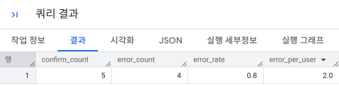


### 3-2 입력 ~ 확인 ~ 완료까지의 이동률 집계하기 

- 입력 양식에서는 `/regist/input → /regist/confirm → /regist/complete`의 이동률을 확인한다.
- 입력 → 확인 비율은 **확정률**, 입력 → 완료 비율은 **CVR**, `100% - CVR`은 **이탈률**로 볼 수 있다.
- 오류 화면은 정상적인 다음 단계로 간주하지 않도록 제외한다.

```sql
-- 입력 양식의 폴아웃 리포트
WITH mst_fallout_step AS (

    -- 폴아웃에서 확인할 단계와 순서를 미리 정의
    SELECT 1 AS step, '/regist/input' AS path
    UNION ALL
    SELECT 2 AS step, '/regist/confirm' AS path
    UNION ALL
    SELECT 3 AS step, '/regist/complete' AS path
),

form_log_with_fallout_step AS (

    SELECT
        l.session,
        m.step,
        m.path,

        MAX(TIMESTAMP(l.stamp)) AS max_stamp,    -- 해당 세션이 이 단계에 '마지막으로' 접근한 시간
                                                -- 사용자가 같은 페이지를 여러 번 방문한 경우까지 고려

        MIN(TIMESTAMP(l.stamp)) AS min_stamp     -- 해당 세션이 이 단계에 '처음' 접근한 시간

    FROM mst_fallout_step AS m

    JOIN `5th_week.form_log` AS l
        ON m.path = l.path                       -- 실제 로그와 폴아웃 단계 연결

    WHERE COALESCE(l.status, '') = ''           -- error 화면은 정상 단계 진행으로 보지 않고 제외
                                                -- 내가 만든 단순 버전은 confirm에서만 error를 제외했지만
                                                -- 책에서는 전체 로그에서 정상 상태만 사용

    GROUP BY
        l.session,
        m.step,
        m.path
),

form_log_with_mod_fallout_step AS (

    SELECT
        session,
        step,
        path,
        max_stamp,

        LAG(min_stamp) OVER (
            PARTITION BY session
            ORDER BY step
        ) AS lag_min_stamp,                      -- 바로 직전 단계의 '최초 접근 시간'
                                                -- 예: confirm 행에서는 input의 최초 접근 시간

        MIN(step) OVER (
            PARTITION BY session
        ) AS min_step,                           -- 해당 세션이 가장 처음 도달한 단계 번호
                                                -- 반드시 step 1(input)부터 시작한 세션인지 확인하기 위해 사용

        COUNT(*) OVER (
            PARTITION BY session
            ORDER BY step
            ROWS BETWEEN UNBOUNDED PRECEDING
                     AND CURRENT ROW
        ) AS cum_count                           -- 지금 단계까지 실제로 몇 개의 단계를 거쳤는지 누적 계산
                                                -- step 번호와 같아야 중간 단계를 건너뛰지 않은 것

    FROM form_log_with_fallout_step
),

fallout_log AS (

    SELECT
        session,
        step,
        path

    FROM form_log_with_mod_fallout_step

    WHERE
        min_step = 1                             -- 반드시 /regist/input(step 1)부터 시작한 세션만 사용

        AND step = cum_count                     -- 단계가 빠짐없이 연결됐는지 확인
                                                -- 예: step 3인데 cum_count=2이면
                                                -- step 2를 건너뛴 것이므로 제외

        AND (
            lag_min_stamp IS NULL                -- step 1은 이전 단계가 없으므로 허용
            OR max_stamp >= lag_min_stamp        -- 현재 단계의 마지막 접근 시간이
                                                -- 이전 단계의 최초 접근 이후인지 확인
                                                -- 반복 방문/뒤로가기까지 어느 정도 고려하는 부분
        )
)

SELECT
    step,
    path,

    COUNT(*) AS access_count,                    -- 각 단계까지 정상적으로 도달한 세션 수

    ROUND(
        100.0 * SAFE_DIVIDE(
            COUNT(*),

            FIRST_VALUE(COUNT(*)) OVER (
                ORDER BY step
                ROWS BETWEEN UNBOUNDED PRECEDING
                         AND UNBOUNDED FOLLOWING
            )
        ),
        2
    ) AS first_trans_rate,                       -- 최초 단계(input) 대비 현재 단계 도달률
                                                -- input → confirm → complete 전체 퍼널 비율

    ROUND(
        100.0 * SAFE_DIVIDE(
            COUNT(*),
            LAG(COUNT(*)) OVER (
                ORDER BY step
            )
        ),
        2
    ) AS step_trans_rate                         -- 바로 직전 단계 대비 이동률
                                                -- 예: confirm → complete 전환율

FROM fallout_log

GROUP BY
    step,
    path

ORDER BY
    step;
```

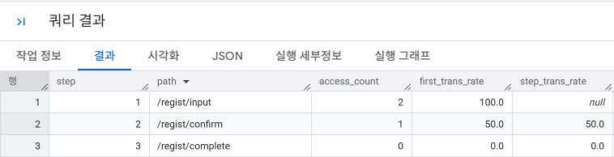

### 3-3 입력 양식 직귀율 집계하기 

- 입력 화면에는 도달했지만 확인 또는 완료 화면으로 전혀 진행하지 않은 세션을 **입력 양식 직귀**로 본다.
- 직귀율이 높다면 입력 항목이 너무 많거나, 양식 구조가 복잡하거나, 입력 화면으로 오기 전 사용자의 동기 부여가 부족할 수 있다.

```sql
-- 날짜별 입력 양식 직귀율 집계
WITH form_progress AS (
    SELECT
        DATE(TIMESTAMP(stamp)) AS dt,
        session,

        MAX(CASE
                WHEN path = '/regist/input' THEN 1
                ELSE 0
            END) AS has_input,

        MAX(CASE
                WHEN path IN ('/regist/confirm', '/regist/complete') THEN 1
                ELSE 0
            END) AS has_progress

    FROM `5th_week.form_log`
    GROUP BY dt, session
)

SELECT
    dt,
    COUNT(1) AS input_count,
    SUM(CASE WHEN has_progress = 0 THEN 1 ELSE 0 END) AS bounce_count,
    100.0*AVG(CASE WHEN has_progress = 0 THEN 1 ELSE 0 END) AS bounce_rate
FROM form_progress
WHERE has_input = 1 -- 입력 화면에 방문했던 세션만 추출하기
GROUP BY dt
ORDER BY dt;
```

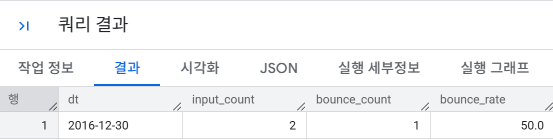

> 페이지 열람 로그만으로는 사용자가 실제로 입력을 시작했는지 알 수 없다. 더 정확하게 분석하려면 첫 입력이나 첫 클릭 시 별도 이벤트 로그를 남기는 것이 좋다.


### 3-4 오류가 발생하는 항목과 내용 집계하기 

- 전체 오류율만 보면 원인을 알 수 없으므로 `form`, `field`, `error_type` 단위로 오류를 세분화한다.
- 각 입력 양식에서 어떤 항목과 오류 유형이 가장 큰 비중을 차지하는지 확인해 개선 우선순위를 정한다.
- 입력값에는 개인정보가 포함될 수 있으므로 원문 값을 로그에 그대로 저장하지 않도록 주의해야 한다.

```sql
-- 입력 양식별 오류 발생 위치와 원인 집계
SELECT
    form,
    field,
    error_type,
    COUNT(1) AS error_count,
    100.0 * COUNT(*)/ SUM(COUNT(*)) OVER (PARTITION BY form) AS share
FROM `5th_week.form_error_log`
GROUP BY form, field, error_type
ORDER BY form, error_count DESC;
```

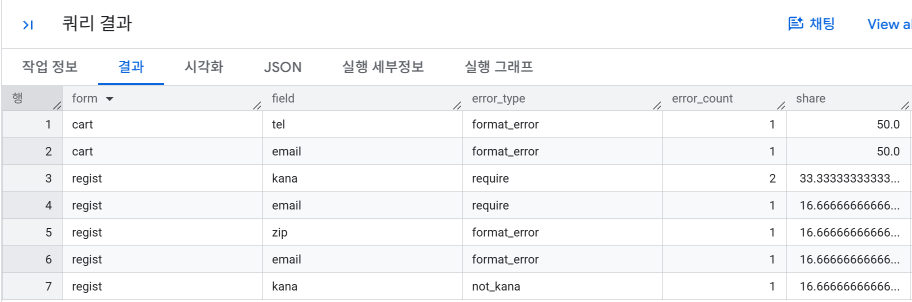
---

**### 핵심 정리**

- 검색 조건 분석: `CTR + CVR`로 어떤 검색 방법이 성과로 이어지는지 확인
- 폴아웃 분석: 주요 단계별로 사용자가 어디에서 가장 많이 이탈하는지 확인
- 사용자 흐름: `LAG / LEAD`로 특정 페이지 전후 행동 확인
- 완독률: 단순 페이지 뷰가 아니라 실제 콘텐츠 소비 정도 확인
- EFO: 오류율, 단계 이동률, 직귀율, 오류 원인을 함께 분석해 입력 양식 개선


### 🎉 수고하셨습니다.
