# SQL_MASTER 6주차 정규과제

📌SQL MASTER 정규과제는 매주 정해진 분량의 『*데이터 분석을 위한 SQL 레시피*』 를 읽고 학습하는 것입니다. 이번 주는 아래의 **SQL_MASTER_6th_TIL**에 나열된 분량을 읽고 공부하시면 됩니다.

아래 실습을 수행하며 학습 내용을 직접 적용해보세요. 단순히 결과를 재현하는 것이 아니라, SQL을 직접 작성하는 과정에서 개념을 스스로 정리하는 것이 중요합니다.

필요한 경우 교재와 추가 자료를 참고하여 이해를 보완하시기 바랍니다.

## SQL_MASTER_6th_TIL

### 7장 데이터 활용의 정밀도를 높이는 분석 기술
#### 1. 데이터를 조합해서 새로운 데이터 만들기
#### 2. 이상값 검출하기 
#### 3. 데이터 중복 검출하기
#### 4. 여러 개의 데이터셋 비교하기 


## Study Schedule

| 주차  | 공부 범위     | 완료 여부 |
| ----- | ------------- | --------- |
| 1주차 | p.52~136   | ✅         |
| 2주차 | p.138~184  | ✅         |
| 3주차 | p.186~232 | ✅         |
| 4주차 | p.233~321 | ✅         |
| 5주차 | p.324~406 | ✅         |
| 6주차 | p.408~464 | ✅         |
| 7주차 | p.466~566 | 🍽️         |

<br>

<!-- 여기까진 그대로 둬 주세요-->


# 실습

## 0. 실습 규칙

1. 샘플 데이터 생성 코드는 **08_SQL_MASTER_Template/src** 경로에 장별로 정리되어 있습니다.
2. 아래 목차에 맞춰 해당 코드를 실행하여 샘플 데이터를 생성한 후, 각 장에서 요구하는 쿼리를 직접 작성해보시기 바랍니다.
3. 작성한 쿼리의 **실행 결과 화면도 함께 제출**해 주세요.
4. 단순히 교재의 예시 코드를 그대로 작성하는 것이 아니라, **제시된 로직을 충분히 이해한 뒤 교재를 보지 않고 스스로 쿼리를 구성**해보는 것을 권장합니다.
5. 교재 예시는 PostgreSQL, Hive, BigQuery 등 다양한 DBMS 기준으로 제시되어 있기 때문에, **MySQL이 아닌 다른 SQL 환경을 사용하여 실습을 진행해도 무방합니다.**
6. 다만, 사용 중인 DBMS에 맞는 문법으로 적절히 변환하여 작성하시기 바랍니다.

## 1. 데이터를 조합해서 새로운 데이터 만들기

### 1-1 IP 주소를 기반으로 국가와 지역 보완하기 

IP주소: 국가, 지역, 타임존 등으로 구분해서 분석 가능

접속 로그에는 국가나 도시가 없어도, IP 주소와 GeoLite2 외부 데이터를 연결하면 지역 정보를 보완할 수 있다.

```sql
SELECT
    a.ip,
    l.continent_name,
    l.country_name,
    l.city_name,
    l.time_zone
FROM public.action_log_with_ip AS a
LEFT JOIN public.mst_city_ip AS i
    ON a.ip::inet <<= i.network
LEFT JOIN public.mst_locations AS l
    ON i.geoname_id = l.geoname_id;
```

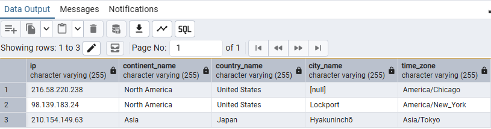

IP 위치 정보는 추정 정보이며, GeoLite2 갱신 시점에 따라 교재와 도시명이나 시간대가 다를 수 있다.

### 1-2 주말과 공휴일 판단하기 

일부 서비스의 경우 주말과 공휴일에는 방문 횟수와 CV에 차이가 존재할 수 있다.

- 날짜 데이터를 사용하면 쉽게 주말을 파악할 수 있다.
- 공휴일은 별도의 정보가 필요하므로 `mst_calendar`에 공휴일 이름을 저장해 사용한다.

**핵심 로직**

- `access_log.stamp`는 문자열이므로, `SUBSTRING`으로 연·월·일을 추출하고 정수로 변환하여 달력과 JOIN한다.
- `dow_num`은 일요일이 `0`, 토요일이 `6`이므로 `IN (0, 6)`으로 주말을 판정한다.
- `holiday_name IS NOT NULL`로 공휴일을 판정한다.
- 두 조건을 `OR`로 연결하여, 하나라도 만족하면 `is_day_off`가 `true`가 된다.

```sql
SELECT
    a.action,
    a.stamp,
    c.dow,
    c.holiday_name,
    (
        c.dow_num IN (0, 6)
        OR c.holiday_name IS NOT NULL
    ) AS is_day_off
FROM public.access_log AS a
JOIN public.mst_calendar AS c
    ON CAST(SUBSTRING(a.stamp, 1, 4) AS INTEGER) = c.year
   AND CAST(SUBSTRING(a.stamp, 6, 2) AS INTEGER) = c.month
   AND CAST(SUBSTRING(a.stamp, 9, 2) AS INTEGER) = c.day
ORDER BY a.stamp;

```

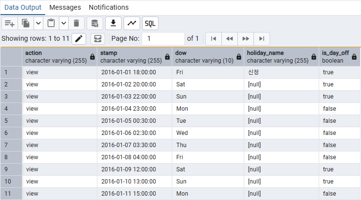

### 1-3 하루 집계 범위 변경하기 

하루를 자정 기준으로 나누면, 밤부터 새벽까지 이어진 사용자 활동이 서로 다른 날짜로 집계될 수 있다. 이를 보완하기 위해 하루의 시작을 변경할 수 있다.

**핵심 로직**

- 문자열인 `stamp`를 `timestamp` 자료형으로 변환한다.
- `INTERVAL '4 hours'`를 빼서 시간을 4시간 앞당긴다.
- 이동한 시각에서 날짜만 추출하여 집계 날짜로 사용한다.
- 이렇게 하면 자정부터 오전 4시 이전까지의 기록이 전날에 포함된다.

예를 들어 `2016-11-04 03:30:00`에서 4시간을 빼면 `2016-11-03 23:30:00`이므로, 집계 날짜는 `2016-11-03`이 된다.

```sql
WITH action_log_with_mod_stamp AS (
    SELECT
        *,
        stamp::timestamp - INTERVAL '4 hours' AS mod_stamp
    FROM public.action_log
)
SELECT
    session,
    user_id,
    action,
    stamp,
    stamp::timestamp::date AS raw_date,
    mod_stamp::date AS mod_date
FROM action_log_with_mod_stamp
ORDER BY stamp::timestamp;
```
- `raw_date`: 원래 접속 시각의 날짜
- `mod_stamp`: 원래 접속 시각에서 4시간을 뺀 시각
- `mod_date`: 오전 4시 기준으로 사용할 집계 날짜

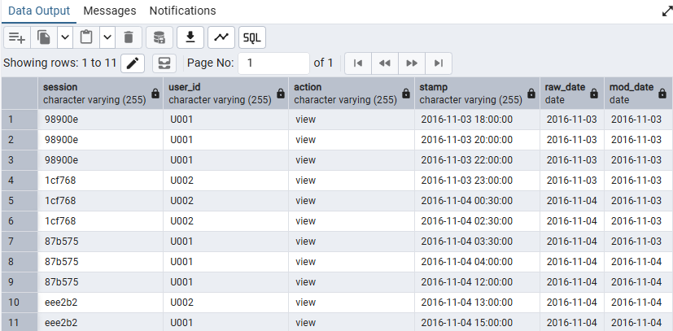


## 2. 이상값 검출하기 

분석 결과의 정확도를 높이려면, 로그에 섞인 과도한 접근·크롤러·결손값·내부 접근 등을 확인해야 한다.

### 2-1 데이터 분산 계산하기 

세션별 접근 횟수와 URL별 접근 횟수의 분포를 확인하면, 지나치게 많은 접근이나 극단적으로 적은 접근을 이상값 후보로 찾을 수 있다. 이 절에서는 통계적 분산값을 직접 계산하기보다 `PERCENT_RANK`로 분포상의 위치를 확인한다.

**핵심 로직**

- 세션별 로그 수를 집계하고 내림차순으로 정렬하면, 접근이 많은 세션이 앞에 온다.
- `RANK()`는 동순위를 허용하는 순위를 부여한다.
- `PERCENT_RANK()`는 `(순위 - 1) / (전체 행 수 - 1)`에 해당하는 상대 순위를 구한다. 집계 대상이 한 행이면 `0`을 반환한다.
- 내림차순 정렬에서 상대 순위가 `0.05` 이하인 세션은 접근이 많은 쪽의 이상값 후보로 볼 수 있다.
- URL은 접근 수를 오름차순으로 정렬해, 상대 순위가 작은 쪽에서 접근이 적은 URL을 확인한다.

```sql
-- 세션별로 페이지 열람 수 랭킹 비율을 구하는 쿼리
WITH session_count AS (
    SELECT
        session,
        COUNT(*) AS access_count
    FROM public.action_log_with_noise
    GROUP BY session
)
SELECT
    session,
    access_count,
    RANK() OVER (ORDER BY access_count DESC) AS access_rank,
    PERCENT_RANK() OVER (ORDER BY access_count DESC) AS percent_rank,
    PERCENT_RANK() OVER (ORDER BY access_count DESC) <= 0.05
        AS is_high_access_candidate
FROM session_count
ORDER BY access_count DESC, session;
```

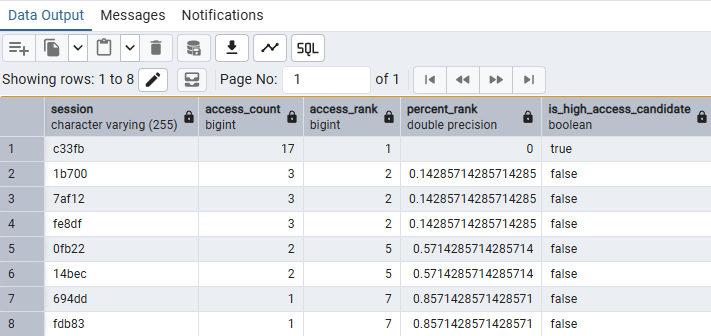

```sql
WITH url_count AS (
    SELECT
        url,
        COUNT(*) AS access_count
    FROM public.action_log_with_noise
    GROUP BY url
)
SELECT
    url,
    access_count,
    RANK() OVER (ORDER BY access_count ASC) AS access_rank,
    PERCENT_RANK() OVER (ORDER BY access_count ASC) AS percent_rank
FROM url_count
ORDER BY access_count ASC, url;
```
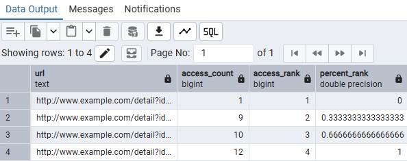

상대 순위의 방향은 `ORDER BY`에 따라 달라진다. 오름차순으로 구한 상대 순위에서 값이 작을수록 접근이 적다. 또한 동순위와 작은 표본의 영향으로, `0.05` 이하의 행이 전체의 정확히 5%가 되는 것은 아니다. 접근 수가 특이하다는 이유만으로 바로 제외하기보다 사용자 에이전트나 IP 등의 근거를 함께 확인한다.

### 2-2 크롤러 제외하기 

검색 엔진이나 자동 수집 도구의 접근이 섞이면 실제 사용자의 방문이나 행동을 해석하기 어려울 수 있다. 사용자 에이전트에 포함된 문자열을 기준으로 크롤러로 의심되는 로그를 제외한다.

크롤러 접근로 크롤러 유도를 분석할 때 사용할 수 있는 정보이다.

크롤러의 접근을 제외하는 방법에는
    1. 규칙을 기반으로 제외하기
    2. 마스터 데이터를 사용해 제외하기
    3. 그 외로도 다양하다

#### 2-2-1 규칙을 기반으로 제외하기

- 일반적으로 크롤러에는 특정 문자열이나 이름이 포함되어 있다.

```sql
SELECT *
FROM public.action_log_with_noise
WHERE NOT (
    LOWER(COALESCE(user_agent, '')) LIKE '%bot%'
    OR LOWER(COALESCE(user_agent, '')) LIKE '%crawler%'
    OR LOWER(COALESCE(user_agent, '')) LIKE '%spider%'
    OR LOWER(COALESCE(user_agent, '')) LIKE '%archiver%'
);
```

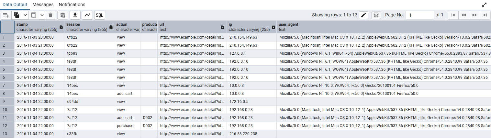

#### 2-2-2 마스터 데이터를 사용하여 제외하기

```sql
WITH mst_bot_user_agent AS (
    SELECT '%bot%' AS rule
    UNION ALL SELECT '%crawler%'
    UNION ALL SELECT '%spider%'
    UNION ALL SELECT '%archiver%'
)
SELECT l.*
FROM public.action_log_with_noise AS l
WHERE NOT EXISTS (
    SELECT 1
    FROM mst_bot_user_agent AS m
    WHERE LOWER(COALESCE(l.user_agent, '')) LIKE m.rule
);
```
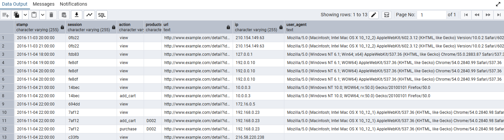

`COALESCE`는 사용자 에이전트가 `NULL`인 로그도 남기는 정책으로 사용했다. 에이전트가 없다고 실제 사람의 접근임이 확인되는 것은 아니다. 또한 규칙에 걸리지 않는 새로운 크롤러가 있을 수 있으므로, 필터링 후에도 접근이 많은 에이전트를 확인한다.

#### 2-2-3 크롤러 감시하기

마스터 데이터를 사용해서 제외한 로그에서, 접근이 많은 사용자 에이전트를 순위대로 추출한 뒤 크롤러의 마스터 데이터에서 누락된 사용자 에이전트가 없는지 확인한다.

```sql
WITH mst_bot_user_agent AS (
    SELECT '%bot%' AS rule
    UNION ALL SELECT '%crawler%'
    UNION ALL SELECT '%spider%'
    UNION ALL SELECT '%archiver%'
), filtered_action_log AS (
    SELECT l.*
    FROM public.action_log_with_noise AS l
    WHERE NOT EXISTS (
        SELECT 1
        FROM mst_bot_user_agent AS m
        WHERE LOWER(COALESCE(l.user_agent, '')) LIKE m.rule
    )
), user_agent_count AS (
    SELECT
        COALESCE(user_agent, '') AS user_agent,
        COUNT(*) AS access_count
    FROM filtered_action_log
    GROUP BY COALESCE(user_agent, '')
)
SELECT
    user_agent,
    access_count,
    100.0 * SUM(access_count) OVER (
        ORDER BY access_count DESC, user_agent
        ROWS BETWEEN UNBOUNDED PRECEDING AND CURRENT ROW
    ) / SUM(access_count) OVER () AS cumulative_ratio
FROM user_agent_count
ORDER BY access_count DESC, user_agent;
```

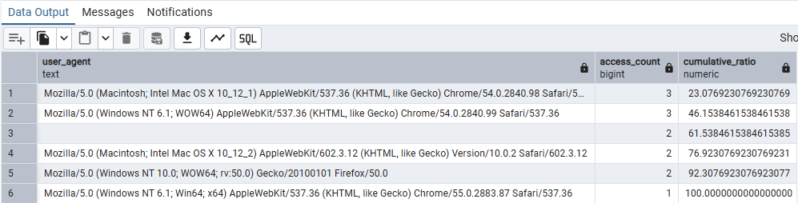

- `cumulative_ratio`: 접근이 많은 에이전트부터 누적한 접근 수의 비율(%).
- 새로운 크롤러가 확인되면 마스터 규칙을 추가한다.

### 2-3 데이터 타당성 확인하기 

로그는 액션의 종류에 따라 필요한 컬럼이 다를 수 있다. 컬럼별 요건을 정한 뒤, 액션별로 그 요건을 만족하는 비율을 계산한다.

**핵심 로직**

- `session`, `user_id`, `stamp`는 모든 액션에서 값이 있어야 한다.
- `view`의 `category`, `products`는 `NULL`, 그 외 액션에서는 값이 있는 것을 요건으로 삼는다.
- `amount`는 `purchase`일 때 값이 있고, 그 외 액션에서는 `NULL`인 것을 요건으로 삼는다.
- `CASE`로 요건을 만족하면 `1.0`, 만족하지 않으면 `0.0`을 부여한다.
- `AVG`로 집계하면 각 요건의 충족 비율을 구할 수 있다.

```sql
SELECT
    action,
    AVG(CASE WHEN session IS NOT NULL
             THEN 1.0 ELSE 0.0 END) AS session_valid_ratio,
    AVG(CASE WHEN user_id IS NOT NULL
             THEN 1.0 ELSE 0.0 END) AS user_id_valid_ratio,
    AVG(CASE
        WHEN action = 'view' AND category IS NULL THEN 1.0
        WHEN action <> 'view' AND category IS NOT NULL THEN 1.0
        ELSE 0.0
    END) AS category_valid_ratio,
    AVG(CASE
        WHEN action = 'view' AND products IS NULL THEN 1.0
        WHEN action <> 'view' AND products IS NOT NULL THEN 1.0
        ELSE 0.0
    END) AS products_valid_ratio,
    AVG(CASE
        WHEN action = 'purchase' AND amount IS NOT NULL THEN 1.0
        WHEN action <> 'purchase' AND amount IS NULL THEN 1.0
        ELSE 0.0
    END) AS amount_valid_ratio,
    AVG(CASE WHEN stamp IS NOT NULL
             THEN 1.0 ELSE 0.0 END) AS stamp_valid_ratio
FROM public.invalid_action_log
GROUP BY action
ORDER BY action;
```

비율이 `1.0`이면 해당 액션의 모든 로그가 그 컬럼의 요건을 만족한다. `1.0`보다 작으면 요건에 맞지 않는 로그가 존재한다. 이 쿼리는 정의한 `NULL` 요건을 검사하므로, 빈 문자열·잘못된 날짜 형식·음수 금액 등의 타당성은 별도 조건이 필요하다.

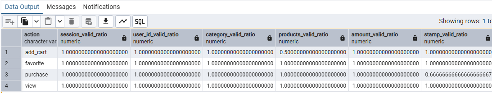

### 2-4 특정 IP 주소에서의 접근 제외하기 

테스트나 사내 접근 등이 분석에 포함되지 않도록, 제외할 IP 네트워크 범위를 정의하고 해당 범위에 속하는 로그를 걸러낸다.

**핵심 로직**

- 제외할 네트워크 범위와 설명을 마스터 데이터로 정의한다.
- PostgreSQL의 `inet` 자료형과 `<<=` 연산자로 IP의 범위 포함 여부를 판정한다.
- `LEFT JOIN`으로 범위가 일치하는 마스터 정보를 연결한다.
- 연결된 `network`가 `NULL`인 로그만 남기면, 제외 범위에 속하지 않는 로그를 조회할 수 있다.

```sql
WITH mst_reserved_ip (network, description) AS (
    VALUES
        ('127.0.0.0/8'::inet, 'Loopback'),
        ('10.0.0.0/8'::inet, 'Private network'),
        ('172.16.0.0/12'::inet, 'Private network'),
        ('192.0.0.0/24'::inet, '교재 예시 제외 대역'),
        ('192.168.0.0/16'::inet, 'Private network')
)
SELECT
    l.user_id,
    l.ip,
    l.stamp,
    m.network,
    m.description
FROM public.action_log_with_ip AS l
LEFT JOIN mst_reserved_ip AS m
    ON l.ip::inet <<= m.network
WHERE m.network IS NULL
ORDER BY l.stamp, l.user_id;
```

`WHERE m.network IS NULL`을 빼고 실행하면 어떤 IP가 어느 제외 범위에 연결되는지 먼저 확인할 수 있다. 이 목록은 교재 실습용 예시이며, 실제 제외 범위는 분석 목적에 맞춰 정한다. 특히 `192.0.0.0/24`는 RFC 1918의 사설 주소 대역과 구분한다.

`inet`을 사용할 수 없는 환경에서는 IPv4를 정수로 변환하거나, 각 구간을 세 자리로 `LPAD`한 문자열로 변환해 범위의 최솟값·최댓값과 비교할 수 있다.

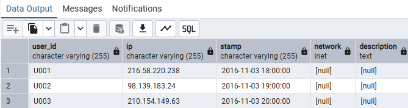


## 3. 데이터 중복 검출하기

마스터 데이터나 로그에 중복이 있으면 JOIN이나 집계 과정에서 실제보다 많은 건수가 계산될 수 있다. 중복을 확인한 뒤, 데이터의 의미에 맞는 기준으로 처리한다.

### 3-1 마스터 데이터의 중복 검출하기

하나의 ID가 하나의 레코드를 나타내야 하는 마스터에서 같은 ID가 여러 행에 존재하는지 확인한다.

**핵심 로직**

- 전체 행 수와 유일한 ID 수를 비교해 중복 가능성을 확인한다.
- `COUNT(DISTINCT id)`는 `NULL`을 세지 않으므로, ID 결손도 함께 확인한다.
- `GROUP BY id`와 `HAVING COUNT(*) > 1`로 중복된 ID를 찾는다.
- `STRING_AGG`로 중복 행의 값을 모아 확인할 수 있다.
- 원래 행을 유지하고 싶으면 `COUNT(*) OVER (PARTITION BY id)`를 사용한다.

```sql
-- 전체 건수와 키 개수 확인하기
SELECT
    COUNT(*) AS total_num,
    COUNT(id) AS non_null_key_num,
    COUNT(DISTINCT id) AS unique_key_num,
    COUNT(*) - COUNT(id) AS null_key_num
FROM public.mst_categories;
```

`non_null_key_num`이 `unique_key_num`보다 크면 `NULL`이 아닌 ID에 중복이 있다. `null_key_num`은 키가 누락된 행 수이다.

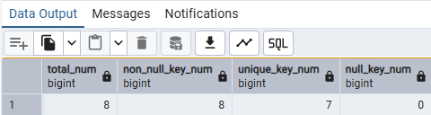

```sql
-- 중복된 ID와 값 확인하기
SELECT
    id,
    COUNT(*) AS record_num,
    STRING_AGG(name, ', ' ORDER BY stamp::timestamp) AS name_list,
    STRING_AGG(stamp::text, ', ' ORDER BY stamp::timestamp) AS stamp_list
FROM public.mst_categories
GROUP BY id
HAVING COUNT(*) > 1
ORDER BY id;
```
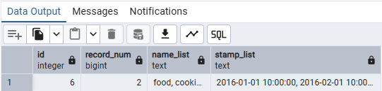

```sql
-- 원래 레코드 형태로 확인하기
WITH mst_categories_with_key_num AS (
    SELECT
        *,
        COUNT(*) OVER (PARTITION BY id) AS key_num
    FROM public.mst_categories
)
SELECT *
FROM mst_categories_with_key_num
WHERE key_num > 1
ORDER BY id, stamp::timestamp;
```
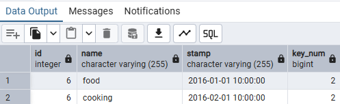

동일 데이터의 중복 적재인지, 값이 갱신되며 이전 데이터와 새 데이터가 함께 남은 것인지 원인을 구분한다. 원인에 따라 중복 적재를 막거나, 최신 레코드를 남기거나, 이력을 구분할 키를 설계할 수 있다.


### 3-2 로그 중복 검출하기 

동일 사용자가 같은 상품을 다시 클릭했다고 해서 모두 오류는 아니다. 세션이나 시간 간격을 함께 확인해 별개의 행동과 중복 기록을 구분해야 한다.

**핵심 로직**

- 사용자·액션·상품이 같은 로그를 묶어 중복 후보를 찾는다.
- 같은 세션 안에서 같은 행동이 반복된 경우에는 가장 먼저 발생한 로그를 남기는 기준을 적용할 수 있다.
- 시간만 집계하면 되는 경우에는 `GROUP BY`와 `MIN`을 사용한다.
- 원래 행의 컬럼을 유지하려면 `ROW_NUMBER`로 순번을 부여해 첫 행을 선택한다.
- 세션을 사용하기 어려우면 `LAG`로 직전 행동과의 시간 간격을 비교한다.

```sql
-- 중복 후보 확인하기
SELECT
    user_id,
    action,
    products,
    COUNT(*) AS record_num,
    STRING_AGG(session, ', ' ORDER BY stamp::timestamp) AS session_list,
    STRING_AGG(stamp::text, ', ' ORDER BY stamp::timestamp) AS stamp_list
FROM public.dup_action_log
GROUP BY user_id, action, products
HAVING COUNT(*) > 1
ORDER BY user_id, action, products;
```
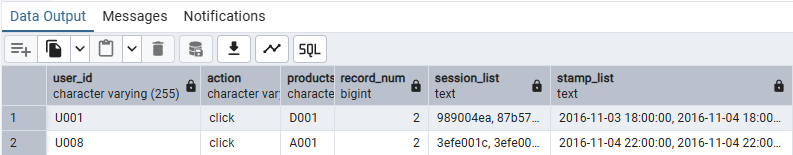

```sql
-- 같은 세션에서 가장 이른 시각만 남기기
SELECT
    session,
    user_id,
    action,
    products,
    MIN(stamp::timestamp) AS stamp
FROM public.dup_action_log
GROUP BY session, user_id, action, products
ORDER BY stamp, session, products;
```
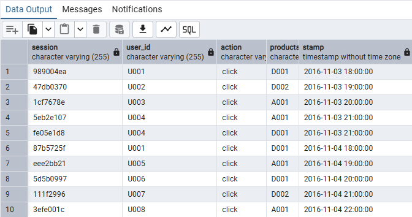

```sql
-- ROW_NUMBER로 중복을 제외한 행 조회하기
WITH numbered_log AS (
    SELECT
        *,
        ROW_NUMBER() OVER (
            PARTITION BY session, user_id, action, products
            ORDER BY stamp::timestamp
        ) AS order_num
    FROM public.dup_action_log
)
SELECT
    session,
    user_id,
    action,
    products,
    stamp
FROM numbered_log
WHERE order_num = 1
ORDER BY stamp::timestamp, session, products;
```
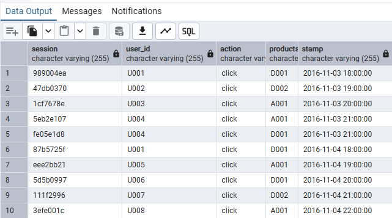

타임스탬프까지 같은 행이 있고 서로 다른 부가 정보를 가진다면, 어떤 행을 남길지 결정할 추가 정렬 기준이 필요하다.

```sql
-- 직전 행동으로부터 30분 미만인 로그 제외하기
WITH log_intervals AS (
    SELECT
        user_id,
        action,
        products,
        stamp,
        EXTRACT(EPOCH FROM (
            stamp::timestamp
            - LAG(stamp::timestamp) OVER (
                PARTITION BY user_id, action, products
                ORDER BY stamp::timestamp
            )
        )) AS lag_seconds
    FROM public.dup_action_log
)
SELECT
    user_id,
    action,
    products,
    stamp,
    lag_seconds
FROM log_intervals
WHERE lag_seconds IS NULL
   OR lag_seconds >= 30 * 60
ORDER BY stamp::timestamp, user_id, products;
```
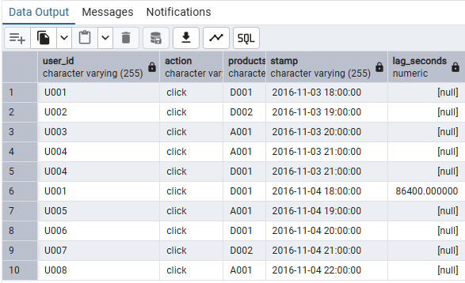

- `EXTRACT(EPOCH FROM ...)`: 시간 차이를 초 단위로 변환한다.
- `lag_seconds IS NULL`: 같은 사용자·액션·상품 조합의 첫 로그를 남긴다.
- `lag_seconds >= 1800`: 직전 원본 로그와 30분 이상 떨어진 로그를 남긴다. 정확히 30분인 경우도 유지된다.

이 쿼리들은 중복을 제외한 조회 결과를 만드는 것이며, 원본 테이블에서 행을 삭제하는 작업은 아니다.


## 4. 여러 개의 데이터셋 비교하기 

서로 다른 시점의 마스터 데이터나 서로 다른 지표로 만든 순위를 비교하면, 데이터와 분석 로직이 어떻게 달라졌는지 확인할 수 있다.

### 4-1 데이터의 차이 추출하기 

과거와 현재의 마스터 데이터를 같은 키로 연결해 추가·삭제·갱신된 데이터를 구분한다.

**핵심 로직**

- 새로운 데이터에만 있는 키는 추가된 레코드이다.
- 과거 데이터에만 있는 키는 삭제된 레코드이다.
- 양쪽에 모두 있는 키는 이름·가격·갱신 시각 등을 비교해 변경 여부를 판단한다.
- `LEFT JOIN`, `RIGHT JOIN`, `INNER JOIN`으로 각 경우를 따로 확인할 수 있다.
- `FULL OUTER JOIN`은 양쪽의 모든 키를 남겨 변경 내용을 한 번에 확인할 수 있게 한다.
- `IS DISTINCT FROM`은 `NULL`을 포함해 두 값이 다른지 판단한다.

#### 4-1-1 추가된 마스터 데이터 추출하기

```sql
SELECT new_mst.*
FROM public.mst_products_20170101 AS new_mst
LEFT JOIN public.mst_products_20161201 AS old_mst
    ON new_mst.product_id = old_mst.product_id
WHERE old_mst.product_id IS NULL
ORDER BY new_mst.product_id;
```
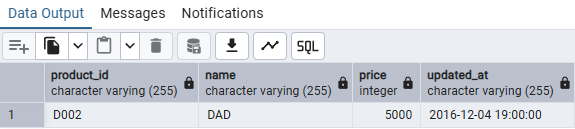

#### 4-1-2 제거된 마스터 데이터 추출하기

```sql
SELECT old_mst.*
FROM public.mst_products_20170101 AS new_mst
RIGHT JOIN public.mst_products_20161201 AS old_mst
    ON new_mst.product_id = old_mst.product_id
WHERE new_mst.product_id IS NULL
ORDER BY old_mst.product_id;
```
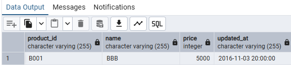

#### 4-1-3 갱신된 마스터 데이터 추출하기

```sql
SELECT
    new_mst.product_id,
    old_mst.name AS old_name,
    new_mst.name AS new_name,
    old_mst.price AS old_price,
    new_mst.price AS new_price,
    old_mst.updated_at AS old_updated_at,
    new_mst.updated_at AS new_updated_at
FROM public.mst_products_20170101 AS new_mst
JOIN public.mst_products_20161201 AS old_mst
    ON new_mst.product_id = old_mst.product_id
WHERE ROW(new_mst.name, new_mst.price, new_mst.updated_at)
      IS DISTINCT FROM
      ROW(old_mst.name, old_mst.price, old_mst.updated_at)
ORDER BY new_mst.product_id;
```

교재는 수정 시 `updated_at`이 반드시 갱신된다는 전제로 시각을 비교한다. 위 쿼리는 이름·가격·갱신 시각을 함께 비교해, 갱신 시각이 같아도 실제 값이 바뀌면 확인할 수 있도록 했다.
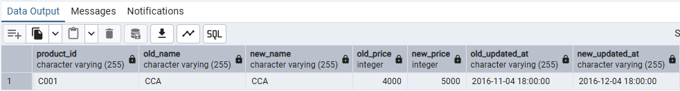

#### 4-1-4 변경된 마스터 데이터 모두 추출하기

```sql
SELECT
    COALESCE(new_mst.product_id, old_mst.product_id) AS product_id,
    old_mst.name AS old_name,
    new_mst.name AS new_name,
    old_mst.price AS old_price,
    new_mst.price AS new_price,
    old_mst.updated_at AS old_updated_at,
    new_mst.updated_at AS new_updated_at,
    CASE
        WHEN old_mst.product_id IS NULL THEN 'added'
        WHEN new_mst.product_id IS NULL THEN 'deleted'
        ELSE 'updated'
    END AS status
FROM public.mst_products_20170101 AS new_mst
FULL OUTER JOIN public.mst_products_20161201 AS old_mst
    ON new_mst.product_id = old_mst.product_id
WHERE old_mst.product_id IS NULL
   OR new_mst.product_id IS NULL
   OR ROW(new_mst.name, new_mst.price, new_mst.updated_at)
      IS DISTINCT FROM
      ROW(old_mst.name, old_mst.price, old_mst.updated_at)
ORDER BY product_id;
```
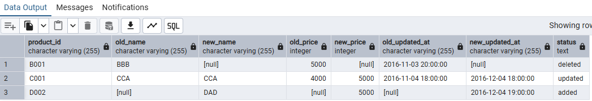

- `COALESCE`: 두 테이블 중 값이 존재하는 상품 ID를 가져온다.
- `status`: `added`는 추가, `deleted`는 삭제, `updated`는 공통 키의 값 변경을 나타낸다.

추가·삭제의 판정에는 `NULL`이 되지 않는 키인 `product_id`를 사용한다. 비교 전에 두 테이블의 키가 각각 유일한지도 확인한다.


### 4-2 두 순위의 유사도 계산하기

방문 횟수·방문자 수·페이지 뷰 등 서로 다른 지표로 만든 순위가 얼마나 비슷한지 수치로 비교한다. 순위의 관계를 나타내는 지표로 스피어만 순위 상관계수를 사용한다.

**핵심 로직**

- `path`별로 방문자 수·방문 횟수·페이지 뷰를 집계한다.
- `COUNT(DISTINCT long_session)`: 방문자 수의 대용 지표이다.
- `COUNT(DISTINCT short_session)`: 방문 횟수의 대용 지표이다.
- `COUNT(*)`: 페이지 뷰이다.
- 각 지표의 값이 클수록 앞선 순위를 부여하고, 같은 경로의 순위끼리 연결한다.
- 동순위가 있으면 평균 순위를 사용하고, 순위 간의 `CORR`를 구해 스피어만 상관계수를 계산한다.

교재는 동순위가 없는 경우에 사용할 수 있는 다음 식으로 순위 차이를 계산한다. 여기서 `d`는 같은 경로에 대한 두 순위의 차이이고, `N`은 비교하는 경로 수이다.

$$
Spearman = 1 - \frac{6\sum diff}{N^3 - N}
$$

동순위가 있으면 위 단순식을 그대로 적용할 수 없으므로, 아래 쿼리는 평균 순위를 만든 뒤 그 순위들의 상관계수를 구한다.

```sql
WITH path_stat AS (
    SELECT
        path,
        COUNT(DISTINCT long_session) AS access_users,
        COUNT(DISTINCT short_session) AS access_count,
        COUNT(*) AS page_view
    FROM public.access_log
    GROUP BY path
), metric_values AS (
    SELECT path, 'access_user' AS type, access_users AS metric_value
    FROM path_stat
    UNION ALL
    SELECT path, 'access_count', access_count
    FROM path_stat
    UNION ALL
    SELECT path, 'page_view', page_view
    FROM path_stat
), path_ranking AS (
    SELECT
        path,
        type,
        RANK() OVER (
            PARTITION BY type
            ORDER BY metric_value DESC
        ) + (
            COUNT(*) OVER (PARTITION BY type, metric_value) - 1
        ) / 2.0 AS rank
    FROM metric_values
), pair_ranking AS (
    SELECT
        r1.path,
        r1.type AS type1,
        r1.rank AS rank1,
        r2.type AS type2,
        r2.rank AS rank2,
        POWER(r1.rank - r2.rank, 2) AS diff
    FROM path_ranking AS r1
    JOIN path_ranking AS r2
        ON r1.path = r2.path
)
SELECT
    type1,
    type2,
    COUNT(*) AS path_count,
    CORR(
        rank1::double precision,
        rank2::double precision
    ) AS spearman
FROM pair_ranking
GROUP BY type1, type2
ORDER BY type1, spearman DESC NULLS LAST, type2;
```
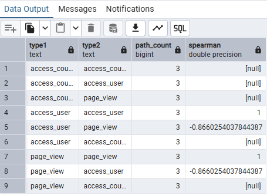

평균 순위는 `RANK() + (동순위 개수 - 1) / 2.0`으로 계산한다. 예를 들어 공동 2위가 두 개라면 각각 2위와 3위의 평균인 `2.5`를 부여한다. 양쪽 지표 모두 큰 값부터 순위를 부여하므로 순위 방향이 일치한다.

| 상관계수 | 해석 |
| --- | --- |
| `1` | 두 순위가 완전히 같은 방향이다. |
| `0`에 가까움 | 순위의 단조 관계가 약하다. |
| `-1` | 두 순위가 완전히 반대 방향이다. |
| `NULL` | 비교할 경로가 부족하거나 한쪽 순위가 모두 같아 상관계수를 정의할 수 없다. |

음수는 관계가 없다는 뜻이 아니라, 한쪽 순위가 높을수록 다른 쪽 순위는 낮아지는 반대 방향의 관계를 뜻한다. 또한 순위가 비슷하다는 사실만으로 어느 지표가 더 적절한지는 결정할 수 없으며, 분석 목적에 맞춰 판단해야 한다.

---

### 🎉 수고하셨습니다.
