# SQL_MASTER 7주차 정규과제

📌SQL MASTER 정규과제는 매주 정해진 분량의 『*데이터 분석을 위한 SQL 레시피*』 를 읽고 학습하는 것입니다. 이번 주는 아래의 **SQL_MASTER_7th_TIL**에 나열된 분량을 읽고 공부하시면 됩니다.

아래 실습을 수행하며 학습 내용을 직접 적용해보세요. 단순히 결과를 재현하는 것이 아니라, SQL을 직접 작성하는 과정에서 개념을 스스로 정리하는 것이 중요합니다.

필요한 경우 교재와 추가 자료를 참고하여 이해를 보완하시기 바랍니다.

## SQL_MASTER_7th_TIL

### 8장 데이터를 무기로 삼기 위한 분석 기술
#### 1. 검색 기능 평가하기
#### 2. 데이터마이닝
#### 3. 추천 (범위 제외)
#### 4. 점수 계산하기 (범위 제외)


## Study Schedule

| 주차  | 공부 범위     | 완료 여부 |
| ----- | ------------- | --------- |
| 1주차 | p.52~136   | ✅         |
| 2주차 | p.138~184  | ✅         |
| 3주차 | p.186~232 | ✅         |
| 4주차 | p.233~321 | ✅         |
| 5주차 | p.324~406 | ✅         |
| 6주차 | p.408~464 | ✅         |
| 7주차 | p.466~566 | ✅         |

<br>

<!-- 여기까진 그대로 둬 주세요-->


# 실습

## 0. 실습 규칙

1. 샘플 데이터 생성 코드는 **08_SQL_MASTER_Template/src** 경로에 장별로 정리되어 있습니다.
2. 아래 목차에 맞춰 해당 코드를 실행하여 샘플 데이터를 생성한 후, 각 장에서 요구하는 쿼리를 직접 작성해보시기 바랍니다.
3. 작성한 쿼리의 **실행 결과 화면도 함께 제출**해 주세요.
4. 단순히 교재의 예시 코드를 그대로 작성하는 것이 아니라, **제시된 로직을 충분히 이해한 뒤 교재를 보지 않고 스스로 쿼리를 구성**해보는 것을 권장합니다.
5. 교재 예시는 PostgreSQL, Hive, BigQuery 등 다양한 DBMS 기준으로 제시되어 있기 때문에, **MySQL이 아닌 다른 SQL 환경을 사용하여 실습을 진행해도 무방합니다.**
6. 다만, 사용 중인 DBMS에 맞는 문법으로 적절히 변환하여 작성하시기 바랍니다.

## 1. 검색 기능 평가하기

사용자가 검색했을 때 결과가 나오는지, 다시 검색하는지, 검색 후 이탈하는지를 살펴보면 검색 개선의 단서를 찾을 수 있다. 미리 정답 아이템을 준비하면 검색 결과의 포괄성·타당성·순위도 평가할 수 있다.

- 검색 기능을 개선하는 방법에는
    1. 검색 키워드의 흔들림(부정확도)을 흡수할 수 있는 **동의어 사전 추가**
    2. 검색 키워드를 검색 엔진이 이해할 수 있는 **사용자 사전 추가**
    3. 검색 결과가 사용자가 원하는 순서로 나오게 **정렬 순서 조정**
동의어 사전은 약칭·별칭·표기 차이를 흡수하고, 사용자 사전은 검색 엔진이 서비스의 고유한 단어를 올바르게 인식하도록 돕는다. 결과는 존재하지만 원하는 아이템이 아래에 있다면 정렬 순서를 점검한다.

### 1-1 No Match 비율과 키워드 집계하기 

검색 결과가 0개인 경우를 **NoMatch**라고 한다. 검색 엔진이 제대로 키워드를 파악하지 못하거나, 검색 키워드의 흔들림을 흡수하지 못할 가능성을 알아보려면, Nomatch 비율을 집계하는 것이 좋다. 전체 검색 중 NoMatch가 얼마나 발생하는지 확인하고, 자주 발생하는 키워드를 개선 후보로 찾는다.

**핵심 로직**

- `action = 'search'`인 로그를 검색 1회로 센다.
- `result_num = 0`이면 NoMatch로 판정한다.
- `CASE`로 NoMatch에 `1.0`, 그 외에 `0.0`을 부여하고 평균을 구하면 NoMatch 비율이 된다.
- 키워드별 비중은 **전체 검색 중 비중**과 **NoMatch 검색 중 비중**을 구분한다.


```sql
-- Nomatch 비율을 집계하는 쿼리
SELECT
    stamp::timestamp::date AS dt,
    COUNT(*) AS search_count,
    SUM(CASE WHEN result_num = 0 THEN 1 ELSE 0 END) AS no_match_count,
    AVG(CASE WHEN result_num = 0 THEN 1.0 ELSE 0.0 END) AS no_match_rate
FROM public.access_log
WHERE action = 'search'
GROUP BY stamp::timestamp::date
ORDER BY dt;
```

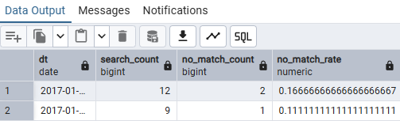

```sql
-- NoMatch 키워드를 집계하는 쿼리
WITH search_keyword_stat AS (
    SELECT
        keyword,
        result_num,
        COUNT(*) AS search_count,
        100.0 * COUNT(*) / SUM(COUNT(*)) OVER () AS search_share
    FROM public.access_log
    WHERE action = 'search'
    GROUP BY keyword, result_num
)
SELECT
    keyword,
    search_count,
    search_share,
    100.0 * search_count / SUM(search_count) OVER () AS no_match_share
FROM search_keyword_stat
WHERE result_num = 0
ORDER BY search_count DESC, keyword;
```
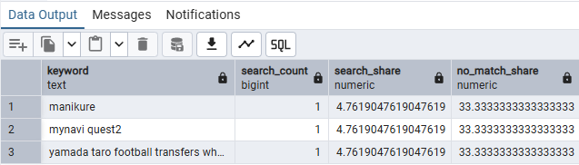

- `no_match_rate`: 0~1의 비율이다. `0.05`이면 5%이다.
- `search_share`: 해당 NoMatch 키워드의 검색 수 / 전체 검색 수 × 100.
- `no_match_share`: 해당 NoMatch 키워드의 검색 수 / 전체 NoMatch 검색 수 × 100.

전체 검색 수는 그룹 수가 아니라 검색 로그 수여야 하므로 `SUM(COUNT(*)) OVER ()`를 사용한다. 검색 결과가 `NULL`인 로그는 0개 결과와 구분해 결손을 점검한다. 실제 취급하지 않는 상품을 검색한 경우도 있으므로, NoMatch가 곧 검색 엔진 오류를 의미하지는 않는다.

### 1-2 재검색 비율과 키워드 집계하기 

검색 후 상세 페이지로 이동하지 않고 다시 검색했다면, 처음 결과로 원하는 정보를 찾지 못했을 가능성이 있다. 같은 세션에서 **검색 바로 다음 행동도 검색인 경우**를 재검색으로 집계한다.

**핵심 로직**

- `LEAD`로 같은 세션의 다음 액션·키워드·검색 결과 수를 가져온다.
- `action = 'search' AND next_action = 'search'`이면 재검색이다.
- 전체 검색 수를 분모로 재검색 비율을 계산한다.
- 원래 키워드와 다음 키워드를 함께 집계해 오타 교정·동의어·검색어 구체화 후보를 찾는다.

#### 1-2-1 재검색 비율 집계하기
- action과 next action이 모두 search인 레코드는 재검색 수라고 볼 수 있다.
```sql
-- 날짜별 재검색 비율
WITH access_log_with_next_search AS (
    SELECT
        *,
        LEAD(action) OVER w AS next_action,
        LEAD(keyword) OVER w AS next_keyword,
        LEAD(result_num) OVER w AS next_result_num
    FROM public.access_log
    WINDOW w AS (
        PARTITION BY session
        ORDER BY stamp::timestamp
    )
)
SELECT
    stamp::timestamp::date AS dt,
    COUNT(*) AS search_count,
    SUM(CASE WHEN next_action = 'search' THEN 1 ELSE 0 END) AS retry_count,
    AVG(CASE WHEN next_action = 'search' THEN 1.0 ELSE 0.0 END) AS retry_rate
FROM access_log_with_next_search
WHERE action = 'search'
GROUP BY stamp::timestamp::date
ORDER BY dt;
```
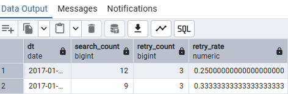

```sql
-- 재검색 전후 키워드 확인하기
WITH access_log_with_next_search AS (
    SELECT
        *,
        LEAD(action) OVER w AS next_action,
        LEAD(keyword) OVER w AS next_keyword,
        LEAD(result_num) OVER w AS next_result_num
    FROM public.access_log
    WINDOW w AS (
        PARTITION BY session
        ORDER BY stamp::timestamp
    )
)
SELECT
    keyword,
    result_num,
    next_keyword,
    next_result_num,
    COUNT(*) AS retry_count
FROM access_log_with_next_search
WHERE action = 'search'
  AND next_action = 'search'
GROUP BY keyword, result_num, next_keyword, next_result_num
ORDER BY retry_count DESC, keyword, next_keyword;
```
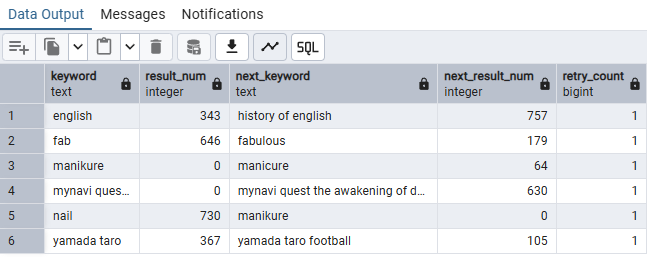

**`LEAD`를 계산한 다음 검색 로그를 추출해야 한다.** 먼저 검색 로그만 남기면 중간의 상세 페이지 이동이 사라져 재검색이 아닌 경우까지 재검색으로 계산된다. 또한 같은 세션 안에서 시각이 같은 로그가 있다면 실제 이벤트 순서를 나타내는 ID 등을 추가 정렬 기준으로 사용해야 한다.

### 1-3 재검색 키워드를 분류해서 집계하기 

재검색 전후 키워드를 비교하면 결과가 없어서 검색어를 바꾼 경우, 기존 검색어를 구체화한 경우, 다른 표현으로 바꾼 경우를 나누어 살펴볼 수 있다.

**핵심 로직**

- 검색 결과가 0개였다면 `NoMatch 조건 변경`으로 분류한다.
- 검색 겨로가가 너무 많으면 `단어를 필터링`한다.
- 검색어가 그대로라면 `동일 키워드 반복`으로 따로 구분한다.
- 다음 키워드가 원래 키워드를 포함하면 `검색어 구체화 후보`로 분류한다.
- 나머지는 `검색 키워드 변경`으로 분류한다.

- `LIKE '%' || keyword || '%'`는 포함 여부를 검사한다. 아래는 키워드 안의 `%`, `_`까지 문자 그대로 비교할 수 있도록 `POSITION`을 사용했다. `LOWER`와 `BTRIM`으로 대소문자·앞뒤 공백도 맞췄다.

```sql
WITH access_log_with_next_search AS (
    SELECT
        *,
        LEAD(action) OVER w AS next_action,
        LEAD(keyword) OVER w AS next_keyword,
        LEAD(result_num) OVER w AS next_result_num
    FROM public.access_log
    WINDOW w AS (
        PARTITION BY session
        ORDER BY stamp::timestamp
    )
), retry_log AS (
    SELECT
        *,
        NULLIF(LOWER(BTRIM(keyword)), '') AS normalized_keyword,
        NULLIF(LOWER(BTRIM(next_keyword)), '') AS normalized_next_keyword
    FROM access_log_with_next_search
    WHERE action = 'search'
      AND next_action = 'search'
), classified_retry AS (
    SELECT
        *,
        CASE
            WHEN result_num = 0 THEN 'NoMatch 조건 변경'
            WHEN normalized_keyword IS NULL
              OR normalized_next_keyword IS NULL THEN '키워드 결손'
            WHEN normalized_next_keyword = normalized_keyword
                THEN '동일 키워드 반복'
            WHEN POSITION(normalized_keyword IN normalized_next_keyword) > 0
                THEN '검색어 구체화 후보'
            ELSE '검색 키워드 변경'
        END AS retry_type
    FROM retry_log
)
SELECT
    retry_type,
    keyword,
    result_num,
    next_keyword,
    next_result_num,
    COUNT(*) AS retry_count
FROM classified_retry
GROUP BY retry_type, keyword, result_num, next_keyword, next_result_num
ORDER BY retry_type, retry_count DESC, keyword, next_keyword;
```
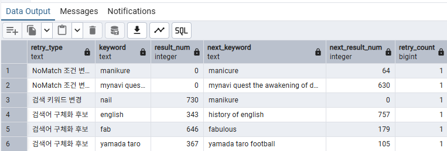

교재의 조건별 조회를 하나의 `CASE`로 묶고, 앞 조건을 우선 적용해 분류가 겹치지 않도록 했다. 문자열에 포함된다는 사실만으로 검색 의도를 확정할 수는 없으므로 구체화 **후보**로 해석한다. 다른 검색어로 바꾸었다고 해서 두 단어가 반드시 동의어인 것도 아니다.


### 1-4 검색 이탈 비율과 키워드 집계하기

검색 후 같은 세션에 더 이상 기록된 행동이 없으면 검색 이탈로 집계한다. 어떤 키워드에서 이탈이 자주 나타나는지 확인해 검색 결과와 순위를 점검한다.

**핵심 로직**

- 세션별 다음 액션을 `LEAD`로 구한다.
- 검색 로그에서 `next_action IS NULL`이면 이탈로 판정한다.
- 검색 이탈 수 / 전체 검색 수로 이탈 비율을 계산한다.
- 키워드별 비율은 이탈 로그만 먼저 남기지 않고 **모든 검색 로그**에서 계산한다.

**날짜별 검색 이탈 비율**

```sql
WITH access_log_with_next_search AS (
    SELECT
        *,
        LEAD(action) OVER w AS next_action,
        LEAD(keyword) OVER w AS next_keyword,
        LEAD(result_num) OVER w AS next_result_num
    FROM public.access_log
    WINDOW w AS (
        PARTITION BY session
        ORDER BY stamp::timestamp
    )
)
SELECT
    stamp::timestamp::date AS dt,
    COUNT(*) AS search_count,
    SUM(CASE WHEN next_action IS NULL THEN 1 ELSE 0 END) AS exit_count,
    AVG(CASE WHEN next_action IS NULL THEN 1.0 ELSE 0.0 END) AS exit_rate
FROM access_log_with_next_search
WHERE action = 'search'
GROUP BY stamp::timestamp::date
ORDER BY dt;
```
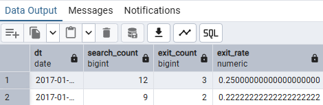

**검색 이탈이 발생한 키워드**

```sql
WITH access_log_with_next_search AS (
    SELECT
        *,
        LEAD(action) OVER w AS next_action,
        LEAD(keyword) OVER w AS next_keyword,
        LEAD(result_num) OVER w AS next_result_num
    FROM public.access_log
    WINDOW w AS (
        PARTITION BY session
        ORDER BY stamp::timestamp
    )
)
SELECT
    keyword,
    result_num,
    COUNT(*) AS search_count,
    SUM(CASE WHEN next_action IS NULL THEN 1 ELSE 0 END) AS exit_count,
    AVG(CASE WHEN next_action IS NULL THEN 1.0 ELSE 0.0 END) AS exit_rate
FROM access_log_with_next_search
WHERE action = 'search'
GROUP BY keyword, result_num
HAVING SUM(CASE WHEN next_action IS NULL THEN 1 ELSE 0 END) > 0
ORDER BY exit_count DESC, keyword, result_num;
```
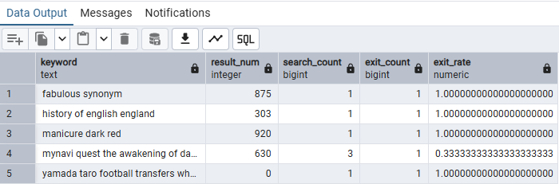

이 정의는 액션 값이 결손되지 않은 로그를 전제로 한다. 또한 관측 기간이 끝나 다음 행동을 수집하지 못한 경우나 로그 누락도 이탈처럼 보일 수 있다. 검색 결과 화면에서 필요한 정보를 얻고 떠난 경우도 있으므로, 이탈률만으로 불만족을 확정하지 않는다.

### 1-5 검색 키워드 관련 지표의 집계 효율화 하기

NoMatch·재검색·이탈을 각각 계산할 때 반복되는 전처리를 하나로 묶는다. 검색 1회에 다음 행동과 판정 플래그를 붙이면 여러 지표를 같은 기준으로 집계할 수 있다.

**핵심 로직**

- 전체 행동에서 다음 액션을 계산한 뒤 검색 로그만 추출한다.
- 검색 1회마다 NoMatch·재검색·이탈의 0/1 플래그를 만든다.
- `SUM`은 발생 횟수, `AVG`는 발생 비율을 구한다.

```sql
WITH access_log_with_next_search AS (
    SELECT
        *,
        LEAD(action) OVER w AS next_action,
        LEAD(keyword) OVER w AS next_keyword,
        LEAD(result_num) OVER w AS next_result_num
    FROM public.access_log
    WINDOW w AS (
        PARTITION BY session
        ORDER BY stamp::timestamp
    )
), search_log_with_flags AS (
    SELECT
        stamp::timestamp::date AS dt,
        session,
        keyword,
        result_num,
        next_action,
        next_keyword,
        next_result_num,
        CASE WHEN result_num = 0 THEN 1.0 ELSE 0.0 END AS is_no_match,
        CASE WHEN next_action = 'search' THEN 1.0 ELSE 0.0 END AS is_retry,
        CASE WHEN next_action IS NULL THEN 1.0 ELSE 0.0 END AS is_exit
    FROM access_log_with_next_search
    WHERE action = 'search'
)
SELECT
    dt,
    COUNT(*) AS search_count,
    SUM(is_no_match) AS no_match_count,
    AVG(is_no_match) AS no_match_rate,
    SUM(is_retry) AS retry_count,
    AVG(is_retry) AS retry_rate,
    SUM(is_exit) AS exit_count,
    AVG(is_exit) AS exit_rate
FROM search_log_with_flags
GROUP BY dt
ORDER BY dt;
```

키워드별로 보고 싶으면 마지막 집계의 `SELECT`, `GROUP BY`를 `keyword` 기준으로 변경한다. NoMatch 후 재검색하거나 이탈할 수 있으므로 **세 비율의 합이 1이 될 필요는 없다.** 같은 중간 데이터를 CTE·뷰·집계 테이블로 관리하면 지표 간 기준 차이를 줄일 수 있다.

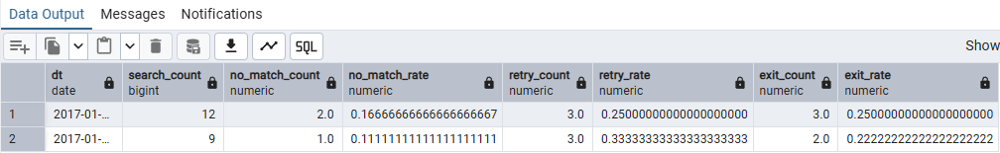

### 1-6 검색 결과의 포괄성을 지표화 하기

**재현율(Recall)**은 미리 정한 정답 아이템 중 실제 검색 결과에 포함된 비율이다. 원하는 아이템을 얼마나 빠짐없이 찾았는지 평가한다.

**핵심 로직**

- `keyword`, `item`으로 검색 결과와 정답을 `FULL OUTER JOIN`한다.
- 검색되지 않은 정답도 남겨야 정답 전체 수를 분모로 계산할 수 있다.
- `correct = 1`이면 정답이며, 순위별 누적 정답 수를 윈도 함수로 계산한다.
- Recall@n = 상위 n개에 포함된 정답 수 / 해당 키워드의 전체 정답 수.

아래 평가는 `(keyword, item)`이 각 테이블에서 유일하고, 검색 순위는 키워드별로 1부터 연속된 고유한 값이라는 전제이다. 정답이 하나도 정의되지 않은 키워드의 Recall은 `NULL`로 두며, 정답은 있지만 검색 결과가 없으면 Recall은 0이다.

**검색 순위별 누적 재현율**

```sql
WITH search_result_with_correct_items AS (
    SELECT
        COALESCE(r.keyword, c.keyword) AS keyword,
        r.rank,
        COALESCE(r.item, c.item) AS item,
        CASE WHEN c.item IS NOT NULL THEN 1 ELSE 0 END AS correct
    FROM public.search_result AS r
    FULL OUTER JOIN public.correct_result AS c
        ON r.keyword = c.keyword
       AND r.item = c.item
), cumulative_result AS (
    SELECT
        *,
        SUM(correct) OVER (
            PARTITION BY keyword
            ORDER BY rank ASC NULLS LAST, item
            ROWS BETWEEN UNBOUNDED PRECEDING AND CURRENT ROW
        ) AS cum_correct,
        SUM(correct) OVER (PARTITION BY keyword) AS total_correct,
        COUNT(rank) OVER (
            PARTITION BY keyword
            ORDER BY rank ASC NULLS LAST, item
            ROWS BETWEEN UNBOUNDED PRECEDING AND CURRENT ROW
        ) AS retrieved_count
    FROM search_result_with_correct_items
)
SELECT
    keyword,
    rank,
    item,
    correct,
    cum_correct,
    total_correct,
    CASE
        WHEN rank IS NULL THEN 0.0
        ELSE 100.0 * cum_correct / NULLIF(total_correct, 0)
    END AS recall
FROM cumulative_result
ORDER BY keyword, rank ASC NULLS LAST, item;
```

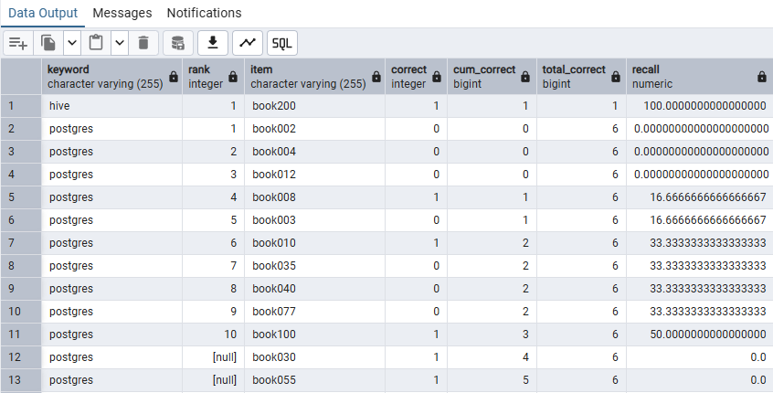

`rank IS NULL`인 행은 검색되지 않은 정답이다. 이 행의 `recall = 0`은 교재와 맞춘 표시용 값이며, 실제 순위의 Recall을 의미하지 않는다.

**키워드별 상위 5개의 재현율과 전체 평균**

```sql
WITH search_result_with_correct_items AS (
    SELECT
        COALESCE(r.keyword, c.keyword) AS keyword,
        r.rank,
        COALESCE(r.item, c.item) AS item,
        CASE WHEN c.item IS NOT NULL THEN 1 ELSE 0 END AS correct
    FROM public.search_result AS r
    FULL OUTER JOIN public.correct_result AS c
        ON r.keyword = c.keyword
       AND r.item = c.item
), cumulative_result AS (
    SELECT
        *,
        SUM(correct) OVER (
            PARTITION BY keyword
            ORDER BY rank ASC NULLS LAST, item
            ROWS BETWEEN UNBOUNDED PRECEDING AND CURRENT ROW
        ) AS cum_correct,
        SUM(correct) OVER (PARTITION BY keyword) AS total_correct,
        COUNT(rank) OVER (
            PARTITION BY keyword
            ORDER BY rank ASC NULLS LAST, item
            ROWS BETWEEN UNBOUNDED PRECEDING AND CURRENT ROW
        ) AS retrieved_count
    FROM search_result_with_correct_items
), recall_at_5_by_keyword AS (
    SELECT
        keyword,
        SUM(CASE WHEN rank <= 5 THEN correct ELSE 0 END) AS hit_count_at_5,
        MAX(total_correct) AS total_correct,
        100.0 * SUM(CASE WHEN rank <= 5 THEN correct ELSE 0 END)
            / NULLIF(MAX(total_correct), 0) AS recall_at_5
    FROM cumulative_result
    GROUP BY keyword
)
SELECT
    *,
    AVG(recall_at_5) OVER () AS average_recall_at_5
FROM recall_at_5_by_keyword
ORDER BY keyword;
```
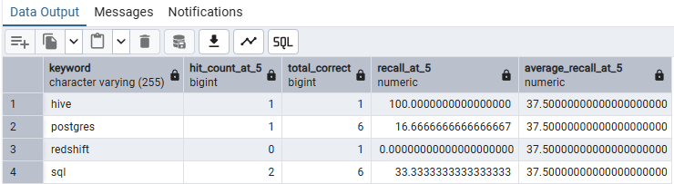

검색 결과가 5개보다 적더라도 분모는 **전체 정답 수**이다. 마지막 평균은 키워드별 값을 동일한 가중치로 평균한 값이다. `NULL`은 `AVG`에서 제외되므로 정답 미정의 키워드는 별도로 확인한다.

### 1-7 검색 결과의 타당성을 지표화하기

**정확률(Precision, 정밀도·적합률)**은 출력한 검색 결과 중 정답 아이템의 비율이다. 사용자가 본 결과가 얼마나 적절했는지 평가한다.

**핵심 로직**

- 정답 판정과 누적 정답 수 계산은 재현율과 같다.
- 분모를 전체 정답 수에서 **현재 순위까지 출력한 결과 수**로 바꾼다.
- 상위 5개를 기준으로 키워드별 정확률을 구하고 평균을 계산한다.

**검색 순위별 누적 정확률**

```sql
WITH search_result_with_correct_items AS (
    SELECT
        COALESCE(r.keyword, c.keyword) AS keyword,
        r.rank,
        COALESCE(r.item, c.item) AS item,
        CASE WHEN c.item IS NOT NULL THEN 1 ELSE 0 END AS correct
    FROM public.search_result AS r
    FULL OUTER JOIN public.correct_result AS c
        ON r.keyword = c.keyword
       AND r.item = c.item
), cumulative_result AS (
    SELECT
        *,
        SUM(correct) OVER (
            PARTITION BY keyword
            ORDER BY rank ASC NULLS LAST, item
            ROWS BETWEEN UNBOUNDED PRECEDING AND CURRENT ROW
        ) AS cum_correct,
        SUM(correct) OVER (PARTITION BY keyword) AS total_correct,
        COUNT(rank) OVER (
            PARTITION BY keyword
            ORDER BY rank ASC NULLS LAST, item
            ROWS BETWEEN UNBOUNDED PRECEDING AND CURRENT ROW
        ) AS retrieved_count
    FROM search_result_with_correct_items
)
SELECT
    keyword,
    rank,
    item,
    correct,
    cum_correct,
    CASE
        WHEN rank IS NULL THEN 0.0
        ELSE 100.0 * cum_correct / NULLIF(retrieved_count, 0)
    END AS precision
FROM cumulative_result
ORDER BY keyword, rank ASC NULLS LAST, item;
```
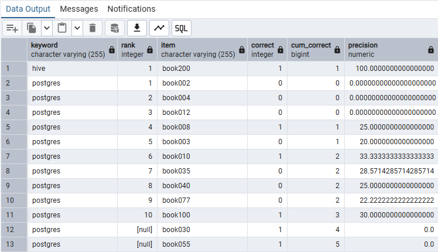

**키워드별 상위 5개 정확률과 전체 평균**

```sql
WITH search_result_with_correct_items AS (
    SELECT
        COALESCE(r.keyword, c.keyword) AS keyword,
        r.rank,
        COALESCE(r.item, c.item) AS item,
        CASE WHEN c.item IS NOT NULL THEN 1 ELSE 0 END AS correct
    FROM public.search_result AS r
    FULL OUTER JOIN public.correct_result AS c
        ON r.keyword = c.keyword
       AND r.item = c.item
), cumulative_result AS (
    SELECT
        *,
        SUM(correct) OVER (
            PARTITION BY keyword
            ORDER BY rank ASC NULLS LAST, item
            ROWS BETWEEN UNBOUNDED PRECEDING AND CURRENT ROW
        ) AS cum_correct,
        SUM(correct) OVER (PARTITION BY keyword) AS total_correct,
        COUNT(rank) OVER (
            PARTITION BY keyword
            ORDER BY rank ASC NULLS LAST, item
            ROWS BETWEEN UNBOUNDED PRECEDING AND CURRENT ROW
        ) AS retrieved_count
    FROM search_result_with_correct_items
), precision_at_5_by_keyword AS (
    SELECT
        keyword,
        SUM(CASE WHEN rank <= 5 THEN correct ELSE 0 END) AS hit_count_at_5,
        COUNT(CASE WHEN rank <= 5 THEN 1 END) AS result_count_at_5,
        COALESCE(
            100.0 * SUM(CASE WHEN rank <= 5 THEN correct ELSE 0 END)
                / NULLIF(COUNT(CASE WHEN rank <= 5 THEN 1 END), 0),
            0.0
        ) AS precision_at_5
    FROM cumulative_result
    GROUP BY keyword
)
SELECT
    *,
    AVG(precision_at_5) OVER () AS average_precision_at_5
FROM precision_at_5_by_keyword
ORDER BY keyword;
```
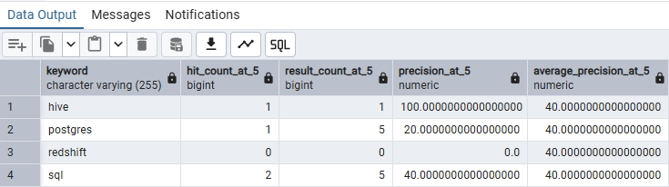

| 지표 | 분모 | 확인하는 것 |
| --- | --- | --- |
| Recall | 전체 정답 수 | 원하는 아이템을 얼마나 빠짐없이 찾았는가 |
| Precision | 출력한 검색 결과 수 | 보여준 결과 중 얼마나 정답인가 |

정확률과 재현율은 해당 범위 안에서 정답이 어느 순서로 배치되었는지는 구분하지 못한다. 정답의 순위까지 평가하려면 다음 절의 AP·MAP 등을 사용한다.

### 1-8 검색 결과 순위와 관련된 지표 계산하기

상위 10개 안의 정답 수가 같아도 정답이 앞쪽에 있는 검색 결과가 사용자에게 더 유용할 수 있다. **AP(Average Precision)**와 **MAP(Mean Average Precision)**을 사용해 정답의 순위를 평가한다.

**핵심 로직**

- 정답이 나타나는 각 순위에서 Precision을 구한다.
- 검색되지 않은 정답의 기여도는 0으로 둔다.
- 그 값을 모두 더해 전체 정답 수로 나누면 키워드별 AP가 된다.
- 키워드별 AP를 평균하면 검색 엔진의 MAP이 된다.

AP = 정답이 나온 순위의 Precision 합계 / 전체 정답 수.

아래는 샘플의 제공된 검색 결과 전체에 대해 계산한다. `Precision@5`의 키워드 평균과 MAP은 다른 지표이다.

```sql
WITH search_result_with_correct_items AS (
    SELECT
        COALESCE(r.keyword, c.keyword) AS keyword,
        r.rank,
        COALESCE(r.item, c.item) AS item,
        CASE WHEN c.item IS NOT NULL THEN 1 ELSE 0 END AS correct
    FROM public.search_result AS r
    FULL OUTER JOIN public.correct_result AS c
        ON r.keyword = c.keyword
       AND r.item = c.item
), cumulative_result AS (
    SELECT
        *,
        SUM(correct) OVER (
            PARTITION BY keyword
            ORDER BY rank ASC NULLS LAST, item
            ROWS BETWEEN UNBOUNDED PRECEDING AND CURRENT ROW
        ) AS cum_correct,
        SUM(correct) OVER (PARTITION BY keyword) AS total_correct,
        COUNT(rank) OVER (
            PARTITION BY keyword
            ORDER BY rank ASC NULLS LAST, item
            ROWS BETWEEN UNBOUNDED PRECEDING AND CURRENT ROW
        ) AS retrieved_count
    FROM search_result_with_correct_items
), precision_by_result AS (
    SELECT
        *,
        CASE
            WHEN rank IS NULL THEN 0.0
            ELSE 100.0 * cum_correct / NULLIF(retrieved_count, 0)
        END AS precision_at_rank
    FROM cumulative_result
), average_precision_by_keyword AS (
    SELECT
        keyword,
        SUM(CASE WHEN correct = 1 THEN precision_at_rank ELSE 0.0 END)
            / NULLIF(MAX(total_correct), 0) AS average_precision
    FROM precision_by_result
    GROUP BY keyword
)
SELECT
    keyword,
    average_precision,
    AVG(average_precision) OVER () AS mean_average_precision
FROM average_precision_by_keyword
ORDER BY keyword;
```
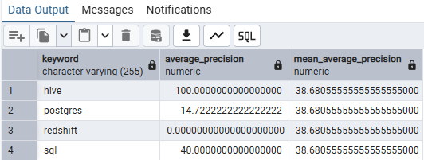

정답 아이템이 4개이고 모두 1~4위에 있으면 AP는 100%이다. 같은 4개가 7~10위에 있다면 각 정답이 나타날 때의 Precision이 낮아져 AP도 낮아진다.

**함께 알아둘 평가 지표**

| 지표 | 평가하는 내용 |
| --- | --- |
| P@n | 상위 n개 결과의 정확률. 결과 수가 n개 미만일 때의 분모 정책을 명시한다. |
| MAP | 정답이 앞쪽에 배치되는지를 AP의 키워드 평균으로 평가한다. |
| MRR | 첫 정답 순위의 역수를 키워드별로 평균한다. 정답이 없으면 기여도는 0이다. |
| F1 | Precision과 Recall의 조화 평균이다. |
| NDCG | 정답의 관련도를 여러 단계로 평가하고, 아래 순위일수록 기여도를 줄인다. |
| BPREF | 관련·비관련으로 판정된 아이템의 상대적 순서를 사용하며, 판정이 불완전한 평가에 활용한다. |

Recall·Precision·AP·MAP은 여기서 0~100의 백분율로 출력했다. 정답 목록과 평가 키워드 집합을 고정해야 검색 엔진 변경 전후를 같은 조건으로 비교할 수 있다.


## 2. 데이터 마이닝

대량의 데이터에서 반복되는 패턴이나 규칙을 찾는다. 이번 강에서는 두 상품이 같은 주문에 함께 포함되는 경향을 SQL로 계산한다.

### 2-1 어소시에이션 분석

상품 A를 구매한 주문에서 상품 B도 함께 구매한 비율을 구하고, B 자체의 인기도와 비교한다. `A → B`와 `B → A`는 조건으로 삼는 상품이 다르므로 확신도가 다를 수 있다.

**핵심 로직**

- 분석 단위는 상품 상세 행이 아니라 `purchase_id`로 구분한 **주문 1건**이다.
- 같은 주문의 동일 상품을 `DISTINCT`로 한 번만 남긴다.
- 같은 주문 ID로 자기 결합해 서로 다른 상품의 페어를 만든다.
- 전체 주문 수, A 주문 수, B 주문 수, A·B 동시 주문 수로 지표를 계산한다.

| 지표 | 계산식 | 의미 |
| --- | --- | --- |
| 지지도 Support | A·B 동시 주문 수 / 전체 주문 수 | 이 조합이 전체 주문에서 얼마나 흔한가 |
| 확신도 Confidence | A·B 동시 주문 수 / A 주문 수 | A가 있는 주문 중 B도 있는 비율 |
| 리프트 Lift | Confidence(A → B) / B의 전체 구매 비율 | B의 기본 구매 비율보다 얼마나 높은가 |

```sql
WITH purchase_products AS (
    SELECT DISTINCT purchase_id, product_id
    FROM public.purchase_detail_log
    WHERE purchase_id IS NOT NULL
      AND product_id IS NOT NULL
), purchase_id_count AS (
    SELECT COUNT(DISTINCT purchase_id) AS purchase_count
    FROM purchase_products
), purchase_detail_log_with_counts AS (
    SELECT
        d.purchase_id,
        d.product_id,
        p.purchase_count,
        COUNT(*) OVER (PARTITION BY d.product_id) AS product_count
    FROM purchase_products AS d
    CROSS JOIN purchase_id_count AS p
), product_pair_with_stat AS (
    SELECT
        l1.product_id AS p1,
        l2.product_id AS p2,
        l1.product_count AS p1_count,
        l2.product_count AS p2_count,
        COUNT(*) AS p1_p2_count,
        l1.purchase_count
    FROM purchase_detail_log_with_counts AS l1
    JOIN purchase_detail_log_with_counts AS l2
        ON l1.purchase_id = l2.purchase_id
       AND l1.product_id <> l2.product_id
    GROUP BY
        l1.product_id, l2.product_id,
        l1.product_count, l2.product_count, l1.purchase_count
)
SELECT
    p1,
    p2,
    purchase_count,
    p1_count,
    p2_count,
    p1_p2_count,
    100.0 * p1_p2_count / NULLIF(purchase_count, 0) AS support,
    100.0 * p1_p2_count / NULLIF(p1_count, 0) AS confidence,
    (1.0 * p1_p2_count / NULLIF(p1_count, 0))
        / NULLIF(1.0 * p2_count / NULLIF(purchase_count, 0), 0) AS lift
FROM product_pair_with_stat
ORDER BY p1, p2;
```
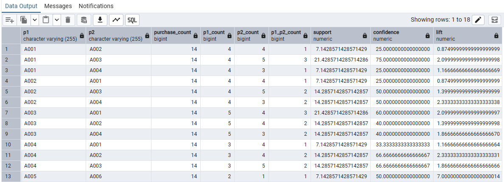

- `support`, `confidence`는 백분율, `lift`는 배수이다.
- `lift > 1`이면 A가 있는 주문에서 B가 더 자주 함께 나타난다. `lift = 1`이면 이 지표상 추가 연관이 없고, `lift < 1`이면 덜 나타난다.
- A·B의 지지도와 리프트는 방향을 바꾸어도 같지만, 확신도는 분모가 달라 달라질 수 있다.
- 리프트가 높더라도 실제 동시 구매가 1건뿐일 수 있으므로 주문 수와 지지도를 함께 확인한다.

이 분석은 **같은 주문 안의 연관성**을 계산한다. A를 먼저 구매해서 나중에 B를 구매했다는 시간 순서나 인과관계를 입증하지 않는다. `p2_count`는 B만 구매한 주문 수가 아니라 **A와 함께 구매한 주문까지 포함한 B 전체 주문 수**이다.

## 3. 추천

추천은 사용자가 선택할 만한 정보를 제안해 탐색과 의사결정을 돕는 기능이다. 복잡한 알고리즘뿐 아니라 최근 본 상품, 인기 순위, 관련 상품도 목적에 따라 추천 모듈이 될 수 있다.

### 3-1 추천 시스템의 넓은 의미

추천을 만들기 전에 어떤 정보를 누구에게, 어떤 목적으로 보여줄지 정한다. 문구가 아니라 실제 계산에 사용한 기준으로 추천 방식을 구분한다.

**핵심 내용**

| 구분 | 기준 | 예시 |
| --- | --- | --- |
| Item to Item | 특정 아이템과 관련된 다른 아이템 | 이 상품을 본 사람이 함께 본 상품 |
| User to Item | 사용자별 선호·행동 이력 | 사용자를 위한 개인화 추천 |
| 리마인드 | 과거 행동 | 최근 본 상품, 다시 구매하기 |
| 인기 순위 | 전체 열람·구매 등 | 인기 상품, 급상승 상품 |
| 콘텐츠 기반 | 상품 속성 | 같은 배우·장르·카테고리의 상품 |

| 데이터 | 얻는 방법 | 해석할 때 확인할 점 |
| --- | --- | --- |
| 명시적 데이터 | 별점·선호 응답 | 직접 표현한 평가지만 참여자와 응답 수가 제한된다. |
| 암묵적 데이터 | 열람·구매 이력 | 많이 수집할 수 있지만 행동이 곧 만족이나 선호를 뜻하지는 않는다. |

열람 로그는 비교 중인 유사 상품을, 구매 로그는 함께 사용할 보완 상품을 찾는 데 활용할 수 있다. 실제 효과는 서비스와 데이터에 따라 확인해야 한다.

- **크로스셀:** 함께 사용할 상품을 제안해 추가 구매를 유도한다.
- **업셀:** 상위 모델이나 고성능 상품을 제안한다.
- **다운셀:** 가격 부담이 적은 대안을 제안해 구매를 돕는다.

추천의 목표를 먼저 정해야 데이터·점수·노출 위치·평가 지표를 일관되게 선택할 수 있다.

### 3-2 특정 아이템에 흥미가 있는 사람이 함께 찾아보는 아이템 검색

사용자별 상품 열람·구매 점수를 만들고, 공통 사용자의 행동이 비슷한 상품을 찾는다. 이를 **Item to Item 추천**에 사용한다.

**핵심 로직**

- 사용자·상품별로 열람 수와 구매 수를 집계한다.
- `0.3 × 열람 수 + 0.7 × 구매 수`를 관심도 점수로 삼는다.
- 상품별로 사용자 점수를 나열한 벡터를 만들고, 공통 사용자 기준으로 자기 결합한다.
- 점수를 곱해 더한 값은 벡터의 내적이다.
- 상품별 점수를 L2 정규화한 뒤 내적하면 코사인 유사도가 된다.

**사용자·상품별 관심도 점수**

```sql
WITH ratings AS (
    SELECT
        user_id,
        product,
        SUM(CASE WHEN action = 'view' THEN 1 ELSE 0 END) AS view_count,
        SUM(CASE WHEN action = 'purchase' THEN 1 ELSE 0 END) AS purchase_count,
        0.3 * SUM(CASE WHEN action = 'view' THEN 1 ELSE 0 END)
        + 0.7 * SUM(CASE WHEN action = 'purchase' THEN 1 ELSE 0 END) AS score
    FROM public.action_log
    WHERE action IN ('view', 'purchase')
    GROUP BY user_id, product
)
SELECT *
FROM ratings
ORDER BY user_id, score DESC, product;
```
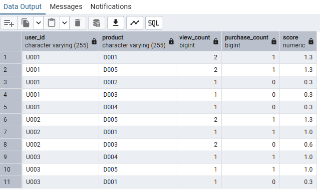

열람·구매의 3:7은 **횟수에 곱하는 계수의 비율**이다. 열람 횟수가 훨씬 많다면 열람의 총 기여도가 더 커질 수도 있다.

**내적과 코사인 유사도로 관련 상품 순위 만들기**

```sql
WITH ratings AS (
    SELECT
        user_id,
        product,
        SUM(CASE WHEN action = 'view' THEN 1 ELSE 0 END) AS view_count,
        SUM(CASE WHEN action = 'purchase' THEN 1 ELSE 0 END) AS purchase_count,
        0.3 * SUM(CASE WHEN action = 'view' THEN 1 ELSE 0 END)
        + 0.7 * SUM(CASE WHEN action = 'purchase' THEN 1 ELSE 0 END) AS score
    FROM public.action_log
    WHERE action IN ('view', 'purchase')
    GROUP BY user_id, product
), product_base_normalized_ratings AS (
    SELECT
        user_id,
        product,
        score,
        SQRT(SUM(score * score) OVER (PARTITION BY product)) AS norm,
        score / NULLIF(
            SQRT(SUM(score * score) OVER (PARTITION BY product)), 0
        ) AS norm_score
    FROM ratings
), item_similarities AS (
    SELECT
        r1.product AS target,
        r2.product AS related,
        COUNT(*) AS common_users,
        SUM(r1.score * r2.score) AS dot_product,
        SUM(r1.norm_score * r2.norm_score) AS cosine_similarity
    FROM product_base_normalized_ratings AS r1
    JOIN product_base_normalized_ratings AS r2
        ON r1.user_id = r2.user_id
       AND r1.product <> r2.product
    GROUP BY r1.product, r2.product
)
SELECT
    *,
    ROW_NUMBER() OVER (
        PARTITION BY target
        ORDER BY cosine_similarity DESC, related
    ) AS rank
FROM item_similarities
ORDER BY target, rank;
```
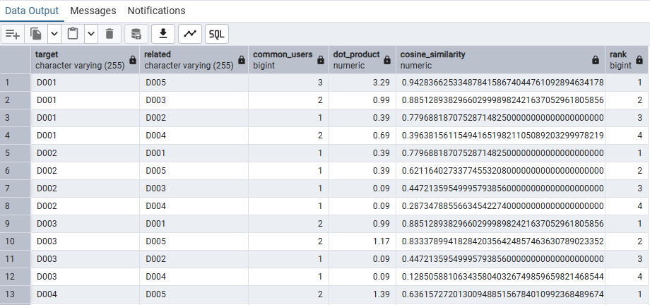

L2 노름은 `SQRT(점수 제곱의 합)`이다. 상품별로 정규화하므로 `PARTITION BY product`를 사용한다. 원래 내적은 점수 크기의 영향을 많이 받지만 코사인 유사도는 벡터의 방향을 비교한다.

이 예시는 점수가 음수가 아니므로 코사인 유사도가 0~1 범위이다. 1은 두 벡터의 방향이 같다는 뜻이며 상품 자체가 동일하다는 뜻은 아니다. 공통 사용자가 없는 상품 페어는 JOIN 결과에 나타나지 않는다. 자기 자신을 추천하지 않도록 같은 상품 페어는 제외했다.

### 3-3 당신을 위한 추천 상품

행동이 비슷한 사용자를 찾고, 그 사용자가 관심을 보인 상품을 추천 후보로 가져온다. 이를 **사용자 기반 협업 필터링**으로 구현한다.

**핵심 로직**

- 사용자별 상품 점수 벡터를 L2 정규화한다.
- 공통 상품으로 자기 결합해 사용자 사이의 코사인 유사도를 구한다.
- 유사도 상위 사용자의 상품에 `사용자 유사도 × 상품 관심도`를 곱해 추천 점수를 계산한다.
- 대상 사용자가 이미 구매한 상품을 제외한 뒤 순위를 다시 매긴다.

**유사 사용자 확인하기**

```sql
WITH ratings AS (
    SELECT
        user_id,
        product,
        SUM(CASE WHEN action = 'view' THEN 1 ELSE 0 END) AS view_count,
        SUM(CASE WHEN action = 'purchase' THEN 1 ELSE 0 END) AS purchase_count,
        0.3 * SUM(CASE WHEN action = 'view' THEN 1 ELSE 0 END)
        + 0.7 * SUM(CASE WHEN action = 'purchase' THEN 1 ELSE 0 END) AS score
    FROM public.action_log
    WHERE action IN ('view', 'purchase')
    GROUP BY user_id, product
), user_base_normalized_ratings AS (
    SELECT
        user_id,
        product,
        score,
        score / NULLIF(
            SQRT(SUM(score * score) OVER (PARTITION BY user_id)), 0
        ) AS norm_score
    FROM ratings
), user_similarities AS (
    SELECT
        r1.user_id,
        r2.user_id AS related_user,
        COUNT(*) AS common_products,
        SUM(r1.norm_score * r2.norm_score) AS similarity
    FROM user_base_normalized_ratings AS r1
    JOIN user_base_normalized_ratings AS r2
        ON r1.product = r2.product
       AND r1.user_id <> r2.user_id
    GROUP BY r1.user_id, r2.user_id
), related_users AS (
    SELECT
        *,
        ROW_NUMBER() OVER (
            PARTITION BY user_id
            ORDER BY similarity DESC, related_user
        ) AS neighbor_rank
    FROM user_similarities
)
SELECT *
FROM related_users
ORDER BY user_id, neighbor_rank;
```
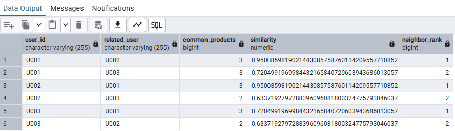

Item to Item과 달리 사용자 벡터를 정규화하므로 `PARTITION BY user_id`를 사용한다.

**가장 유사한 사용자 1명을 기반으로 미구매 상품 추천하기**

```sql
WITH ratings AS (
    SELECT
        user_id,
        product,
        SUM(CASE WHEN action = 'view' THEN 1 ELSE 0 END) AS view_count,
        SUM(CASE WHEN action = 'purchase' THEN 1 ELSE 0 END) AS purchase_count,
        0.3 * SUM(CASE WHEN action = 'view' THEN 1 ELSE 0 END)
        + 0.7 * SUM(CASE WHEN action = 'purchase' THEN 1 ELSE 0 END) AS score
    FROM public.action_log
    WHERE action IN ('view', 'purchase')
    GROUP BY user_id, product
), user_base_normalized_ratings AS (
    SELECT
        user_id,
        product,
        score,
        score / NULLIF(
            SQRT(SUM(score * score) OVER (PARTITION BY user_id)), 0
        ) AS norm_score
    FROM ratings
), user_similarities AS (
    SELECT
        r1.user_id,
        r2.user_id AS related_user,
        COUNT(*) AS common_products,
        SUM(r1.norm_score * r2.norm_score) AS similarity
    FROM user_base_normalized_ratings AS r1
    JOIN user_base_normalized_ratings AS r2
        ON r1.product = r2.product
       AND r1.user_id <> r2.user_id
    GROUP BY r1.user_id, r2.user_id
), related_users AS (
    SELECT
        *,
        ROW_NUMBER() OVER (
            PARTITION BY user_id
            ORDER BY similarity DESC, related_user
        ) AS neighbor_rank
    FROM user_similarities
), recommendation_candidates AS (
    SELECT
        u.user_id,
        r.product,
        SUM(u.similarity * r.score) AS recommendation_score
    FROM related_users AS u
    JOIN ratings AS r
        ON u.related_user = r.user_id
    WHERE u.neighbor_rank <= 1
    GROUP BY u.user_id, r.product
), unpurchased_candidates AS (
    SELECT p.*
    FROM recommendation_candidates AS p
    LEFT JOIN ratings AS own
        ON p.user_id = own.user_id
       AND p.product = own.product
    WHERE COALESCE(own.purchase_count, 0) = 0
)
SELECT
    *,
    ROW_NUMBER() OVER (
        PARTITION BY user_id
        ORDER BY recommendation_score DESC, product
    ) AS rank
FROM unpurchased_candidates
ORDER BY user_id, rank;
```
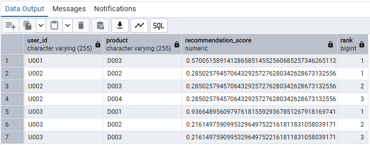

- `neighbor_rank <= 1`을 `<= 5` 등으로 바꾸면 더 많은 유사 사용자를 반영할 수 있다.
- 이미 열람했지만 구매하지 않은 상품은 추천에 남는다. 이 예시의 제외 기준은 **열람 여부가 아니라 구매 여부**이다.
- `COALESCE`로 행동 이력이 없는 상품의 구매 수를 0으로 취급한다.
- 이력이 부족하거나 다른 사용자와 공통 상품이 없으면 추천이 나오지 않을 수 있다. 이런 사용자에게는 인기 순위·콘텐츠 기반 추천 등을 보완적으로 적용한다.

자기 결합은 데이터가 늘면 계산량이 커지므로, 대상 기간·최소 행동 수·이웃 수 등을 정해 처리 범위를 관리한다.

### 3-4 추천 시스템을 개선할 때의 포인트

추천은 유사도 공식 하나만 바꾸는 작업이 아니다. 데이터 수집부터 최종 정렬까지 어떤 부분을 바꾸었는지 구분해서 개선한다.

**핵심 내용**

| 단계 | 개선할 내용 | 예시 |
| --- | --- | --- |
| 데이터 수집 | 목적에 맞는 신호 확보 | 열람·구매·리뷰·상품 속성 수집 |
| 데이터 가공 | 잡음과 기간 처리 | 봇·중복·이상 행동 제외, 최근 행동에 가중치 |
| 데이터 계산 | 점수와 계산 방식 | 열람·구매 가중치 조정, 인기 순위와 협업 필터링 비교 |
| 데이터 정렬 | 실제 노출 가능한 목록 구성 | 품절·판매 종료 상품 제외, 다양성·신규성 반영 |

- **가중치:** 어떤 행동을 더 강한 관심으로 볼지 정한다.
- **필터:** 추천할 수 없거나 목적에 맞지 않는 상품을 제외한다.
- **정렬:** 매출·발견·탐색 등 목표에 맞게 최종 우선순위를 정한다.

소비재의 재구매 추천과 일회성 구매 상품은 이미 구매한 상품을 처리하는 기준이 다를 수 있다. 변경 전후의 데이터 기간과 평가 조건을 맞춰 결과를 비교한다.

### 3-5 출력할 때의 포인트

같은 추천 목록이라도 어느 페이지에서 언제 보여주는지에 따라 효과가 달라질 수 있다. 추천 로직과 함께 사용자에게 제안하는 방식을 설계한다.

**핵심 내용**

| 노출 상황 | 추천 방향 | 확인할 점 |
| --- | --- | --- |
| 상품 탐색 중 | 유사 상품·대체 상품 | 비교를 돕는가 |
| 장바구니·구매 완료 | 함께 사용할 보완 상품 | 구매 흐름을 방해하지 않는가 |
| 검색 결과 없음 | 인기 상품·관련 상품 | 탐색을 이어갈 수 있는가 |
| 무료 배송 기준 미달 | 함께 살 만한 상품 | 추가 금액과 혜택이 명확한가 |

추천의 근거를 데이터가 뒷받침할 때 “함께 구매한 상품” 등으로 설명하면 사용자가 제안을 이해하기 쉽다. 페이지 위치·노출 시점·문구·버튼도 비교해보고, 실제 클릭과 구매 행동으로 효과를 확인한다.

### 3-6 추천과 관련한 지표

클릭률이나 매출뿐 아니라, 누구에게 얼마나 폭넓고 유용한 추천을 제공하는지도 확인한다.

**핵심 내용**

| 지표 | 확인하는 것 |
| --- | --- |
| Coverage | 추천을 제공할 수 있는 사용자·아이템의 비율 |
| Confidence | 추천을 뒷받침하는 데이터와 시스템의 신뢰 수준 |
| Trust | 사용자가 추천을 신뢰하는 정도 |
| Novelty | 사용자가 아직 잘 모르는 아이템을 제안하는 정도 |
| Serendipity | 예상 밖이면서 유용한 아이템을 발견하게 하는 정도 |
| Diversity | 추천 목록이 여러 종류의 아이템을 포함하는 정도 |
| Utility | 추천이 사용자·서비스 목적에 주는 효용 |
| Risk | 추천 대상에 수반되는 위험 |
| Robustness | 조작·공격·이상 행동에 덜 왜곡되는 정도 |
| Privacy | 추천 과정과 결과에서 개인 정보가 노출되는 정도 |
| Adaptivity | 선호·유행·아이템 변화에 대응하는 정도 |
| Scalability | 데이터 증가에 대응하는 처리 능력 |

사용자 Coverage는 `추천을 제공할 수 있는 사용자 수 / 대상 사용자 수`, 아이템 Coverage는 `추천에 포함된 고유 아이템 수 / 대상 아이템 수` 등으로 정의할 수 있다. 분모의 대상과 평가 기간을 정해두어야 한다. 추천 결과가 있는 사용자만 분모에 넣으면 추천을 받지 못한 사용자가 빠진다.

추천의 **정확도는 과거 데이터로 평가**하고, **실제 효과는 노출·클릭·전환·매출 등의 비교 실험으로 확인**한다. 학습에 쓴 구매를 정답으로 다시 평가하지 않도록 시간 순서에 따라 학습·평가 기간을 나눈다.

## 4. 점수 계산하기

여러 지표를 하나의 점수로 합치거나 순위를 만들 때는 지표의 의미·범위·분포·기간을 맞춰야 한다. 가중치를 조정하기 전에 서로 비교 가능한 값인지 확인한다.

### 4-1 여러 값을 균형 있게 조합해서 점수 계산하기

재현율과 정확률처럼 여러 지표를 하나로 평가할 때 산술 평균·기하 평균·조화 평균을 사용할 수 있다. 낮은 지표를 얼마나 엄격하게 반영할지에 따라 평균을 선택한다.

**핵심 로직**

| 평균 | 두 값 a, b의 계산식 | 특징 |
| --- | --- | --- |
| 산술 평균 | `(a + b) / 2` | 값을 더해 평균한다. |
| 기하 평균 | `SQRT(a * b)` | 곱셈으로 결합하며 낮은 값을 더 반영한다. |
| 조화 평균 | `2 / (1/a + 1/b)` | 낮은 값의 영향을 더 크게 반영한다. |

양수인 값에서는 산술 평균 ≥ 기하 평균 ≥ 조화 평균이고, 두 값이 같으면 세 평균이 같다. 재현율·정확률의 조화 평균은 **F1 점수**이다.

아래는 교재처럼 두 값이 모두 양수인 대상만 계산한다. 따라서 `/search5`처럼 정확률이 0인 행은 제외된다. 전체 평가에 적용할 때는 0점 대상을 제외할지, F1을 0으로 포함할지 별도로 정해야 한다.

**지표가 각각의 컬럼에 있는 경우**

```sql
SELECT
    path,
    recall,
    precision,
    (recall + precision) / 2.0 AS arithmetic_mean,
    POWER(recall * precision, 0.5) AS geometric_mean,
    2.0 / (1.0 / recall + 1.0 / precision) AS harmonic_mean
FROM public.search_evaluation_by_col
WHERE recall > 0
  AND precision > 0
ORDER BY path;
```
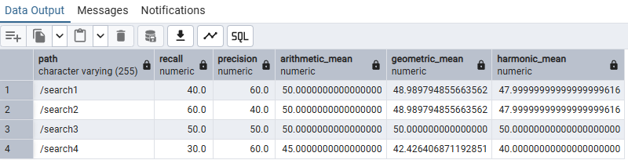

**지표가 여러 행에 나누어 저장된 경우**

`(path, index)`가 유일하고 `index`가 `recall`, `precision`인 데이터를 사용한다. `LOG`의 입력과 나눗셈의 분모가 양수가 되도록 필터링한 뒤, 두 지표가 모두 있는 경로만 남긴다.

```sql
SELECT
    path,
    AVG(value) AS arithmetic_mean,
    EXP(AVG(LN(value))) AS geometric_mean,
    1.0 / AVG(1.0 / value) AS harmonic_mean
FROM public.search_evaluation_by_row
WHERE "index" IN ('recall', 'precision')
  AND value > 0
GROUP BY path
HAVING COUNT(*) = 2
   AND COUNT(DISTINCT "index") = 2
ORDER BY path;
```
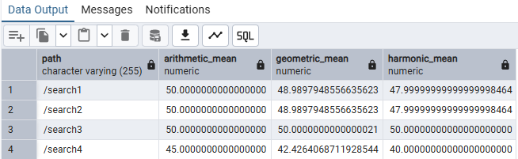

기하 평균은 `EXP(AVG(LN(value)))`로 계산할 수 있다. 로그를 취하면 곱셈을 덧셈으로 바꿀 수 있어 지표가 3개 이상인 경우에도 같은 형태로 계산한다.

**재현율:정확률 = 3:7의 가중 평균**

```sql
SELECT
    path,
    recall,
    precision,
    0.3 * recall + 0.7 * precision AS weighted_a_mean,
    POWER(recall, 0.3) * POWER(precision, 0.7) AS weighted_g_mean,
    1.0 / (0.3 / recall + 0.7 / precision) AS weighted_h_mean
FROM public.search_evaluation_by_col
WHERE recall > 0
  AND precision > 0
ORDER BY path;
```
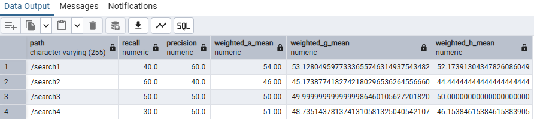

**행 형태의 지표에 가중치 마스터 연결하기**

```sql
WITH weights (metric, weight) AS (
    VALUES ('recall', 0.3), ('precision', 0.7)
)
SELECT
    e.path,
    SUM(w.weight * e.value) / SUM(w.weight) AS weighted_a_mean,
    EXP(SUM(w.weight * LN(e.value)) / SUM(w.weight)) AS weighted_g_mean,
    SUM(w.weight) / SUM(w.weight / e.value) AS weighted_h_mean
FROM public.search_evaluation_by_row AS e
JOIN weights AS w
    ON e."index" = w.metric
WHERE e.value > 0
GROUP BY e.path
HAVING COUNT(*) = 2
   AND COUNT(DISTINCT e."index") = 2
ORDER BY e.path;
```
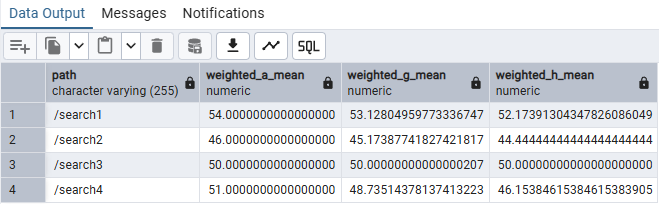

가중 산술 평균은 `AVG(weight * value)`가 아니라 가중 합계를 가중치 합계로 나눈다. 여기서는 가중치 합계가 1이므로 컬럼 형태의 식은 나눗셈을 생략했다. Recall·Precision이 0~100이면 평균도 같은 척도이다.

### 4-2 값의 범위가 다른 지표를 정규화해서 비교 가능한 상태로 만들기

열람 수가 수십 회이고 구매 수가 0~1회라면, 두 값을 그대로 더할 때 열람 수의 영향이 커질 수 있다. 범위를 맞춘 다음 목적에 맞는 가중치를 적용한다.

**핵심 로직**

- Min-Max 정규화는 `(값 - 최솟값) / (최댓값 - 최솟값)`으로 0~1 범위로 바꾼다.
- 최솟값·최댓값은 `MIN`, `MAX` 윈도 함수로 전체 행에 붙인다.
- 최댓값과 최솟값이 같으면 `NULLIF`로 0으로 나누는 것을 막는다.
- 변형 시그모이드 `2 / (1 + EXP(-a*x)) - 1`은 0 이상의 행동 횟수를 0 이상 1 미만으로 압축한다.

**Min-Max 정규화**

```sql
SELECT
    user_id,
    product,
    view_count,
    purchase_count,
    1.0 * (view_count - MIN(view_count) OVER ())
        / NULLIF(MAX(view_count) OVER () - MIN(view_count) OVER (), 0)
        AS norm_v_count,
    1.0 * (purchase_count - MIN(purchase_count) OVER ())
        / NULLIF(MAX(purchase_count) OVER () - MIN(purchase_count) OVER (), 0)
        AS norm_p_count
FROM public.action_counts
ORDER BY user_id, product;
```
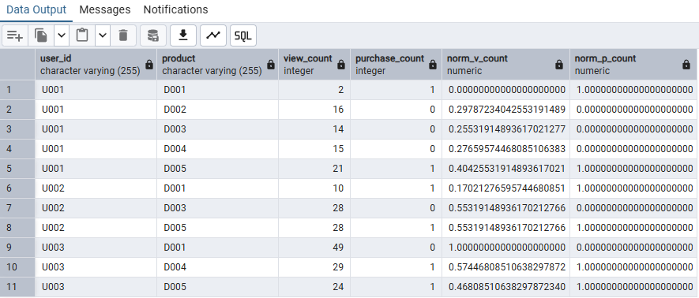

모든 값이 같은 지표는 `NULL`로 나온다. 이 경우 점수에서 제외할지 공통값을 줄지 정책을 정한다. Min-Max 값은 비교 대상의 최솟값·최댓값이 달라지면 바뀌며, 극단값의 영향을 받는다.

**시그모이드로 횟수 압축하기**

```sql
SELECT
    user_id,
    product,
    view_count,
    purchase_count,
    2.0 / (1 + EXP(-0.1 * view_count)) - 1.0 AS sigm_v_count,
    2.0 / (1 + EXP(-10.0 * purchase_count)) - 1.0 AS sigm_p_count
FROM public.action_counts
ORDER BY user_id, product;
```
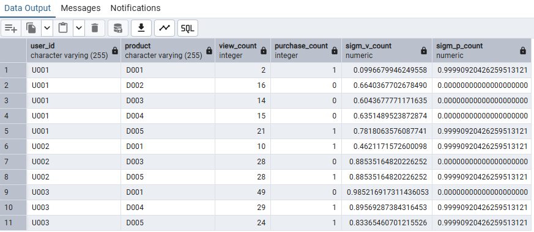

`a`가 클수록 작은 입력에서도 1에 빨리 가까워진다. 입력이 0이면 결과가 0이고, 횟수가 커질수록 추가 횟수의 영향이 줄어든다. `a`를 고정하면 다른 행의 최댓값이 변해도 같은 횟수의 변환값은 바뀌지 않는다.

예를 들어 열람 수 10회는 약 0.4621, 49회는 약 0.9852가 된다. 이 값은 **변환한 점수**이며 구매 확률로 해석하지 않는다.

### 4-3 각 데이터의 편차값 계산하기

원점수가 같더라도 집단의 평균과 분산이 다르면 상대적인 위치가 다르다. 과목별 평균·표준편차로 점수를 표준화해 비교한다.

**사용 데이터:** `exam_scores` / p.551~555.

**핵심 로직**

- `AVG(score)`로 과목별 평균을 구한다.
- `STDDEV_POP(score)`로 해당 집단 전체의 표준편차를 구한다.
- 정규값(z-score) = `(점수 - 평균) / 표준편차`.
- 교재의 편차값 = `z-score × 10 + 50`.

```sql
WITH exam_stats AS (
    SELECT
        *,
        AVG(score) OVER (PARTITION BY subject) AS avg_score,
        STDDEV_POP(score) OVER (PARTITION BY subject) AS stddev_pop
    FROM public.exam_scores
), standardized_scores AS (
    SELECT
        *,
        (score - avg_score) / NULLIF(stddev_pop, 0) AS std_value
    FROM exam_stats
)
SELECT
    subject,
    name,
    score,
    avg_score,
    stddev_pop,
    std_value,
    10.0 * std_value + 50 AS deviation
FROM standardized_scores
ORDER BY subject, name;
```
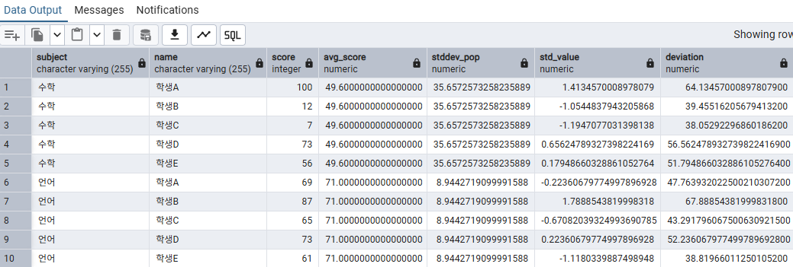

- `std_value = 0`: 집단 평균과 같다.
- `std_value = 1`: 평균보다 표준편차 1개만큼 높다.
- 편차값 50은 평균, 60은 평균보다 표준편차 1개만큼 높은 위치이다.

`STDDEV_POP`은 분모가 N인 모집단 표준편차이며, 표본 표준편차는 `STDDEV_SAMP`를 사용한다. 표준편차가 0이면 이 방식의 상대 점수는 정의할 수 없어 `NULL`로 둔다.

표준화 자체에 정규분포 가정이 필요한 것은 아니다. 다만 z-score를 특정 백분위나 확률로 해석하려면 분포를 추가로 확인해야 한다. 표준화했다고 데이터가 정규분포로 바뀌지는 않는다.

### 4-4 거대한 숫자 지표를 직감적으로 이해하기 쉽게 가공하기

오래된 행동은 최근 행동보다 관심도를 덜 반영할 수 있다. 날짜 차이에 로그를 적용해 가중치가 급격히 줄지 않도록 조절하고, 열람·구매 점수에 반영한다.

**핵심 로직**

- 사용자별 마지막 행동 날짜를 `MAX(dt::date)`로 구한다.
- 마지막 행동일에서 각 행동 날짜를 빼 경과 일수를 구한다.
- `1 / LOG(2, 0.1 × 경과 일수 + 2)`로 날짜별 가중치를 계산한다.
- 열람 수·구매 수에 각각 가중치를 곱해 사용자·상품별로 합산한다.

PostgreSQL의 두 인자 `LOG(밑, 진수)`를 사용한다. 경과 일수 0일은 가중치가 1이고, 오래된 행동일수록 가중치가 작아진다.

**행동별 날짜 차이와 가중치**

```sql
WITH action_counts_with_diff_date AS (
    SELECT
        *,
        MAX(dt::date) OVER (PARTITION BY user_id) AS last_access,
        MAX(dt::date) OVER (PARTITION BY user_id) - dt::date AS diff_date
    FROM public.action_counts_with_date
), action_counts_with_weight AS (
    SELECT
        *,
        1.0 / LOG(2::numeric, 0.1 * diff_date + 2) AS weight
    FROM action_counts_with_diff_date
)
SELECT
    dt,
    user_id,
    product,
    v_count,
    p_count,
    last_access,
    diff_date,
    weight
FROM action_counts_with_weight
ORDER BY user_id, product, dt::date;
```

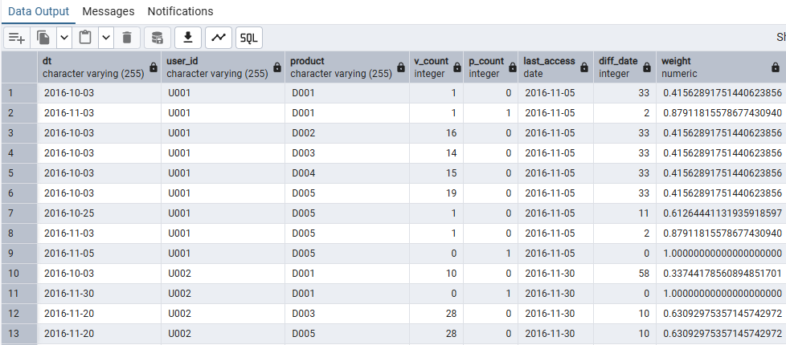

**날짜 가중치를 반영한 상품 점수**

```sql
WITH action_counts_with_diff_date AS (
    SELECT
        *,
        MAX(dt::date) OVER (PARTITION BY user_id) AS last_access,
        MAX(dt::date) OVER (PARTITION BY user_id) - dt::date AS diff_date
    FROM public.action_counts_with_date
), action_counts_with_weight AS (
    SELECT
        *,
        1.0 / LOG(2::numeric, 0.1 * diff_date + 2) AS weight
    FROM action_counts_with_diff_date
)
SELECT
    user_id,
    product,
    SUM(v_count) AS v_count,
    SUM(p_count) AS p_count,
    SUM(v_count * weight) AS v_score,
    SUM(p_count * weight) AS p_score
FROM action_counts_with_weight
GROUP BY user_id, product
ORDER BY user_id, product;
```

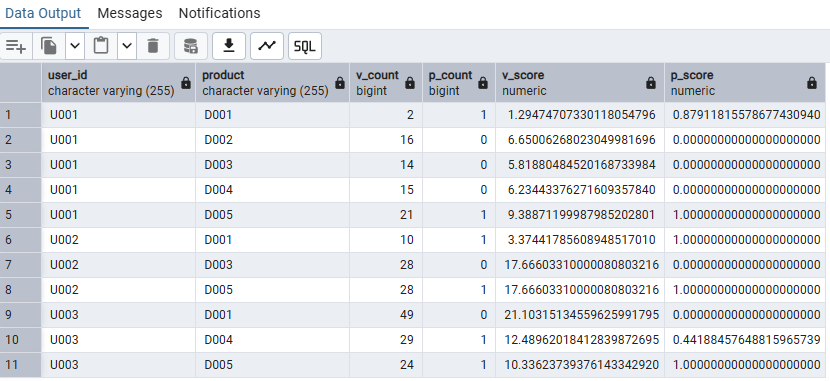

매개변수 `0.1`을 크게 하면 오래된 행동의 가중치가 더 빨리 감소한다. 0으로 두면 모든 가중치가 1이 된다.

이 쿼리의 기준일은 **각 사용자의 마지막 행동일**이다. 현재 날짜 기준으로 휴면 기간을 평가하는 점수와는 다르다. 예측 실험에서는 평가 시점 이후 행동이 기준일 계산에 들어가지 않도록 관측 기간을 먼저 제한한다.

### 4-5 독자적인 점수 계산 방법을 정의해서 순위 작성하기

과거 계절에 잘 팔렸던 상품과 최근 잘 팔리는 상품을 함께 반영해 순위를 만든다. 서로 다른 기간의 매출 규모를 맞춘 뒤 가중 평균한다.

**사용 데이터:** `monthly_sales` / p.562~566.

**핵심 로직**

- 상품별 2016년 1분기(1~3월)와 4분기(10~12월) 매출을 집계한다.
- 각 분기 안에서 상품 매출을 Min-Max 정규화한다.
- 1분기 점수에 0.7, 4분기 점수에 0.3을 곱해 합산한다.
- 최종 점수 내림차순으로 순위를 매긴다.

1분기는 다음 해 같은 계절의 수요를, 4분기는 최근 추세를 반영하기 위한 교재의 예시이다. 계절성을 입증하거나 미래 매출을 예측한 결과는 아니다.

```sql
WITH item_sales_per_quarters AS (
    SELECT
        item,
        SUM(CASE
            WHEN year_month IN ('2016-01', '2016-02', '2016-03')
            THEN amount ELSE 0
        END) AS sales_2016_q1,
        SUM(CASE
            WHEN year_month IN ('2016-10', '2016-11', '2016-12')
            THEN amount ELSE 0
        END) AS sales_2016_q4
    FROM public.monthly_sales
    GROUP BY item
), item_scores_per_quarters AS (
    SELECT
        *,
        1.0 * (sales_2016_q1 - MIN(sales_2016_q1) OVER ())
            / NULLIF(MAX(sales_2016_q1) OVER () - MIN(sales_2016_q1) OVER (), 0)
            AS score_2016_q1,
        1.0 * (sales_2016_q4 - MIN(sales_2016_q4) OVER ())
            / NULLIF(MAX(sales_2016_q4) OVER () - MIN(sales_2016_q4) OVER (), 0)
            AS score_2016_q4
    FROM item_sales_per_quarters
), item_scores AS (
    SELECT
        *,
        0.7 * score_2016_q1 + 0.3 * score_2016_q4 AS score
    FROM item_scores_per_quarters
)
SELECT
    item,
    sales_2016_q1,
    sales_2016_q4,
    score_2016_q1,
    score_2016_q4,
    score,
    ROW_NUMBER() OVER (ORDER BY score DESC NULLS LAST, item) AS rank
FROM item_scores
ORDER BY rank;
```

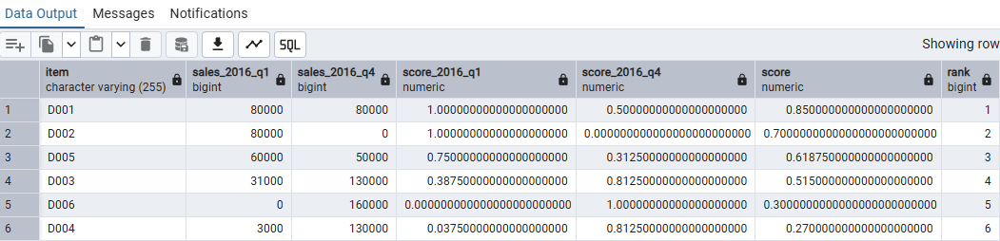

최종 점수뿐 아니라 원래 매출과 정규화 점수를 함께 출력해, 어떤 요소 때문에 순위가 높아졌는지 확인한다. 같은 점수에서는 `item`으로 정렬해 결과 순서를 일정하게 했다. 같은 점수에 같은 등수를 주려면 `RANK() OVER (ORDER BY score DESC NULLS LAST)`를 사용한다.

분기 내 모든 상품 매출이 같으면 해당 정규화 점수는 `NULL`이다. 이 경우 가중치를 어떻게 처리할지 정한 뒤 실제 운영에 적용한다. 가중치 7:3은 예시이며, 과거 기간으로 계산한 순위가 이후 기간에도 유용한지는 별도로 평가한다.


한 학기 동안 다소 부족한 커리큘럼이었음에도 불구하고 성실하게, 그리고 열심히 과제를 수행해주셔서 진심으로 감사드립니다.

이번 과정을 통해 배운 내용이 앞으로 여러분이 SQL을 다루는 데에 조금이나마 도움이 되기를 바랍니다.

여러분의 앞날을 진심으로 응원합니다. 😊


### 🎉 수고하셨습니다.
